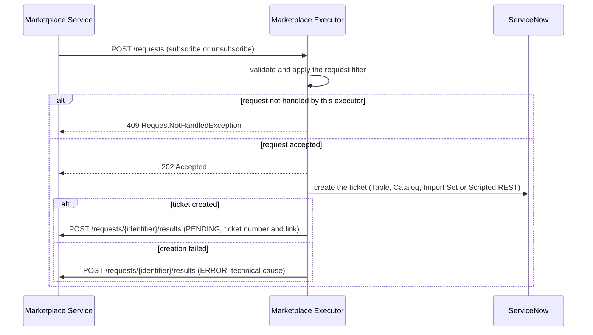
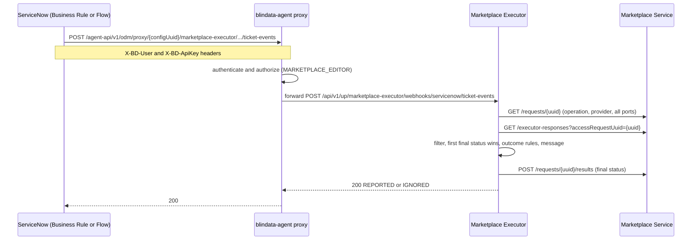

# ODM Platform Marketplace Executor for ServiceNow

> Fulfil the access requests of the [Open Data Mesh Platform](https://dpds.opendatamesh.org/) marketplace through **ServiceNow tickets** —
> a ticket is opened for every subscribe or unsubscribe, and the request is completed when the ticket is closed on ServiceNow.

<p align="center">
  <a href="https://opensource.org/licenses/Apache-2.0"></a>
</p>

<p align="center">
  <a href="https://openjdk.org/"></a>
  <a href="https://quarkus.io/"></a>
  <a href="https://www.servicenow.com/"></a>
</p>

<p align="center">
  <a href="#what-the-executor-does">What it does</a> ·
  <a href="#status-taxonomy-and-rules">Status taxonomy</a> ·
  <a href="#quick-start">Quick start</a> ·
  <a href="#executor-api">Executor API</a> ·
  <a href="#configuration-reference">Configuration</a> ·
  <a href="#qute-template-primer">Templates</a> ·
  <a href="#servicenow-setup-common">ServiceNow setup</a> ·
  <a href="#blindata-agent-route">Agent route</a> ·
  <a href="#basic-scenarios">Scenarios</a> ·
  <a href="#operations-notes">Operations</a> ·
  <a href="#contributing">Contributing</a>
</p>

---

## What the executor does

The Marketplace Executor bridges the **Data Product Catalog** and your enterprise tools. This executor bridges it to **ServiceNow**, so that access to data products follows the processes your organisation already runs there (incidents, catalog requests, approvals, tasks).

- The **Marketplace Service** receives an access request (`MARKETPLACE_SUBSCRIBE` or `MARKETPLACE_UNSUBSCRIBE`) and forwards it to the executor.
- The executor **opens a ServiceNow ticket** (one ticket covers *all* the ports of the request) and reports `PENDING` with the ticket number and link.
- When the ticket is **closed on ServiceNow**, a Business Rule or Flow calls the executor through the **blindata-agent proxy**. The executor turns the ticket state into the final status (`GRANTED`, `DENIED`, `REVOKED` or `ERROR`) and reports it with a descriptive message.

Everything about the ticket is **configuration only**: the creation interface (Table API, Service Catalog, Import Set or Scripted REST), the target, the ticket content, where the request UUID is stored, how ticket states map to outcomes and the result messages. The executor is **stateless**: the ticket carries the request UUID, and the Marketplace Service holds the request data and the result history.

### Leg 1 — the ticket is opened



### Leg 2 — the ticket is completed



> **Hard prerequisites.** ServiceNow **Washington DC or later** (OAuth 2.0 client credentials for inbound calls) and **blindata-agent** (authenticates the webhook). Standalone ODM deployments without blindata-agent must put **their own authenticating gateway** in front of the executor's webhook, see [blindata-agent route](#blindata-agent-route).

---

## Status taxonomy and rules

The final status depends on the **operation** and on the **cause** the outcome rules assign to the ticket. Rules only ever declare a cause, never a status, so a configuration cannot produce a status that is not allowed for the operation.

| Cause (from outcome rules) | `MARKETPLACE_SUBSCRIBE` | `MARKETPLACE_UNSUBSCRIBE` |
|:--|:--|:--|
| `FULFILLED` | `GRANTED` | `REVOKED` |
| `REFUSED` | `DENIED` | `ERROR` (message states that the request was refused on ServiceNow) |
| `FAILED` | `ERROR` | `ERROR` |

Other statuses you will see:

| Status | Sent when |
|:--|:--|
| `PENDING` | The ticket has been opened (once per accepted request, never from the webhook) |
| `ERROR` | The ticket could not be opened (technical cause in the message), or one of the `ERROR` cases above |

**Rules**

- **No partial grants.** One ticket handles all the ports of the request. Every result carries *all* the requested ports, taken from the Marketplace Service, never from the webhook. A request that matches the filter only for some ports is declined as a whole.
- **First final status wins.** Once a final status (`GRANTED`, `DENIED`, `REVOKED`, `ERROR`) exists for a request, later ticket events for it (reopened and re-closed tickets, repeated Business Rules) are acknowledged and ignored. `PENDING` does not count as final.
- **Non-final ticket updates are not results.** An event matching no outcome rule is acknowledged and ignored, and the request stays `PENDING`.
- **Messages are descriptive.** Every result message says what happened: ticket number and link, close notes and, by default, the ServiceNow user who closed the ticket. For `UNSUBSCRIBE` a refusal is an `ERROR`, and its message makes clear that it is a ServiceNow-side refusal and not a platform failure. See [Message templates](#message-templates).

---

## Quick start

**Requirements:** Java **21** · Maven **3.9+** (or the included `./mvnw`) · a ServiceNow instance (Washington DC or later) · a running Marketplace Service · blindata-agent for the webhook leg.

```bash
git clone <repository-url>
cd odm-platform-adapter-marketplace-executor-servicenow

export SERVICENOW_INSTANCE_URL=https://acme.service-now.com
export SERVICENOW_CLIENT_ID=<oauth application client id>
export SERVICENOW_CLIENT_SECRET=<oauth application client secret>
export ODM_PRODUCT_PLANE_MARKETPLACE_SERVICE_ADDRESS=http://localhost:8085

./mvnw quarkus:dev
```

| Environment variable | Purpose |
|:--|:--|
| `SERVICENOW_INSTANCE_URL` | **Required.** Instance base URL, `https` (`http://localhost…` is accepted for tests only) |
| `SERVICENOW_CLIENT_ID`, `SERVICENOW_CLIENT_SECRET` | OAuth 2.0 client credentials (default auth mode) |
| `SERVICENOW_API_KEY` | API key, used only when `servicenow.auth.type=API_KEY` |
| `SERVICENOW_AUTH_TYPE` | Quarkus env mapping of `servicenow.auth.type` (`OAUTH2_CLIENT_CREDENTIALS` or `API_KEY`) |
| `SERVICENOW_MESSAGES_INCLUDE_CLOSING_USER` | `false` to keep the closing user out of result messages (default `true`) |
| `ODM_PRODUCT_PLANE_MARKETPLACE_SERVICE_ADDRESS` | Marketplace Service base URL (`odm.product-plane.marketplace-service.address`) |

Any configuration key can be overridden by an environment variable using the standard Quarkus mapping (upper case, dots and dashes become underscores). Secrets must come from the environment or from mounted secrets, never from a committed file.

The executor listens on port **9019**. When it is up:

| | Endpoint |
|:--|:---------|
| **Swagger UI** | [http://localhost:9019/swagger-ui](http://localhost:9019/swagger-ui) |
| **OpenAPI** | [http://localhost:9019/api-docs](http://localhost:9019/api-docs) |

```bash
./mvnw package                  # JVM build, runner in target/quarkus-app/
./mvnw -Pnative package         # native build (Mandrel or GraalVM 21)
./mvnw test                     # tests (outbound calls are mocked)
```

> **The executor refuses to start with an invalid configuration** and prints a numbered list of the problems (blank instance URL, missing credentials, unparsable template, profile without a `FULFILLED` rule, invalid regex, …). Fix them and start again. Secrets are never printed.

### Where to put the configuration

The packaged `src/main/resources/application.yml` contains the connection, authentication and message defaults, but **no ticket profiles**. You must provide `servicenow.profiles.subscribe` and `servicenow.profiles.unsubscribe` yourself. If they are missing, the executor refuses to start with a "required property … not found" error.

Put your profiles (and any other overrides) in an **external file**:

- `config/application.yml` in the executor's working directory, which is the easiest choice with a container volume mount,
- or any path passed with `QUARKUS_CONFIG_LOCATIONS=/path/file.yml` (or `-Dquarkus.config.locations=…`).

Start from the YAML of the [basic scenario](#basic-scenarios) that matches your ServiceNow practice. Scenario 1 (Table API / `incident`) works as-is on a standard instance.

> **Why no packaged profiles?** Quarkus merges configuration sources entry by entry: list items by index and map entries by key. Default `fields` or `outcome-rules` shipped in the jar would be **merged into** yours instead of being replaced. For example, a rule `state: "3"` would silently inherit a packaged `close_code` condition and never match. This was observed on a real instance during testing. Scalar values (instance URL, credentials, messages, filter entries) can still be overridden safely through environment variables.

### Standalone deployments (no blindata-agent)

The webhook endpoint has **no authentication of its own**. In ODM deployments without blindata-agent you must provide your own gateway that authenticates ServiceNow and forwards only `POST /api/v1/up/marketplace-executor/webhooks/servicenow/ticket-events` to the executor.

---

## Executor API

The executor exposes two endpoints, both described in Swagger UI.

### `POST /api/v1/up/marketplace-executor/requests` — called by the Marketplace Service

Answers **202 Accepted** and works asynchronously. Other answers:

| Status | Meaning |
|:--|:--|
| `400` | Invalid request (missing fields, `startDate` after `endDate`) |
| `409` | `RequestNotHandledException`: the request does not match this executor's [request filter](#request-filter). Nothing is created on ServiceNow and nothing is reported. The Marketplace Service counts it as "not handled by this executor" |
| `500` | Unexpected error |

<details open>
<summary><strong>Request</strong></summary>

<br>

```json
{
  "v": "1",
  "operation": "MARKETPLACE_SUBSCRIBE | MARKETPLACE_UNSUBSCRIBE",
  "request": {
    "name": "",
    "identifier": "marketplace request UUID",
    "provider": {
      "dataProductFqn": "",
      "dataProductPortsFqn": [""]
    },
    "consumer": {
      "type": "dataproduct | user | team",
      "identifier": "fqn | email | ?"
    },
    "requester": {
      "type": "user",
      "identifier": "email"
    },
    "properties": {},
    "startDate": "Date",
    "endDate": "Date"
  }
}
```

</details>

<details open>
<summary><strong>Result sent to the Marketplace Service</strong></summary>

<br>

The executor posts results to `{marketplaceServiceAddress}/api/v1/pp/marketplace/requests/{identifier}/results`. The `identifier` is the Marketplace Service **internal UUID**: it is also the *correlation id* stored on the ServiceNow ticket.

```json
{
  "status": "PENDING | GRANTED | DENIED | REVOKED | ERROR",
  "message": "",
  "provider": {
    "dataProductFqn": "",
    "dataProductPortsFqn": [""]
  },
  "createdAt": "Date"
}
```

</details>

### `POST /api/v1/up/marketplace-executor/webhooks/servicenow/ticket-events` — called by ServiceNow, through blindata-agent

<details open>
<summary><strong>Webhook contract</strong></summary>

<br>

This is a fixed contract: your Business Rule or Flow must send exactly this shape. `fields` is a free map of strings; the outcome rules and the message templates read from it. The names below are the ones used throughout this README.

```json
{
  "correlationId": "7c9e6679-7425-40de-944b-e07fc1f90ae7",
  "fields": {
    "state": "7",
    "close_code": "Solution provided",
    "close_notes": "Access granted through AD group GRP-SALES-READ",
    "number": "INC0010042",
    "sys_id": "9d385017c611228701d22104cc95c371",
    "table": "incident",
    "closed_by": "Mario Rossi"
  }
}
```

| Field | Meaning |
|:--|:--|
| `correlationId` | The marketplace request UUID, read back from the ticket |
| `fields.number`, `fields.sys_id`, `fields.table` | The ticket that was **fulfilled** (used for the final message and link) |
| `fields.state`, `fields.close_code`, `fields.approval`, … | Whatever your outcome rules need |
| `fields.close_notes` | Free text for the message |
| `fields.closed_by` | Closing user (omitted from templates when [closing-user inclusion](#privacy) is disabled) |

</details>

**Answers**

| Status | Body | Meaning |
|:--|:--|:--|
| `200` | `{"outcome": "REPORTED", "status": "GRANTED"}` | The final result was posted to the Marketplace Service (`status` is the status reported) |
| `200` | `{"outcome": "IGNORED", "reason": "…"}` | Acknowledged, nothing was posted. See the reasons below |
| `500` | error body | The Marketplace Service (lookup or result delivery) failed. **Nothing was lost: the caller should retry** |
| `400` | error body | Malformed JSON only |

| `IGNORED` reason | Why |
|:--|:--|
| `MISSING_CORRELATION` | The payload has no `correlationId` (the ticket is not a marketplace ticket, or the read-back is wrong) |
| `UNKNOWN_REQUEST` | The Marketplace Service does not know that UUID |
| `NOT_HANDLED_BY_EXECUTOR` | The request does not match this executor's [filter](#request-filter) |
| `FINAL_RESULT_ALREADY_REPORTED` | A final result already exists for the request (first final status wins) |
| `NON_TERMINAL_STATE` | No outcome rule matched the fields: the ticket is not in a final state |

The checks run in this order. The operation, provider and ports always come from the Marketplace Service, never from the webhook.

---

## Configuration reference

All keys live under the `servicenow` prefix (YAML, kebab-case) unless stated otherwise.

### Connection and authentication

| Key | Default | Description |
|:--|:--|:--|
| `servicenow.instance-url` | **required** (`${SERVICENOW_INSTANCE_URL}`) | Instance base URL. Must be `https` (`http` only for `http://localhost…`) |
| `servicenow.auth.type` | `OAUTH2_CLIENT_CREDENTIALS` | `OAUTH2_CLIENT_CREDENTIALS` (recommended) or `API_KEY` |
| `servicenow.auth.oauth2.client-id` | `${SERVICENOW_CLIENT_ID:}` | Required for OAuth |
| `servicenow.auth.oauth2.client-secret` | `${SERVICENOW_CLIENT_SECRET:}` | Required for OAuth |
| `servicenow.auth.oauth2.token-url` | `{instance-url}/oauth_token.do` | Token endpoint override |
| `servicenow.auth.oauth2.scope` | none | Optional OAuth scope, omitted from the token request when not set |
| `servicenow.auth.api-key.header-name` | `x-sn-apikey` | Header that carries the key |
| `servicenow.auth.api-key.value` | `${SERVICENOW_API_KEY:}` | Required for `API_KEY` |

With OAuth the executor requests an access token from `{instance-url}/oauth_token.do`, caches it until it expires and sends it as `Authorization: Bearer`. 401 and 403 answers and token failures become `ERROR` results that name the auth type and what to check (OAuth application, integration user roles, API access policy), never any secret.

### Request filter

`servicenow.filter.*` decides which requests this executor handles. Every value is a **list of regular expressions** that must **fully match** (`(?i)` makes a pattern case-insensitive). A criterion that is not configured matches everything; an empty filter handles every request.

| Key | Matched against |
|:--|:--|
| `servicenow.filter.operations` | `MARKETPLACE_SUBSCRIBE` / `MARKETPLACE_UNSUBSCRIBE` |
| `servicenow.filter.provider-data-product-fqns` | `request.provider.dataProductFqn` |
| `servicenow.filter.port-fqns` | **Every** port in `request.provider.dataProductPortsFqn` (a request without ports never matches a configured port criterion) |
| `servicenow.filter.consumer-types` | `request.consumer.type` |
| `servicenow.filter.consumer-identifiers` | `request.consumer.identifier` |
| `servicenow.filter.requester-identifiers` | `request.requester.identifier` |
| `servicenow.filter.properties.<key>` | `request.properties.<key>` (a single regex per key; a missing property does not match) |

Semantics: **all configured criteria must match (AND)**; within a list, **any** pattern may match (OR). For ports, **every** requested port must match some pattern, because a request that only partly belongs to this executor cannot be partially granted: it is **declined as a whole**.

```yaml
servicenow:
  filter:
    operations: ["MARKETPLACE_.*"]
    provider-data-product-fqns:
      - 'urn:dp:finance:.*'
      - 'urn:dp:risk:.*'
    consumer-types: ['(?i)user|team']
    properties:
      costCenter: 'FIN-.*'
```

A declined request gets **409** and produces no side effect. If **no** executor accepts a request, the Marketplace Service rolls the submission back with "No executor was able to handle the request": this is intended, the request fails fast instead of staying `PENDING` forever. The filter is re-applied when a webhook arrives (`NOT_HANDLED_BY_EXECUTOR`).

> **Exclusive filters are the operating rule.** Several executors can run behind one Marketplace Service, but each request must be accepted by **exactly one** of them. Results carry no executor identity, so two executors accepting the same request would suppress each other's final result (first final status wins). Example of two disjoint filters: executor A `urn:dp:finance:.*`, executor B `(?!urn:dp:finance:).*`.

> In an environment variable, a comma separates list items. If a regex contains a comma, configure it in the YAML file.

### Ticket profiles

One profile per operation: `servicenow.profiles.subscribe.*` (for `MARKETPLACE_SUBSCRIBE`) and `servicenow.profiles.unsubscribe.*` (for `MARKETPLACE_UNSUBSCRIBE`).

| Key (under `profiles.<op>`) | Default | Description |
|:--|:--|:--|
| `type` | **required** | `TABLE`, `SERVICE_CATALOG`, `IMPORT_SET` or `SCRIPTED_REST` |
| `target` | none | Table name (TABLE), catalog item sys_id (SERVICE_CATALOG), staging table (IMPORT_SET). Required for these three |
| `path` | none | Endpoint path (SCRIPTED_REST, **required**), relative to the instance URL |
| `method` | `POST` | `POST` or `PATCH` (SCRIPTED_REST) |
| `correlation-field` | per interface, see below | Field, variable or column that stores the marketplace request UUID |
| `fields.<name>` | none | Ticket content: field, variable or column name → [Qute template](#qute-template-primer). The correlation entry is **always added by the executor** after rendering and cannot be removed or overridden: a field named like the correlation target is a startup error |
| `requester-match-field` | `email` | SERVICE_CATALOG only: the `sys_user` field compared with the requester identifier |
| `submit-cart-when-two-step` | `true` | SERVICE_CATALOG only: submit the cart when the instance answers `order_now` with a cart (two-step checkout) |
| `response.number-pointer` | per interface | [JSON Pointer](https://datatracker.ietf.org/doc/html/rfc6901) of the ticket number in the creation response |
| `response.sys-id-pointer` | per interface | JSON Pointer of the ticket sys_id |
| `response.table-pointer` | per interface | JSON Pointer of the ticket table |
| `response.table` | per interface | Fixed table name, used when there is no table pointer |
| `outcome-rules[n].when.<field>` | – | Condition: webhook field → regex (full match) |
| `outcome-rules[n].outcome` | – | `FULFILLED`, `REFUSED` or `FAILED` |
| `outcome-rules[n].message` | none | Optional message template for this rule only |
| `messages.pending` / `fulfilled` / `refused` / `failed` / `technical-error` | none | Optional per-profile message overrides |

**Per-interface defaults** (each one can be overridden by the profile):

| Type | Endpoint called | Body | Correlation default | Ticket reference default |
|:--|:--|:--|:--|:--|
| `TABLE` | `POST /api/now/table/{target}` | rendered fields + correlation field | field `correlation_id` | number `/result/number`, sys_id `/result/sys_id`, table = `target` |
| `SERVICE_CATALOG` | `POST /api/sn_sc/servicecatalog/items/{target}/order_now` (+ `POST /api/sn_sc/servicecatalog/cart/submit_order` for two-step checkout) | `sysparm_quantity: "1"`, `sysparm_requested_for` (resolved requester), `variables` = rendered fields + correlation | variable `marketplace_request_id` | number `/result/request_number` (else `/result/number`), sys_id `/result/request_id` (else `/result/sys_id`), table `sc_request` |
| `IMPORT_SET` | `POST /api/now/import/{target}` | rendered fields + correlation column | column `u_marketplace_request_id` | number `/result/0/display_value`, sys_id `/result/0/sys_id`, table `/result/0/table`. A row status of `error` or `ignored` fails the creation with the ServiceNow message |
| `SCRIPTED_REST` | `{method} {path}` | rendered fields + correlation field | field `correlation_id` | `number-pointer` and `sys-id-pointer` **required**; table from `table-pointer` or `table` (optional) |

The ticket link is `{instance-url}/{table}.do?sys_id={sysId}`, empty when the table or sys_id is unknown. Response shapes vary with the release and the instance configuration: that is why the pointers are overridable.

**Service Catalog requester resolution.** Catalog orders are placed **on behalf of the marketplace requester**. Before ordering, the executor looks up `GET /api/now/table/sys_user?sysparm_query={requester-match-field}={requester identifier}&sysparm_fields=sys_id&sysparm_limit=1` and sends the sys_id as `sysparm_requested_for`. The requester must be of type `user`; if it is not, or it is not found in `sys_user`, no order is placed and an `ERROR` is reported. The executor never falls back to ordering for the integration user.

> **Required ServiceNow setting: ordering on behalf of others.** ServiceNow honours `sysparm_requested_for` only if the caller may request for other users. Otherwise it **silently** places the order for the integration user. The permission is controlled by `glide.sc.req_for.roles`, which is empty by default; with `glide.sc.req_for.roles.default = deny`, nobody but admins can request for others. Create a dedicated role (e.g. `odm_marketplace_requester`), grant it to the integration user, and set **System Properties → `glide.sc.req_for.roles`** to that role (comma-separate it if the property already lists roles). Verify once by checking that a test REQ shows the requester, not the integration user, in *Requested for*.
>
> Also supply every **mandatory variable** of the catalog item through the profile `fields`. Otherwise `order_now` fails with `400 "Mandatory Variables are required"`, which the executor reports as `ERROR`.

**Outcome rules.** Evaluated **in order** against the webhook `fields`; a rule matches when every `when` entry names a field that is present and whose value matches the regex entirely. The **first match wins**; no match means the event is ignored (`NON_TERMINAL_STATE`). Each profile needs at least one rule, at least one `FULFILLED`, and every rule needs a non-empty `when`.

```yaml
outcome-rules:
  - when:
      state: "6|7"
      close_code: '(?i)(Solution provided|Workaround provided|Resolved by .*)'
    outcome: FULFILLED
  - when:
      state: "8"
    outcome: REFUSED
    message: "Request cancelled on ServiceNow ({ticket.number}). {fields.close_notes}"
  - when:              # fallback, keep it last: a resolved/closed ticket always yields a final result
      state: "6|7"
    outcome: FAILED
```

> The incident close codes above are the ones shipped by current releases (verified on Zurich): `Solution provided`, `Workaround provided`, `Resolved by caller|change|problem|request`, `No resolution provided`, `Duplicate`, `Known error`, `User error`. Check **System Definition → Choice Lists** (`incident.close_code`) on your instance, since customers often customise them. Without a fallback rule, a resolved ticket whose close code matches no rule is ignored and the request stays `PENDING`.

> Use **single quotes** for regexes with backslashes (`'\d+'`); in double quotes they would need doubling.

### Message templates

All messages are [Qute templates](#qute-template-primer), trimmed and truncated to 4000 characters. The template used is the first available of: the **rule's** `message`, the **profile's** `messages.<kind>`, the **global** `servicenow.messages.<kind>`. These are the global defaults:

```yaml
servicenow:
  messages:
    pending: "ServiceNow ticket {ticket.number} opened for {operation} of {request.provider.dataProductFqn} (ports: {#each request.provider.dataProductPortsFqn}{it}{#if it_hasNext}, {/if}{/each}). Awaiting fulfilment: {ticket.link}"
    fulfilled: "{outcome.status} through ServiceNow ticket {ticket.number} ({ticket.link}){#if ticket.closedBy} closed by {ticket.closedBy}{/if}.{#if fields.close_notes} Close notes: {fields.close_notes}{/if}"
    refused: "Request refused on ServiceNow: ticket {ticket.number} ({ticket.link}){#if ticket.closedBy} closed by {ticket.closedBy}{/if}.{#if fields.close_notes} Reason: {fields.close_notes}{/if}"
    failed: "ServiceNow reported a failure on ticket {fields.number} ({ticket.link}).{#if fields.close_notes} Details: {fields.close_notes}{/if}"
    technical-error: "Technical error while processing {operation} on ServiceNow: {error.message}"
    closing-user:
      include: ${SERVICENOW_MESSAGES_INCLUDE_CLOSING_USER:true}
      field: closed_by
```

| Message | Used for |
|:--|:--|
| `pending` | `PENDING` after the ticket is opened |
| `fulfilled` | Cause `FULFILLED` (`GRANTED` / `REVOKED`) |
| `refused` | Cause `REFUSED` (`DENIED` for subscribe, `ERROR` for unsubscribe) |
| `failed` | Cause `FAILED` (`ERROR`) |
| `technical-error` | `ERROR` when the ticket cannot be opened (ServiceNow unreachable, 401/403, requester not found, Import Set transform error, missing response pointer, …) |

### Result delivery

| Key | Default | Description |
|:--|:--|:--|
| `odm.product-plane.marketplace-service.address` | `http://localhost:8085` | Marketplace Service base URL |
| `odm.product-plane.marketplace-service.result-delivery.max-attempts` | `5` | Attempts to post a result |
| `odm.product-plane.marketplace-service.result-delivery.backoff` | `1s` | Wait between attempts |

Posting is retried on **404** (the Marketplace Service calls the executor inside its own transaction, so the request may not be visible yet), on **5xx** and on I/O errors; other 4xx answers fail immediately. The `PENDING` post is **best effort**: if it cannot be delivered a warning is logged and the ticket stays open. A **final** result that cannot be delivered makes the webhook answer **500**, so ServiceNow can retry.

> `quarkus.qute.strict-rendering: false` and `quarkus.qute.property-not-found-strategy: noop` are preconfigured in `application.yml` so that missing template data renders empty. Do not change them.

---

## Qute template primer

Ticket fields and messages are written in [Qute](https://quarkus.io/guides/qute-reference), the template engine of Quarkus.

**Syntax at a glance**

| You want | Write |
|:--|:--|
| A value | `{request.provider.dataProductFqn}` (single braces; **not** Mustache's `{{…}}`) |
| A condition | `{#if ticket.closedBy} closed by {ticket.closedBy}{/if}` |
| If / else | `{#if operation == 'MARKETPLACE_SUBSCRIBE'}Grant{#else}Revoke{/if}` |
| A loop | `{#each request.provider.dataProductPortsFqn}{it}{#if it_hasNext}, {/if}{/each}` |
| A literal brace | `{|{"a": 1}|}` (unparsed section) or `\{` |

- **Quote templates in YAML** whenever they contain `{`, `:` or `#`. Use double quotes for templates and single quotes for regexes. Multi-line texts use a block scalar (`|-`).
- **Never write `${…}` in a template**: Quarkus expands it as a configuration expression before the template is parsed.
- **No escaping**: rendered values are plain strings, serialised to JSON by the executor (no HTML escaping, no JSON-injection risk).
- **Missing values render empty**: `{request.properties.costCenter}` on a request without that property renders nothing and never fails. `{#if}` is false for empty and missing values.
- **External templates**: a value starting with `file:` is loaded at startup from that path, e.g. `description: "file:/etc/marketplace/description.qute"`. A file that does not exist or does not parse stops the executor at startup.
- Dates are ISO-8601 strings (empty when not set).

**Data model**

| Available in | Expression | Content |
|:--|:--|:--|
| ticket fields and messages | `request.identifier`, `request.name`, `request.operation` | UUID, name, operation |
| | `request.startDate`, `request.endDate` | ISO-8601, or empty |
| | `request.properties.<key>` | request properties |
| | `request.provider.dataProductFqn`, `request.provider.dataProductPortsFqn` | provider and the list of **all** ports |
| | `request.consumer.type`, `request.consumer.identifier` | consumer |
| | `request.requester.type`, `request.requester.identifier` | requester |
| | `operation` | `MARKETPLACE_SUBSCRIBE` or `MARKETPLACE_UNSUBSCRIBE` |
| messages only | `ticket.number`, `ticket.sysId`, `ticket.table`, `ticket.link` | the ticket (`PENDING`: the created ticket; final: from the webhook `number`, `sys_id`, `table`) |
| | `ticket.closedBy` | the closing user. **Present only when closing-user inclusion is enabled** |
| | `fields.<name>` | the webhook `fields` (final results). With inclusion disabled, the closing-user field is removed from here too |
| | `outcome.cause`, `outcome.status` | `FULFILLED`/`REFUSED`/`FAILED` and the final status |
| | `error.message` | technical error text (`technical-error` only) |

---

## ServiceNow setup (common)

Steps shared by all creation interfaces. The interface-specific objects are in [Basic scenarios](#basic-scenarios).

### 1. Integration user

Create a dedicated, non-interactive service user (for example `svc.odm.marketplace`, with **Web service access only** checked). Give it the **minimum** needed, through a dedicated role and ACLs:

- **create** on each target table of your profiles (Table API), or write access to the staging table (Import Set), or the right to run your Scripted REST resource;
- the right to **order the catalog items** (availability, user criteria) and to order **on behalf of other users**, if you use the Service Catalog;
- **read** on `sys_user` (at least `sys_id` and the `requester-match-field`, by default `email`), for requester resolution.

The one credential below is used for *every* interface your profiles use, so grant only what the configured profiles need. A missing permission only shows up at runtime as an `ERROR` result with a 401/403 message.

### 2. Authentication — OAuth 2.0 client credentials (recommended)

1. **Enable inbound client credentials** on the instance: it is off by default and is controlled by a system property. Use the property described in the ServiceNow *Client Credentials* documentation for your release.
2. In **System OAuth › Application Registry**, choose **New** and **Create an OAuth API endpoint for external clients**. Give it a name.
3. Set the **OAuth Application User** to the integration user of step 1. Tokens issued to this application act as that user.
4. Save, then copy the generated **Client ID** and **Client Secret** into your secret store and expose them to the executor as `SERVICENOW_CLIENT_ID` and `SERVICENOW_CLIENT_SECRET`.
5. Verify:

```bash
curl -s -X POST "$SERVICENOW_INSTANCE_URL/oauth_token.do" \
  -d grant_type=client_credentials \
  -d client_id="$SERVICENOW_CLIENT_ID" \
  -d client_secret="$SERVICENOW_CLIENT_SECRET"
# → {"access_token":"…","token_type":"Bearer","expires_in":1799,…}
```

### 2-bis. Authentication — API key (alternative)

For instances where client credentials cannot be enabled. Set `servicenow.auth.type: API_KEY`.

1. Activate the **API Key and HMAC Authentication** plugin.
2. Create an **inbound authentication profile** of type API key, using the header `x-sn-apikey` (the executor's default `auth.api-key.header-name`).
3. Create a **REST API key** bound to the integration user, and expose it as `SERVICENOW_API_KEY`.

### 3. API access policies

If your instance enforces **REST API access policies**, create one for **each API** your profiles use — Table API, Import Set API, Service Catalog API and/or your Scripted REST API (and the Table API again for the `sys_user` read when you use the Catalog) — referencing the inbound authentication profile that matches the mechanism you chose.

### 4. Make ServiceNow call the executor: a Business Rule

When the ticket reaches a closed state, ServiceNow must call the webhook through the blindata-agent proxy (see [blindata-agent route](#blindata-agent-route)). The usual way is a **Business Rule** on the record that gets fulfilled:

| Setting | Value |
|:--|:--|
| Table | The fulfilled record (per interface: see each scenario) |
| When | `after` |
| Insert / Update | Update only |
| Advanced | checked |
| Condition | State **changes into a closed state** and the correlation value is not empty (per scenario) |

Store the three connection values as **system properties**, never in the script:

| Property (example names, choose your own) | Value |
|:--|:--|
| `x_acme.marketplace.agent_url` | `https://<agent>/agent-api/v1/odm/proxy/<configUuid>/marketplace-executor/api/v1/up/marketplace-executor/webhooks/servicenow/ticket-events` |
| `x_acme.marketplace.agent_user` | Blindata application user (value of `X-BD-User`) |
| `x_acme.marketplace.agent_api_key` | Its API key (value of `X-BD-ApiKey`). Prefer a `password2` property (decrypt it in the script with the platform's standard `GlideEncrypter`) or a Connection and Credential record |

Template script. Replace the three marked lines according to the scenario (the correlation read-back, and optionally the fields you send):

```javascript
(function executeRule(current, previous /* null when async */) {

  // 1. Read the marketplace request UUID back from the ticket (scenario specific)
  var correlationId = current.getValue('correlation_id') || '';
  if (!correlationId) {
    return; // not a marketplace ticket
  }

  // 2. Connection values come from system properties: never hard-code or log them
  var url    = gs.getProperty('x_acme.marketplace.agent_url');
  var user   = gs.getProperty('x_acme.marketplace.agent_user');
  var apiKey = gs.getProperty('x_acme.marketplace.agent_api_key');

  // 3. The webhook contract: {correlationId, fields{...}}
  var payload = {
    correlationId: correlationId,
    fields: {
      state:       current.getValue('state') || '',
      close_code:  current.getValue('close_code') || '',
      close_notes: current.getValue('close_notes') || '',
      number:      current.getValue('number') || '',
      sys_id:      current.getUniqueValue(),
      table:       current.getTableName(),
      // incidents in state 6 (Resolved) have an empty closed_by: fall back to resolved_by when the table has it
      closed_by:   current.closed_by.getDisplayValue()
                   || (current.isValidField('resolved_by') ? current.resolved_by.getDisplayValue() : '')
    }
  };

  var message = new sn_ws.RESTMessageV2();
  message.setEndpoint(url);
  message.setHttpMethod('POST');
  message.setRequestHeader('Content-Type', 'application/json');
  message.setRequestHeader('X-BD-User', user);
  message.setRequestHeader('X-BD-ApiKey', apiKey);
  message.setRequestBody(JSON.stringify(payload));
  message.executeAsync(); // fire and forget, does not block the user's update

})(current, previous);
```

`executeAsync()` does not wait for the answer, so a `500` from the executor is not visible and not retried. If you need that, call `message.execute()` from an **async** Business Rule, check `getStatusCode()` and log failures with `gs.error` (never log the headers), or use a Flow with retries.

**Alternative: Flow Designer.** If you have IntegrationHub, create a Flow with the trigger *Record updated* on the fulfilled table (condition: state changes to a closed state), and a **REST** step: method `POST`, the URL above, headers `Content-Type`, `X-BD-User`, `X-BD-ApiKey` (from a Connection and Credential alias, not in clear text), and a JSON body with the same shape built from data pills. Add error handling on non-2xx so that a `500` can be retried.

> **Where to attach it.** The record the executor creates is not always the one that gets fulfilled. Attach the rule to the record that is **closed by the fulfiller** and make sure it carries the correlation value: the `incident` (Table API), the `sc_req_item` (Service Catalog), the transformed target such as `sc_task` (Import Set), or whatever your script creates (Scripted REST). The executor does not care which record calls it, as long as `correlationId` is right.

> **ServiceNow must reach the agent.** The agent is often inside your network and ServiceNow is SaaS: expose the proxy route over TLS and allow-list the ServiceNow egress IPs, or use a ServiceNow MID Server.

---

## blindata-agent route

The webhook is authenticated and authorized by the **blindata-agent ODM proxy**, not by the executor.

**1. Register the executor in the ODM proxy configuration.** Add the executor's base URL to `servicesURLs`, with the key `marketplace-executor`:

```json
{
  "servicesURLs": {
    "marketplace-executor": "http://marketplace-executor.internal:9019"
  }
}
```

The key `marketplace-executor` is a contract: it is the `servicesURLs` key, the `{service}` segment of the proxy URL, and the name of the agent authorization filter. The agent forwards `/agent-api/v1/odm/proxy/{configUuid}/{service}/**` to that base URL, keeping the rest of the path and the query string.

**2. The URL ServiceNow calls:**

```
https://<agent-host>/agent-api/v1/odm/proxy/<configUuid>/marketplace-executor/api/v1/up/marketplace-executor/webhooks/servicenow/ticket-events
```

`<configUuid>` is the identifier of the ODM proxy configuration in Blindata.

**3. A dedicated Blindata application user.** Create an application user (API key) for ServiceNow with the **`MARKETPLACE_EDITOR`** permission and nothing else. ServiceNow sends its credentials in the `X-BD-User` and `X-BD-ApiKey` headers.

**4. Authorization.** The agent's `marketplace-executor` authorization filter allows a caller with `MARKETPLACE_EDITOR` to **`POST` only inside the executors' webhooks namespace `…/api/v1/up/marketplace-executor/webhooks/**`**, which holds this executor's `…/webhooks/servicenow/ticket-events`. Every other method and path of the executor, notably `POST …/requests` (which would let a caller inject access requests bypassing the Marketplace Service), is answered with `403`. **Never use `DATAOPS_ADMIN` for the ServiceNow identity**: it bypasses the filter and can reach every executor path. The filter is delivered with the agent and must be released together with this executor.

**5. Smoke test** (harmless: an unknown UUID is acknowledged and ignored):

```bash
curl -i -X POST "https://<agent-host>/agent-api/v1/odm/proxy/<configUuid>/marketplace-executor/api/v1/up/marketplace-executor/webhooks/servicenow/ticket-events" \
  -H "Content-Type: application/json" \
  -H "X-BD-User: <application user>" -H "X-BD-ApiKey: <api key>" \
  -d '{"correlationId":"00000000-0000-0000-0000-000000000000","fields":{"state":"7"}}'
# → 200 {"outcome":"IGNORED","reason":"UNKNOWN_REQUEST"}
```

A `403` means the user lacks `MARKETPLACE_EDITOR` (or the route points to a different service key); a `200 IGNORED` proves the whole chain works.

> **Network isolation is a hard requirement.** The executor's webhook has **no authentication of its own**. The executor must be reachable **only by the Marketplace Service and by blindata-agent**, never directly from ServiceNow or the internet; otherwise anyone who can reach it can forge final results. The agent forwards **all** the caller's headers to the executor, including `X-BD-User` and `X-BD-ApiKey`. The executor never logs or echoes request headers; keep it that way in any proxy or access log you add in front of it. Standalone deployments without blindata-agent must provide their own authenticating gateway.

---

## Basic scenarios

Four self-contained walkthroughs, one per creation interface. Each one gives (a) the base executor configuration, (b) the minimal ServiceNow objects, (c) the Business Rule and the correlation read-back, (d) an example run. They all use:

- instance `https://acme.service-now.com`, OAuth client credentials from the environment, a filter that handles the `urn:dp:finance:*` data products;
- the global message defaults from [Message templates](#message-templates) (repeated in each configuration so it can be pasted whole; omit the `messages` block to keep the defaults);
- the Business Rule template from [ServiceNow setup](#4-make-servicenow-call-the-executor-a-business-rule) with the properties `x_acme.marketplace.agent_*`.

The example request used in all runs:

```json
{
  "v": "1",
  "operation": "MARKETPLACE_SUBSCRIBE",
  "request": {
    "name": "Sales data for Marketing",
    "identifier": "7c9e6679-7425-40de-944b-e07fc1f90ae7",
    "provider": {
      "dataProductFqn": "urn:dp:finance:sales",
      "dataProductPortsFqn": ["urn:dp:finance:sales:port:orders", "urn:dp:finance:sales:port:customers"]
    },
    "consumer": { "type": "user", "identifier": "jane.doe@acme.com" },
    "requester": { "type": "user", "identifier": "jane.doe@acme.com" },
    "properties": {},
    "startDate": "2026-11-01T00:00:00Z",
    "endDate": "2027-11-01T00:00:00Z"
  }
}
```

### Scenario 1 — Table API (`incident`)

The simplest option: the executor creates a record in any table; the correlation UUID goes in the standard `correlation_id` field. Use `sc_task`, `change_request` or a custom `u_` table the same way.

<details open>
<summary><strong>(a) Executor configuration</strong></summary>

<br>

```yaml
servicenow:
  instance-url: ${SERVICENOW_INSTANCE_URL}
  auth:
    type: OAUTH2_CLIENT_CREDENTIALS
    oauth2:
      client-id: ${SERVICENOW_CLIENT_ID}
      client-secret: ${SERVICENOW_CLIENT_SECRET}
  filter:
    provider-data-product-fqns:
      - 'urn:dp:finance:.*'
  profiles:
    subscribe:
      type: TABLE
      target: incident
      fields:
        short_description: "Grant access to {request.provider.dataProductFqn} for {request.consumer.identifier}"
        description: |-
          Marketplace request: {request.identifier}
          Data product: {request.provider.dataProductFqn}
          Ports: {#each request.provider.dataProductPortsFqn}{it}{#if it_hasNext}, {/if}{/each}
          Consumer: {request.consumer.type} {request.consumer.identifier}
          Requested by: {request.requester.identifier}
          Start date: {request.startDate}
          End date: {request.endDate}
        category: "inquiry"
      outcome-rules:
        - when:
            state: "6|7"
            close_code: '(?i)(Solution provided|Workaround provided|Resolved by .*)'
          outcome: FULFILLED
        - when:
            state: "6|7"
            close_code: '(?i)No resolution provided'
          outcome: REFUSED
        - when:
            state: "8"
          outcome: REFUSED
        - when:            # fallback: any other close code (Duplicate, Known error, User error, …)
            state: "6|7"
          outcome: FAILED
    unsubscribe:
      type: TABLE
      target: incident
      fields:
        short_description: "Revoke access to {request.provider.dataProductFqn} for {request.consumer.identifier}"
        description: |-
          Marketplace request: {request.identifier}
          Data product: {request.provider.dataProductFqn}
          Ports: {#each request.provider.dataProductPortsFqn}{it}{#if it_hasNext}, {/if}{/each}
          Consumer: {request.consumer.type} {request.consumer.identifier}
          Requested by: {request.requester.identifier}
        category: "inquiry"
      outcome-rules:
        - when:
            state: "6|7"
            close_code: '(?i)(Solution provided|Workaround provided|Resolved by .*)'
          outcome: FULFILLED
        - when:
            state: "6|7"
            close_code: '(?i)No resolution provided'
          outcome: REFUSED
        - when:
            state: "8"
          outcome: REFUSED
        - when:            # fallback: any other close code (Duplicate, Known error, User error, …)
            state: "6|7"
          outcome: FAILED
  messages:
    pending: "ServiceNow ticket {ticket.number} opened for {operation} of {request.provider.dataProductFqn} (ports: {#each request.provider.dataProductPortsFqn}{it}{#if it_hasNext}, {/if}{/each}). Awaiting fulfilment: {ticket.link}"
    fulfilled: "{outcome.status} through ServiceNow ticket {ticket.number} ({ticket.link}){#if ticket.closedBy} closed by {ticket.closedBy}{/if}.{#if fields.close_notes} Close notes: {fields.close_notes}{/if}"
    refused: "Request refused on ServiceNow: ticket {ticket.number} ({ticket.link}){#if ticket.closedBy} closed by {ticket.closedBy}{/if}.{#if fields.close_notes} Reason: {fields.close_notes}{/if}"
    failed: "ServiceNow reported a failure on ticket {fields.number} ({ticket.link}).{#if fields.close_notes} Details: {fields.close_notes}{/if}"
    technical-error: "Technical error while processing {operation} on ServiceNow: {error.message}"
    closing-user:
      include: ${SERVICENOW_MESSAGES_INCLUDE_CLOSING_USER:true}
      field: closed_by
```

Incident states used: `6` Resolved, `7` Closed, `8` Canceled. Close codes that none of the rules match (for example `Closed/Resolved by Caller`, or custom codes) leave the request `PENDING`: add a rule for them.

</details>

**(b) ServiceNow objects.** Integration user, OAuth application and API access policies for `POST /api/now/table/incident` ([common setup](#servicenow-setup-common)); the integration user needs create rights on `incident`. Nothing else.

**(c) Business Rule** on table `incident`.

| Setting | Value |
|:--|:--|
| When / Update | after / update |
| Condition | `current.state.changes() && (current.state == 6 \|\| current.state == 7 \|\| current.state == 8) && !current.correlation_id.nil()` |
| Correlation read-back | `current.getValue('correlation_id')` (already the default in the template script) |

Webhook payload sent when the incident is closed (see the template script):

```json
{
  "correlationId": "7c9e6679-7425-40de-944b-e07fc1f90ae7",
  "fields": {
    "state": "7",
    "close_code": "Solution provided",
    "close_notes": "Access granted to both ports through AD group GRP-SALES-READ",
    "number": "INC0010042",
    "sys_id": "9d385017c611228701d22104cc95c371",
    "table": "incident",
    "closed_by": "Mario Rossi"
  }
}
```

<details>
<summary><strong>(d) Example run</strong></summary>

<br>

1. The Marketplace Service posts the example request above to `POST /api/v1/up/marketplace-executor/requests` → `202`.
2. The executor calls `POST https://acme.service-now.com/api/now/table/incident` with the JSON body (the `correlation_id` entry is added by the executor):

```json
{
  "short_description": "Grant access to urn:dp:finance:sales for jane.doe@acme.com",
  "description": "Marketplace request: 7c9e6679-7425-40de-944b-e07fc1f90ae7\nData product: urn:dp:finance:sales\nPorts: urn:dp:finance:sales:port:orders, urn:dp:finance:sales:port:customers\nConsumer: user jane.doe@acme.com\nRequested by: jane.doe@acme.com\nStart date: 2026-11-01T00:00:00Z\nEnd date: 2027-11-01T00:00:00Z",
  "category": "inquiry",
  "correlation_id": "7c9e6679-7425-40de-944b-e07fc1f90ae7"
}
```

3. ServiceNow answers `{"result": {"number": "INC0010042", "sys_id": "9d385017c611228701d22104cc95c371", …}}`. The executor posts to `/requests/7c9e6679-…/results`:

```json
{
  "status": "PENDING",
  "message": "ServiceNow ticket INC0010042 opened for MARKETPLACE_SUBSCRIBE of urn:dp:finance:sales (ports: urn:dp:finance:sales:port:orders, urn:dp:finance:sales:port:customers). Awaiting fulfilment: https://acme.service-now.com/incident.do?sys_id=9d385017c611228701d22104cc95c371",
  "provider": {
    "dataProductFqn": "urn:dp:finance:sales",
    "dataProductPortsFqn": ["urn:dp:finance:sales:port:orders", "urn:dp:finance:sales:port:customers"]
  },
  "createdAt": "2026-10-16T14:02:11Z"
}
```

4. A fulfiller resolves the incident (state 6, close code `Solution provided`). The Business Rule sends the webhook payload above through the agent. The executor answers `200 {"outcome": "REPORTED", "status": "GRANTED"}` and posts:

```json
{
  "status": "GRANTED",
  "message": "GRANTED through ServiceNow ticket INC0010042 (https://acme.service-now.com/incident.do?sys_id=9d385017c611228701d22104cc95c371) closed by Mario Rossi. Close notes: Access granted to both ports through AD group GRP-SALES-READ",
  "provider": {
    "dataProductFqn": "urn:dp:finance:sales",
    "dataProductPortsFqn": ["urn:dp:finance:sales:port:orders", "urn:dp:finance:sales:port:customers"]
  },
  "createdAt": "2026-10-16T15:40:03Z"
}
```

If the incident is resolved with `No resolution provided` (or cancelled, state 8) the same event produces `DENIED` with `Request refused on ServiceNow: ticket INC0010042 (…) closed by …`. For a `MARKETPLACE_UNSUBSCRIBE` the same closing produces `REVOKED`, and a refusal produces an `ERROR` with that same "refused on ServiceNow" message.

</details>

### Scenario 2 — Service Catalog

The executor orders a catalog item **on behalf of the requester**; the correlation UUID goes in a catalog **variable**. The order creates a request (`REQ`) with a requested item (`RITM`) and tasks under your catalog workflow, so the record that is *closed* is the RITM.

<details open>
<summary><strong>(a) Executor configuration</strong></summary>

<br>

```yaml
servicenow:
  instance-url: ${SERVICENOW_INSTANCE_URL}
  auth:
    type: OAUTH2_CLIENT_CREDENTIALS
    oauth2:
      client-id: ${SERVICENOW_CLIENT_ID}
      client-secret: ${SERVICENOW_CLIENT_SECRET}
  filter:
    provider-data-product-fqns:
      - 'urn:dp:finance:.*'
  profiles:
    subscribe:
      type: SERVICE_CATALOG
      target: ${SERVICENOW_SUBSCRIBE_ITEM_SYS_ID}      # sys_id of the "Data product access" catalog item
      correlation-field: marketplace_request_id        # default, shown for clarity
      requester-match-field: email                     # default, sys_user field compared with the requester
      submit-cart-when-two-step: true                  # default
      fields:                                          # keys = catalog variable names
        data_product: "{request.provider.dataProductFqn}"
        ports: "{#each request.provider.dataProductPortsFqn}{it}{#if it_hasNext}, {/if}{/each}"
        consumer: "{request.consumer.type}: {request.consumer.identifier}"
        period: "{request.startDate} - {request.endDate}"
      outcome-rules:
        - when:
            approval: "rejected"
          outcome: REFUSED
        - when:
            state: "3"
          outcome: FULFILLED
        - when:
            state: "4"
          outcome: REFUSED
    unsubscribe:
      type: SERVICE_CATALOG
      target: ${SERVICENOW_UNSUBSCRIBE_ITEM_SYS_ID}    # sys_id of the "Data product access removal" item
      fields:
        data_product: "{request.provider.dataProductFqn}"
        ports: "{#each request.provider.dataProductPortsFqn}{it}{#if it_hasNext}, {/if}{/each}"
        consumer: "{request.consumer.type}: {request.consumer.identifier}"
      outcome-rules:
        - when:
            approval: "rejected"
          outcome: REFUSED
        - when:
            state: "3"
          outcome: FULFILLED
        - when:
            state: "4"
          outcome: REFUSED
  messages:
    pending: "ServiceNow ticket {ticket.number} opened for {operation} of {request.provider.dataProductFqn} (ports: {#each request.provider.dataProductPortsFqn}{it}{#if it_hasNext}, {/if}{/each}). Awaiting fulfilment: {ticket.link}"
    fulfilled: "{outcome.status} through ServiceNow ticket {ticket.number} ({ticket.link}){#if ticket.closedBy} closed by {ticket.closedBy}{/if}.{#if fields.close_notes} Close notes: {fields.close_notes}{/if}"
    refused: "Request refused on ServiceNow: ticket {ticket.number} ({ticket.link}){#if ticket.closedBy} closed by {ticket.closedBy}{/if}.{#if fields.close_notes} Reason: {fields.close_notes}{/if}"
    failed: "ServiceNow reported a failure on ticket {fields.number} ({ticket.link}).{#if fields.close_notes} Details: {fields.close_notes}{/if}"
    technical-error: "Technical error while processing {operation} on ServiceNow: {error.message}"
    closing-user:
      include: ${SERVICENOW_MESSAGES_INCLUDE_CLOSING_USER:true}
      field: closed_by
```

**Two-step checkout.** If the instance uses two-step checkout, `order_now` answers with a `cart_id` and no request number. With `submit-cart-when-two-step: true` (default) the executor then calls `POST /api/sn_sc/servicecatalog/cart/submit_order` and takes the ticket reference from that answer. With `false`, a cart answer is reported as `ERROR`. The `PENDING` ticket is the **request** (`REQ…`, table `sc_request`); the final message refers to the **RITM** sent by the webhook. In the default outcome rules the RITM `state` `3` is *Closed Complete* and `4` *Closed Incomplete*; add `7` (*Closed Skipped*) if you use it.

</details>

**(b) ServiceNow objects**

1. A **catalog item** per operation (e.g. *Data product access* and *Data product access removal*), orderable by the integration user, with these **variables**:
   - `marketplace_request_id` (Single Line Text, **required name**: this is where the correlation UUID goes; hide it from the end user)
   - `data_product`, `ports`, `consumer`, `period` (names must equal the keys of `fields`)
2. The catalog workflow/flow with your approval and fulfilment tasks. Put the catalog item sys_ids in `SERVICENOW_SUBSCRIBE_ITEM_SYS_ID` / `SERVICENOW_UNSUBSCRIBE_ITEM_SYS_ID`.
3. Integration user, OAuth application and API access policies for the **Service Catalog API** and for the **Table API read on `sys_user`** (requester resolution). The requester's email must exist in `sys_user`: an unknown requester makes the executor report an `ERROR` ("Requester … not found in ServiceNow sys_user") without ordering anything.

**(c) Business Rule** on table `sc_req_item`.

| Setting | Value |
|:--|:--|
| When / Update | after / update |
| Condition | `(current.state.changes() && (current.state == 3 \|\| current.state == 4)) \|\| (current.approval.changes() && current.approval == 'rejected')` |
| Correlation read-back | `current.variables.marketplace_request_id` |

In the template script replace the first lines and the `fields`:

```javascript
  var correlationId = current.variables.marketplace_request_id + '';
  if (!correlationId || correlationId === 'undefined') {
    return;
  }
  // …
  fields: {
    state:       current.getValue('state') || '',
    approval:    current.getValue('approval') || '',
    close_notes: current.getValue('close_notes') || '',
    number:      current.getValue('number') || '',
    sys_id:      current.getUniqueValue(),
    table:       current.getTableName(),          // sc_req_item
    closed_by:   current.closed_by.getDisplayValue()
  }
```

Webhook payload (`approval` is an extra field read by the first outcome rule):

```json
{
  "correlationId": "7c9e6679-7425-40de-944b-e07fc1f90ae7",
  "fields": {
    "state": "3",
    "approval": "approved",
    "close_notes": "Access granted through AD group GRP-SALES-READ",
    "number": "RITM0010011",
    "sys_id": "c3a1f2e4db2a0110a5b4b3c9d9961937",
    "table": "sc_req_item",
    "closed_by": "Mario Rossi"
  }
}
```

State `3` → `FULFILLED`; state `4` → `REFUSED`; `approval: rejected` → `REFUSED`. These rules map to `GRANTED` / `DENIED` for a subscribe and `REVOKED` / `ERROR` for an unsubscribe. A rejection usually also closes the RITM as incomplete: the first event wins and the second is ignored (`FINAL_RESULT_ALREADY_REPORTED`).

<details>
<summary><strong>(d) Example run</strong></summary>

<br>

1. The Marketplace Service posts the example request → `202`.
2. The executor resolves the requester:
   `GET /api/now/table/sys_user?sysparm_query=email=jane.doe@acme.com&sysparm_fields=sys_id&sysparm_limit=1` → `{"result":[{"sys_id":"6816f79cc0a8016401c5a33be04be441"}]}`.
3. The executor orders the item, `POST /api/sn_sc/servicecatalog/items/<item sys_id>/order_now`:

```json
{
  "sysparm_quantity": "1",
  "sysparm_requested_for": "6816f79cc0a8016401c5a33be04be441",
  "variables": {
    "data_product": "urn:dp:finance:sales",
    "ports": "urn:dp:finance:sales:port:orders, urn:dp:finance:sales:port:customers",
    "consumer": "user: jane.doe@acme.com",
    "period": "2026-11-01T00:00:00Z - 2027-11-01T00:00:00Z",
    "marketplace_request_id": "7c9e6679-7425-40de-944b-e07fc1f90ae7"
  }
}
```

4. ServiceNow answers with the request (`"request_number": "REQ0010007"`, `"request_id": "a1b2c3d4db2a0110a5b4b3c9d9961937"`). The executor posts `PENDING`:

```json
{
  "status": "PENDING",
  "message": "ServiceNow ticket REQ0010007 opened for MARKETPLACE_SUBSCRIBE of urn:dp:finance:sales (ports: urn:dp:finance:sales:port:orders, urn:dp:finance:sales:port:customers). Awaiting fulfilment: https://acme.service-now.com/sc_request.do?sys_id=a1b2c3d4db2a0110a5b4b3c9d9961937",
  "provider": { "dataProductFqn": "urn:dp:finance:sales", "dataProductPortsFqn": ["urn:dp:finance:sales:port:orders", "urn:dp:finance:sales:port:customers"] },
  "createdAt": "2026-10-16T14:02:11Z"
}
```

5. The request is approved and the RITM is closed complete: the Business Rule sends the webhook payload above. The executor answers `200 REPORTED GRANTED` and posts:

```json
{
  "status": "GRANTED",
  "message": "GRANTED through ServiceNow ticket RITM0010011 (https://acme.service-now.com/sc_req_item.do?sys_id=c3a1f2e4db2a0110a5b4b3c9d9961937) closed by Mario Rossi. Close notes: Access granted through AD group GRP-SALES-READ",
  "provider": { "dataProductFqn": "urn:dp:finance:sales", "dataProductPortsFqn": ["urn:dp:finance:sales:port:orders", "urn:dp:finance:sales:port:customers"] },
  "createdAt": "2026-10-16T15:40:03Z"
}
```

If the approver rejects the request (`approval: rejected`), the result is `DENIED` with `Request refused on ServiceNow: ticket RITM0010011 (…) closed by …. Reason: <close notes>`.

</details>

### Scenario 3 — Import Set

The executor writes a row into a **staging table**; a **transform map** creates the real record (here an `sc_task`) and copies the correlation column to `correlation_id`.

<details open>
<summary><strong>(a) Executor configuration</strong></summary>

<br>

```yaml
servicenow:
  instance-url: ${SERVICENOW_INSTANCE_URL}
  auth:
    type: OAUTH2_CLIENT_CREDENTIALS
    oauth2:
      client-id: ${SERVICENOW_CLIENT_ID}
      client-secret: ${SERVICENOW_CLIENT_SECRET}
  filter:
    provider-data-product-fqns:
      - 'urn:dp:finance:.*'
  profiles:
    subscribe:
      type: IMPORT_SET
      target: u_marketplace_access
      correlation-field: u_marketplace_request_id      # default, shown for clarity
      fields:                                          # keys = staging table columns
        u_short_description: "Grant access to {request.provider.dataProductFqn} for {request.consumer.identifier}"
        u_description: |-
          Marketplace request: {request.identifier}
          Data product: {request.provider.dataProductFqn}
          Ports: {#each request.provider.dataProductPortsFqn}{it}{#if it_hasNext}, {/if}{/each}
          Consumer: {request.consumer.type} {request.consumer.identifier}
          Requested by: {request.requester.identifier}
          Period: {request.startDate} - {request.endDate}
      outcome-rules:
        - when:
            state: "3"
          outcome: FULFILLED
        - when:
            state: "4"
          outcome: REFUSED
    unsubscribe:
      type: IMPORT_SET
      target: u_marketplace_access
      fields:
        u_short_description: "Revoke access to {request.provider.dataProductFqn} for {request.consumer.identifier}"
        u_description: |-
          Marketplace request: {request.identifier}
          Data product: {request.provider.dataProductFqn}
          Ports: {#each request.provider.dataProductPortsFqn}{it}{#if it_hasNext}, {/if}{/each}
          Consumer: {request.consumer.type} {request.consumer.identifier}
      outcome-rules:
        - when:
            state: "3"
          outcome: FULFILLED
        - when:
            state: "4"
          outcome: REFUSED
  messages:
    pending: "ServiceNow ticket {ticket.number} opened for {operation} of {request.provider.dataProductFqn} (ports: {#each request.provider.dataProductPortsFqn}{it}{#if it_hasNext}, {/if}{/each}). Awaiting fulfilment: {ticket.link}"
    fulfilled: "{outcome.status} through ServiceNow ticket {ticket.number} ({ticket.link}){#if ticket.closedBy} closed by {ticket.closedBy}{/if}.{#if fields.close_notes} Close notes: {fields.close_notes}{/if}"
    refused: "Request refused on ServiceNow: ticket {ticket.number} ({ticket.link}){#if ticket.closedBy} closed by {ticket.closedBy}{/if}.{#if fields.close_notes} Reason: {fields.close_notes}{/if}"
    failed: "ServiceNow reported a failure on ticket {fields.number} ({ticket.link}).{#if fields.close_notes} Details: {fields.close_notes}{/if}"
    technical-error: "Technical error while processing {operation} on ServiceNow: {error.message}"
    closing-user:
      include: ${SERVICENOW_MESSAGES_INCLUDE_CLOSING_USER:true}
      field: closed_by
```

</details>

**(b) ServiceNow objects**

1. **Staging table** `u_marketplace_access` (extends *Import Set Row*) with the columns `u_marketplace_request_id` (String, length of at least 40), `u_short_description` and `u_description`.
2. **Transform map** from `u_marketplace_access` to `sc_task` (run synchronously when called through the Import Set API), with the field maps:

   | Source | Target |
   |:--|:--|
   | `u_marketplace_request_id` | `correlation_id` |
   | `u_short_description` | `short_description` |
   | `u_description` | `description` |

3. Integration user, OAuth application and API access policy for `POST /api/now/import/u_marketplace_access`; the integration user must be allowed to write the staging table.

**Error handling.** The Import Set API can answer *success* while no record was created. The executor reads the row status: when it is `error` or `ignored` the ticket is **not** considered opened, and an `ERROR` is reported with the ServiceNow message, e.g. `Technical error while processing MARKETPLACE_SUBSCRIBE on ServiceNow: Import Set transform did not create the ticket (status error): <error message>`. Check the transform map and the import log in that case.

**(c) Business Rule** on table `sc_task` (the *transformed* record, not the staging row).

| Setting | Value |
|:--|:--|
| When / Update | after / update |
| Condition | `current.state.changes() && (current.state == 3 \|\| current.state == 4) && !current.correlation_id.nil()` |
| Correlation read-back | `current.getValue('correlation_id')` (the transform map copied the column here) |

Webhook payload (the template script's default `fields`; `close_code` is empty on a task):

```json
{
  "correlationId": "7c9e6679-7425-40de-944b-e07fc1f90ae7",
  "fields": {
    "state": "3",
    "close_code": "",
    "close_notes": "Access granted through AD group GRP-SALES-READ",
    "number": "SCTASK0010020",
    "sys_id": "f4e8a1c2db2a0110a5b4b3c9d9961937",
    "table": "sc_task",
    "closed_by": "Mario Rossi"
  }
}
```

<details>
<summary><strong>(d) Example run</strong></summary>

<br>

1. The Marketplace Service posts the example request → `202`.
2. The executor posts a row to `POST /api/now/import/u_marketplace_access`:

```json
{
  "u_short_description": "Grant access to urn:dp:finance:sales for jane.doe@acme.com",
  "u_description": "Marketplace request: 7c9e6679-7425-40de-944b-e07fc1f90ae7\nData product: urn:dp:finance:sales\nPorts: urn:dp:finance:sales:port:orders, urn:dp:finance:sales:port:customers\nConsumer: user jane.doe@acme.com\nRequested by: jane.doe@acme.com\nPeriod: 2026-11-01T00:00:00Z - 2027-11-01T00:00:00Z",
  "u_marketplace_request_id": "7c9e6679-7425-40de-944b-e07fc1f90ae7"
}
```

3. ServiceNow answers `{"import_set": "ISET0010001", "staging_table": "u_marketplace_access", "result": [{"transform_map": "Marketplace access to sc_task", "table": "sc_task", "display_name": "number", "display_value": "SCTASK0010020", "status": "inserted", "sys_id": "f4e8a1c2db2a0110a5b4b3c9d9961937"}]}` and the transform map creates the `sc_task` with `correlation_id` set. The executor posts `PENDING` with the message `ServiceNow ticket SCTASK0010020 opened for MARKETPLACE_SUBSCRIBE of urn:dp:finance:sales (ports: …). Awaiting fulfilment: https://acme.service-now.com/sc_task.do?sys_id=f4e8a1c2db2a0110a5b4b3c9d9961937`.
4. The task is closed complete: the Business Rule sends the payload above. The executor answers `200 REPORTED GRANTED` and posts:

```json
{
  "status": "GRANTED",
  "message": "GRANTED through ServiceNow ticket SCTASK0010020 (https://acme.service-now.com/sc_task.do?sys_id=f4e8a1c2db2a0110a5b4b3c9d9961937) closed by Mario Rossi. Close notes: Access granted through AD group GRP-SALES-READ",
  "provider": { "dataProductFqn": "urn:dp:finance:sales", "dataProductPortsFqn": ["urn:dp:finance:sales:port:orders", "urn:dp:finance:sales:port:customers"] },
  "createdAt": "2026-10-16T15:40:03Z"
}
```

</details>

### Scenario 4 — Scripted REST

You own the endpoint: the executor sends the rendered fields to it and finds the ticket in the answer through **two required JSON Pointers**. Useful when the ticket creation logic (assignment, templates, defaults) lives in ServiceNow.

<details open>
<summary><strong>(a) Executor configuration</strong></summary>

<br>

```yaml
servicenow:
  instance-url: ${SERVICENOW_INSTANCE_URL}
  auth:
    type: OAUTH2_CLIENT_CREDENTIALS
    oauth2:
      client-id: ${SERVICENOW_CLIENT_ID}
      client-secret: ${SERVICENOW_CLIENT_SECRET}
  filter:
    provider-data-product-fqns:
      - 'urn:dp:finance:.*'
  profiles:
    subscribe:
      type: SCRIPTED_REST
      path: /api/x_acme_mkt/v1/access_tickets          # required
      method: POST                                     # default
      correlation-field: correlation_id                # default, shown for clarity
      fields:
        operation: "{operation}"
        short_description: "Grant access to {request.provider.dataProductFqn} for {request.consumer.identifier}"
        description: |-
          Marketplace request: {request.identifier}
          Ports: {#each request.provider.dataProductPortsFqn}{it}{#if it_hasNext}, {/if}{/each}
          Requested by: {request.requester.identifier}
          Period: {request.startDate} - {request.endDate}
      response:
        number-pointer: /result/number                 # required
        sys-id-pointer: /result/sys_id                 # required
        table: sc_task                                 # or table-pointer: /result/table
      outcome-rules:
        - when:
            state: "3"
          outcome: FULFILLED
        - when:
            state: "4"
          outcome: REFUSED
        - when:
            state: "7"
          outcome: FAILED
    unsubscribe:
      type: SCRIPTED_REST
      path: /api/x_acme_mkt/v1/access_tickets
      fields:
        operation: "{operation}"
        short_description: "Revoke access to {request.provider.dataProductFqn} for {request.consumer.identifier}"
        description: |-
          Marketplace request: {request.identifier}
          Ports: {#each request.provider.dataProductPortsFqn}{it}{#if it_hasNext}, {/if}{/each}
          Requested by: {request.requester.identifier}
      response:
        number-pointer: /result/number
        sys-id-pointer: /result/sys_id
        table: sc_task
      outcome-rules:
        - when:
            state: "3"
          outcome: FULFILLED
        - when:
            state: "4"
          outcome: REFUSED
        - when:
            state: "7"
          outcome: FAILED
  messages:
    pending: "ServiceNow ticket {ticket.number} opened for {operation} of {request.provider.dataProductFqn} (ports: {#each request.provider.dataProductPortsFqn}{it}{#if it_hasNext}, {/if}{/each}). Awaiting fulfilment: {ticket.link}"
    fulfilled: "{outcome.status} through ServiceNow ticket {ticket.number} ({ticket.link}){#if ticket.closedBy} closed by {ticket.closedBy}{/if}.{#if fields.close_notes} Close notes: {fields.close_notes}{/if}"
    refused: "Request refused on ServiceNow: ticket {ticket.number} ({ticket.link}){#if ticket.closedBy} closed by {ticket.closedBy}{/if}.{#if fields.close_notes} Reason: {fields.close_notes}{/if}"
    failed: "ServiceNow reported a failure on ticket {fields.number} ({ticket.link}).{#if fields.close_notes} Details: {fields.close_notes}{/if}"
    technical-error: "Technical error while processing {operation} on ServiceNow: {error.message}"
    closing-user:
      include: ${SERVICENOW_MESSAGES_INCLUDE_CLOSING_USER:true}
      field: closed_by
```

The executor sends the JSON `{fields…, "correlation_id": "<uuid>"}` to the path with the configured method (`POST` or `PATCH`). If either pointer finds nothing in the answer, the ticket creation fails and an `ERROR` is reported (`ServiceNow response did not contain the ticket number at /result/number`): the `PENDING` is never sent without a ticket reference. A non-2xx answer from your script is reported as `ERROR` with the HTTP status and the (truncated) body.

</details>

**(b) ServiceNow objects.** A **Scripted REST API** (e.g. namespace `x_acme_mkt`, API ID `v1`) with a `POST` resource `/access_tickets`, **requires authentication**. Example scripted resource script:

```javascript
(function process(/*RESTAPIRequest*/ request, /*RESTAPIResponse*/ response) {

  var body = request.body.data;            // the JSON sent by the executor

  var gr = new GlideRecord('sc_task');
  gr.initialize();
  gr.short_description = body.short_description;
  gr.description = body.description;
  gr.correlation_id = body.correlation_id;  // the marketplace request UUID: always present
  gr.assignment_group.setDisplayValue(
    body.operation == 'MARKETPLACE_UNSUBSCRIBE' ? 'Access Revocation' : 'Data Governance');
  var sysId = gr.insert();

  if (!sysId) {
    response.setStatus(500);
    response.setBody({ error: { message: 'Unable to create the access task' } });
    return;
  }

  response.setStatus(201);
  // the executor reads these through number-pointer, sys-id-pointer and table
  response.setBody({
    result: {
      number: gr.getValue('number'),
      sys_id: sysId,
      table: 'sc_task'
    }
  });

})(request, response);
```

The pointers must match what your script really returns. Call the endpoint once with the REST API Explorer and look at the real answer before configuring `number-pointer` and `sys-id-pointer`: ServiceNow can wrap values returned by a script in a `result` object. Also create an **API access policy** for this Scripted REST API and let the integration user execute it.

**(c) Business Rule** on the record the script creates (`sc_task` here).

| Setting | Value |
|:--|:--|
| When / Update | after / update |
| Condition | `current.state.changes() && (current.state == 3 \|\| current.state == 4 \|\| current.state == 7) && !current.correlation_id.nil()` |
| Correlation read-back | `current.getValue('correlation_id')` (the field your script wrote) |

Webhook payload:

```json
{
  "correlationId": "7c9e6679-7425-40de-944b-e07fc1f90ae7",
  "fields": {
    "state": "3",
    "close_code": "",
    "close_notes": "Access granted through AD group GRP-SALES-READ",
    "number": "SCTASK0010031",
    "sys_id": "0d9be3a5db2a0110a5b4b3c9d9961937",
    "table": "sc_task",
    "closed_by": "Mario Rossi"
  }
}
```

State `3` → `FULFILLED`, `4` → `REFUSED`, `7` → `FAILED` (an `ERROR` for both operations, with the `failed` message).

<details>
<summary><strong>(d) Example run</strong></summary>

<br>

1. The Marketplace Service posts the example request → `202`.
2. The executor calls `POST https://acme.service-now.com/api/x_acme_mkt/v1/access_tickets`:

```json
{
  "operation": "MARKETPLACE_SUBSCRIBE",
  "short_description": "Grant access to urn:dp:finance:sales for jane.doe@acme.com",
  "description": "Marketplace request: 7c9e6679-7425-40de-944b-e07fc1f90ae7\nPorts: urn:dp:finance:sales:port:orders, urn:dp:finance:sales:port:customers\nRequested by: jane.doe@acme.com\nPeriod: 2026-11-01T00:00:00Z - 2027-11-01T00:00:00Z",
  "correlation_id": "7c9e6679-7425-40de-944b-e07fc1f90ae7"
}
```

3. The script answers `201 {"result": {"number": "SCTASK0010031", "sys_id": "0d9be3a5db2a0110a5b4b3c9d9961937", "table": "sc_task"}}`. The executor posts `PENDING`: `ServiceNow ticket SCTASK0010031 opened for MARKETPLACE_SUBSCRIBE of urn:dp:finance:sales (ports: …). Awaiting fulfilment: https://acme.service-now.com/sc_task.do?sys_id=0d9be3a5db2a0110a5b4b3c9d9961937`.
4. The task is closed complete: the Business Rule sends the payload above. The executor answers `200 REPORTED GRANTED` and posts:

```json
{
  "status": "GRANTED",
  "message": "GRANTED through ServiceNow ticket SCTASK0010031 (https://acme.service-now.com/sc_task.do?sys_id=0d9be3a5db2a0110a5b4b3c9d9961937) closed by Mario Rossi. Close notes: Access granted through AD group GRP-SALES-READ",
  "provider": { "dataProductFqn": "urn:dp:finance:sales", "dataProductPortsFqn": ["urn:dp:finance:sales:port:orders", "urn:dp:finance:sales:port:customers"] },
  "createdAt": "2026-10-16T15:40:03Z"
}
```

</details>

---

## Operations notes

**Logs.** Look for the request UUID and the ticket number, they appear in every business log line:

| Log line | Meaning |
|:--|:--|
| `Opened ServiceNow ticket <number> (<table>) for request <uuid> operation <op>` | Leg 1 succeeded |
| `PENDING result for request <uuid> not delivered; ticket <number> is open` | The (best effort) `PENDING` post failed; the ticket exists and the webhook will still work |
| `Ticket event for request <uuid> ignored: <REASON>` | Webhook acknowledged without a result |
| error with the request UUID | A result could not be delivered |

Request headers, tokens, secrets and request bodies are never logged.

**Troubleshooting: the request stays `PENDING`.** The final status only ever comes from the webhook. Check in this order:

1. *Did the Business Rule run?* Check its condition and the ServiceNow system log. Is the `agent_url`, `agent_user` and `agent_api_key` property set?
2. *Did the agent accept the call?* `403` means the application user lacks `MARKETPLACE_EDITOR` or the route/service key is wrong; `401` means wrong credentials. Run the [smoke test](#blindata-agent-route).
3. *What did the executor answer?* Look for `ignored: <REASON>` in the executor log:
   - `MISSING_CORRELATION`: the read-back returned nothing (wrong field or variable name in the Business Rule);
   - `UNKNOWN_REQUEST`: the correlation value is not a Marketplace Service UUID;
   - `NOT_HANDLED_BY_EXECUTOR`: the filter does not accept the request any more;
   - `FINAL_RESULT_ALREADY_REPORTED`: a final result already exists;
   - `NON_TERMINAL_STATE`: no outcome rule matched the fields. Compare the real `state` / `close_code` with your rules (regexes are full matches and case-sensitive unless `(?i)`).
4. A `500` from the webhook means the Marketplace Service was unreachable or rejected the result: fix it and re-trigger the Business Rule.

**Unsubscribe while the subscribe ticket is still open.** Two tickets exist at the same time. This is not resolved by the executor: handle it in your ServiceNow process.

**Secret rotation.**
- *OAuth*: create or regenerate the client secret in the OAuth application registry, update `SERVICENOW_CLIENT_SECRET` and restart the executor. Tokens already issued are cached until their expiry.
- *API key*: create the new key, update `SERVICENOW_API_KEY`, restart the executor, then revoke the old key.
- Between the rotation and the restart, ticket creation fails with an `ERROR` message that names an authentication failure.
- The Blindata application user key used by ServiceNow is rotated on the Blindata side and in the system property `agent_api_key`.

**Coexisting executors.** Several executors can sit behind one Marketplace Service. Give each one a filter that is **exclusive** of the others (see [Request filter](#request-filter)). A request that no executor accepts is rejected by the Marketplace Service at submission, with "No executor was able to handle the request". Every non-matching executor answers `409`, which the Marketplace Service may log: that is expected noise.

### Privacy

Result messages go to the Marketplace Service history and, in Blindata deployments, are shown to Blindata users. By default a message contains the **name of the ServiceNow user who closed the ticket** and the **close notes**.

- To keep the closing user out of messages set `servicenow.messages.closing-user.include=false` (env `SERVICENOW_MESSAGES_INCLUDE_CLOSING_USER=false`). Then `ticket.closedBy` does not exist and the closing-user field (`servicenow.messages.closing-user.field`, default `closed_by`) is removed from `fields.*`, so no template can leak it, even by mistake.
- The close notes are free text written by the fulfiller. Remove `{fields.close_notes}` from the templates if they might hold personal or sensitive data, and/or do not send them in the webhook.
- You can also simply not send `closed_by` in the Business Rule payload.

---

## Out of scope and roadmap

- **Automatic revoke on `endDate`.** Not handled. The recommended direction is for the **system that owns the request lifecycle** (blindata-api in Blindata deployments, the Marketplace Service in standalone ODM) to run a scheduled job that submits a normal `MARKETPLACE_UNSUBSCRIBE` once access expires; this executor then handles it like any other unsubscribe, with no change. That job needs a long-lived service identity (the requester's tokens will have expired). The default ticket templates already carry `startDate` and `endDate` for the fulfillers.
- **Blindata-direct mode** (blindata-api webhooks → executor → ServiceNow). Not needed with ODM, where results already reach Blindata through the Marketplace Service. It would only matter for Blindata installations without ODM, and is a possible follow-up.
- **Executor attribution in the Marketplace Service results.** Not required: exclusive filters are the operating rule.
- Polling or reconciliation of stuck tickets, writing a work note back to the ticket, changes to the Marketplace Service, and stripping the credential headers in the agent forwarder (recommended agent hardening).

---

## Related links

- [Open Data Mesh Architecture](https://platform.opendatamesh.org/architecture/)
- [ODM Initiative Discussion](https://github.com/orgs/opendatamesh-initiative/discussions/1)
- Project conventions: [`spdd/norms/`](spdd/norms/README.md)

---

## Contributing

This project is intended to be forked and customised.

1. Fork the repository and create a feature branch
2. Make your changes with clear commits
3. Open a pull request against the main branch

Questions or proposals → [ODM Initiative Discussion](https://github.com/orgs/opendatamesh-initiative/discussions/1).

---

## License

Licensed under the [Apache License 2.0](https://www.apache.org/licenses/LICENSE-2.0).

Part of the [Open Data Mesh Initiative](https://github.com/opendatamesh-initiative).
