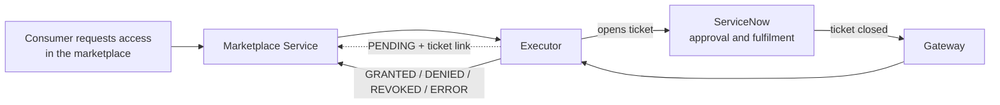

# ODM Platform Marketplace Executor for ServiceNow

> Fulfil the access requests of the [Open Data Mesh Platform](https://dpds.opendatamesh.org/) marketplace through **ServiceNow tickets**: a ticket is opened for every subscribe or unsubscribe, and the request is completed when the ticket is closed on ServiceNow.

## What it does

When someone asks for access to a data product in the marketplace (or asks for it to be removed), the executor opens a **ServiceNow ticket** with everything already filled in. Your people work the ticket as they always do. When it is closed, the marketplace shows whether access was **granted, denied, revoked or failed**, with the ticket link and the close notes.

## Capabilities

- **Your existing process.** Access to data products follows the approvals, assignment and audit trail you already run in ServiceNow.
- **Four ways to create the ticket.** A record in any table, a Service Catalog order on behalf of the requester, an Import Set row, or your own Scripted REST API.
- **Subscribe and unsubscribe.** Each has its own ticket definition and outcome mapping.
- **Configuration only.** Ticket content, which states mean "approved" or "rejected", and the marketplace messages are YAML, with no code.
- **Request filter.** Send only some data products, consumers or requests to ServiceNow, so several executors can work side by side ([examples](docs/reference/examples.md#cross-cutting-scenarios)).
- **Serverless, scales to zero.** A small native image that runs on Cloud Run, Knative, KEDA or Azure Container Apps and costs nothing when idle.
- **Stateless and safe to retry.** The ticket carries the request id, and the first final status wins.

## Get started in three steps

### 1. Pick your scenario

| Your organisation... | Scenario |
|:--|:--|
| just needs someone to action a ticket (incident, task, custom table) | [**Simple access ticket**](docs/scenarios/table-api.md): the fastest to set up |
| runs access requests through the Service Catalog, with approvals | [**Catalog order with approvals**](docs/scenarios/service-catalog.md) |
| lets ServiceNow transform inbound data with transform maps | [**Import Set with transform map**](docs/scenarios/import-set.md) |
| wants the ticket logic (assignment, defaults) written in ServiceNow | [**Your own Scripted REST API**](docs/scenarios/scripted-rest.md) |

Not sure? Start with the **simple access ticket**: it works on a standard instance and you can switch later by changing one file. Every scenario handles both access requests and access removals.

The scenario page covers the ServiceNow side and gives you the executor configuration file.

### 2. Pick your platform

| You run on... | Quickstart |
|:--|:--|
| Google Cloud | [**Cloud Run**](docs/platforms/cloud-run.md) |
| Kubernetes with Knative | [**Knative Serving**](docs/platforms/knative.md) |
| Kubernetes with KEDA | [**KEDA HTTP add-on**](docs/platforms/keda-http.md) |
| Azure | [**Azure Container Apps**](docs/platforms/azure-container-apps.md) |

The platform page deploys the executor, connects ServiceNow back to it and runs an end-to-end test. Docker, plain Kubernetes or a VM: see [Deployment](docs/reference/deployment.md).

### 3. Test it

The last step of the platform page: request access in the marketplace, close the ticket in ServiceNow, and watch the request become `GRANTED`.

**What you need before you start:** a ServiceNow instance (Washington DC or later) with an admin account, a running ODM Marketplace Service, a running [blindata-agent](docs/reference/servicenow-setup.md#option-b-blindata-agent) reachable by ServiceNow over HTTPS (it authenticates the ServiceNow callback), and the rights to deploy on your platform.

## In depth

Read these when you need more than the quickstart: production hardening, other options, every setting.

| Document | Contents |
|:--|:--|
| [Concepts](docs/reference/concepts.md) | Architecture, request lifecycle, status rules, request filter |
| [ServiceNow setup](docs/reference/servicenow-setup.md) | Integration user, OAuth or API key, access policies, gateway options, OAuth with Entra ID, Business Rule and Flow, secret rotation |
| [Deployment](docs/reference/deployment.md) | Which platforms fit and why, common requirements, containers and Kubernetes, scale-in limit, cost |
| Platform details: [Cloud Run](docs/reference/deploy-cloud-run.md), [Knative](docs/reference/deploy-knative.md), [KEDA](docs/reference/deploy-keda-http.md), [Azure Container Apps](docs/reference/deploy-azure-container-apps.md) | Why each setting, network isolation, alternative gateways, declarative files, day 2 operations, platform troubleshooting |
| [Configuration reference](docs/reference/configuration-reference.md) | Every property, env var, default and requirement |
| [Message templates and privacy](docs/reference/message-templates.md) | Qute syntax, data model, default messages, hiding the closing user |
| [Examples](docs/reference/examples.md) | Step-by-step example runs per scenario, several executors, routing, privacy |
| [API reference](docs/reference/api-reference.md) | Executor endpoints, payloads and webhook answers |
| [Build, run locally and release](docs/reference/build-and-run.md) | Maven and Docker builds, local run, tests, CI/CD and releases |
| [Troubleshooting](docs/reference/troubleshooting.md) | Startup errors, `ERROR` and `PENDING` diagnosis, logs |

## Related links

- [Open Data Mesh Architecture](https://platform.opendatamesh.org/architecture/)
- [ODM Initiative Discussion](https://github.com/orgs/opendatamesh-initiative/discussions/1)
- Project conventions: [`spdd/norms/`](spdd/norms/README.md)

## Contributing

This project is intended to be forked and customised.

1. Fork the repository and create a feature branch.
2. Make your changes with clear commits.
3. Open a pull request against the main branch.

Questions or proposals: [ODM Initiative Discussion](https://github.com/orgs/opendatamesh-initiative/discussions/1).

## License

Licensed under the [Apache License 2.0](https://www.apache.org/licenses/LICENSE-2.0). Part of the [Open Data Mesh Initiative](https://github.com/opendatamesh-initiative).
