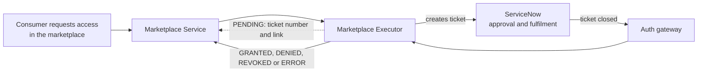

# ODM Platform Marketplace Executor for ServiceNow

> Fulfil the access requests of the [Open Data Mesh Platform](https://dpds.opendatamesh.org/) marketplace through **ServiceNow tickets**: a ticket is opened for every subscribe or unsubscribe, and the request is completed when the ticket is closed on ServiceNow.

[](https://opensource.org/licenses/Apache-2.0)
[](https://openjdk.org/)
[](https://quarkus.io/)
[](https://www.servicenow.com/)

## What is it?

A data marketplace lets people ask for access to data products. Somebody then has to approve and grant that access, and in most companies that work is already done in **ServiceNow**, with its tickets, approvals and audit trail.

The **Marketplace Executor for ServiceNow** connects the two. When a person asks for access to a data product (or asks for it to be removed), the executor opens the matching ServiceNow ticket. When the ticket is closed, it tells the marketplace whether access was granted, denied, revoked or failed, with a readable message.

## The problem it solves

- **No second process.** Access to data products follows the approval and fulfilment process your organisation already runs in ServiceNow.
- **No copy and paste.** Requests do not travel by email or spreadsheet: the ticket is created with the data product, ports, consumer, requester and dates already filled in.
- **No blind spots.** The requester sees in the marketplace which ticket is handling the request and how it ended.

## How it works



1. A consumer requests access to a data product in the marketplace.
2. The executor opens **one ServiceNow ticket** for the whole request (all ports) and reports `PENDING`, with the ticket number and link.
3. People work the ticket in ServiceNow: approve, grant the permissions, close it.
4. ServiceNow notifies the executor, which turns the ticket outcome into the final status and tells the marketplace.

## Main capabilities

- **Four ways to create the ticket**: a record in any table (for example `incident`), a Service Catalog order placed on behalf of the requester, an Import Set row transformed by ServiceNow, or your own Scripted REST API.
- **Everything is configuration**: ticket content, which ticket states mean "approved" or "rejected", and the messages shown in the marketplace, with no code.
- **Subscribe and unsubscribe**: each has its own ticket definition and outcome mapping.
- **Request filter**: route only some data products, consumers or requests to ServiceNow, so several executors can coexist.
- **Stateless and safe to retry**: the ticket carries the request id; results are retried and the first final status wins.
- **Privacy switch**: keep the name of the ServiceNow user who closed the ticket out of marketplace messages.

## Use cases

| Use case | What happens |
|:--|:--|
| Simple access ticket | A consumer requests access, an `incident` (or any table record) is created for the data governance team, resolving it grants the access. See [Table API](docs/use-case-table-api.md) |
| Approval workflow | The request becomes the consumer's own catalog order, goes through your approvals, and a rejection becomes `DENIED` in the marketplace. See [Service Catalog](docs/use-case-service-catalog.md) |
| Transform-map driven intake | The request lands in a staging table and ServiceNow transforms it into a task. See [Import Set](docs/use-case-import-set.md) |
| Custom ticket logic | Your Scripted REST API decides assignment group and defaults. See [Scripted REST](docs/use-case-scripted-rest.md) |
| Access removal | An unsubscribe opens a revoke ticket; closing it marks the request `REVOKED`. Works with any of the above |
| Several systems | A request for finance data goes to ServiceNow, others to another executor, by filter. See [Use cases](docs/use-cases.md#cross-cutting-scenarios) |

## Quick start

Requirements: Java 21 and Maven 3.9+ (or `./mvnw`) for the Maven option, or Docker for the image option; a ServiceNow instance (Washington DC or later), a running ODM Marketplace Service, and an authenticating gateway (reverse proxy) in front of the webhook for the callback leg.

**With Maven**

```bash
export SERVICENOW_INSTANCE_URL=https://acme.service-now.com
export SERVICENOW_CLIENT_ID=<oauth application client id>
export SERVICENOW_CLIENT_SECRET=<oauth application client secret>
export ODM_PRODUCT_PLANE_MARKETPLACE_SERVICE_ADDRESS=http://localhost:8085

./mvnw quarkus:dev          # listens on port 9019
```

**With Docker** (published on every release, no Java needed)

```bash
docker run --rm -p 9019:9019 \
  -e SERVICENOW_INSTANCE_URL=https://acme.service-now.com \
  -e SERVICENOW_CLIENT_ID=<oauth application client id> \
  -e SERVICENOW_CLIENT_SECRET=<oauth application client secret> \
  -e ODM_PRODUCT_PLANE_MARKETPLACE_SERVICE_ADDRESS=http://host.docker.internal:8085 \
  -v "$(pwd)/config/application.yml:/work/config/application.yml:ro" \
  ghcr.io/opendatamesh-initiative/odm-platform-adapter-marketplace-executor-servicenow:<version>
```

The image is also on Docker Hub as `opendatamesh/odm-platform-adapter-marketplace-executor-servicenow`.

The executor needs ticket profiles in `config/application.yml` (none are packaged; mount the file at `/work/config/application.yml` in the container): copy one from the [use cases](docs/use-cases.md), then follow [Provisioning](docs/provisioning.md) and [ServiceNow setup](docs/servicenow-setup.md). Swagger UI is at `http://localhost:9019/swagger-ui`.

> The webhook that ServiceNow calls has no authentication of its own: keep the executor reachable only by the Marketplace Service and the authenticating gateway that fronts the webhook.

## Documentation

| Document | Contents |
|:--|:--|
| [Concepts](docs/concepts.md) | Architecture, request lifecycle, mapping to ServiceNow records, status rules, request filter |
| [Use cases](docs/use-cases.md) | Which ticket type to choose, shared example, cross-cutting scenarios |
| [Use case: Table API](docs/use-case-table-api.md) | Configure and set up the `incident` / any-table flow |
| [Use case: Service Catalog](docs/use-case-service-catalog.md) | Configure and set up catalog orders on behalf of the requester |
| [Use case: Import Set](docs/use-case-import-set.md) | Configure and set up staging table and transform map |
| [Use case: Scripted REST](docs/use-case-scripted-rest.md) | Configure and set up your own endpoint |
| [ServiceNow setup](docs/servicenow-setup.md) | Integration user, OAuth or API key, access policies, webhook security, Business Rule |
| [Provisioning](docs/provisioning.md) | Build, configure, run (Maven or Docker), deploy, CI/CD and releases, register with the Marketplace Service, verify |
| [Configuration reference](docs/configuration-reference.md) | Every property, env var, default and requirement |
| [Message templates and privacy](docs/message-templates.md) | Qute syntax, data model, default messages, closing-user privacy |
| [API reference](docs/api-reference.md) | Executor endpoints, payloads and webhook answers |
| [Troubleshooting](docs/troubleshooting.md) | Startup errors, `ERROR` and `PENDING` diagnosis, logs |

## Related links

- [Open Data Mesh Architecture](https://platform.opendatamesh.org/architecture/)
- [ODM Initiative Discussion](https://github.com/orgs/opendatamesh-initiative/discussions/1)
- Project conventions: [`spdd/norms/`](spdd/norms/README.md)

## Contributing

This project is intended to be forked and customised.

1. Fork the repository and create a feature branch.
2. Make your changes with clear commits.
3. Open a pull request against the main branch.

Questions or proposals: [ODM Initiative Discussion](https://github.com/orgs/opendatamesh-initiative/discussions/1).

## License

Licensed under the [Apache License 2.0](https://www.apache.org/licenses/LICENSE-2.0). Part of the [Open Data Mesh Initiative](https://github.com/opendatamesh-initiative).
