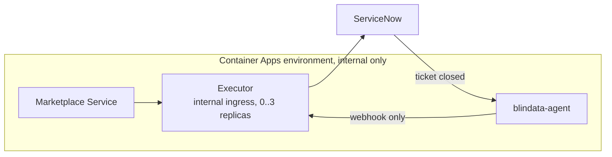

# Quickstart on Azure Container Apps

[README](../../README.md) > 1. Scenario > **2. Platform** > 3. Test

You deploy the executor on Azure Container Apps (it scales to zero) in an internal-only environment, let ServiceNow call it back through blindata-agent, register it in the Marketplace Service and test the whole flow.

**You need:**

- the **Client ID**, **Client Secret** and **`config/application.yml`** from your [scenario page](../../README.md#1-pick-your-scenario);
- the Azure CLI with the `containerapp` extension (`az extension add --name containerapp`), a resource group, a virtual network with a subnet for the environment, and a Key Vault that uses Azure RBAC;
- the Marketplace Service and blindata-agent running as container apps in the same environment, with blindata-agent reachable by ServiceNow over HTTPS. If they run elsewhere in the virtual network, see [ingress modes](../reference/deploy-azure-container-apps.md#network-isolation).



## 1. Deploy the executor

Fill in the first block, then run the rest from the directory that contains `config/application.yml`.

```bash
export RG=odm-rg LOCATION=westeurope KV=odm-kv
export SUBNET_ID=$(az network vnet subnet show -g $RG --vnet-name odm-vnet -n aca-subnet --query id -o tsv)

# internal-only environment: no public endpoint
az containerapp env create -n odm-env -g $RG -l $LOCATION \
  --infrastructure-subnet-resource-id $SUBNET_ID --internal-only true

# identity and secrets in Key Vault
az identity create -n servicenow-executor-id -g $RG
export ID_PRINCIPAL=$(az identity show -n servicenow-executor-id -g $RG --query principalId -o tsv)
az keyvault secret set --vault-name $KV --name sn-client-id     --value '<client id>'
az keyvault secret set --vault-name $KV --name sn-client-secret --value '<client secret>'
az keyvault secret set --vault-name $KV --name servicenow-executor-profiles --file config/application.yml
az role assignment create --assignee $ID_PRINCIPAL --role "Key Vault Secrets User" \
  --scope $(az keyvault show -n $KV --query id -o tsv)

# values for the app file below
az account show --query id -o tsv                  # <sub>
```

Save this as `servicenow-executor.yaml`, replacing `<sub>`, `<version>`, the instance URL and the Marketplace Service address:

```yaml
location: westeurope
identity:
  type: UserAssigned
  userAssignedIdentities:
    /subscriptions/<sub>/resourceGroups/odm-rg/providers/Microsoft.ManagedIdentity/userAssignedIdentities/servicenow-executor-id: {}
properties:
  managedEnvironmentId: /subscriptions/<sub>/resourceGroups/odm-rg/providers/Microsoft.App/managedEnvironments/odm-env
  configuration:
    ingress:
      external: false              # only apps in the same environment: mandatory isolation
      targetPort: 9019
      transport: http
    secrets:
      - name: sn-client-id
        keyVaultUrl: https://odm-kv.vault.azure.net/secrets/sn-client-id
        identity: /subscriptions/<sub>/resourceGroups/odm-rg/providers/Microsoft.ManagedIdentity/userAssignedIdentities/servicenow-executor-id
      - name: sn-client-secret
        keyVaultUrl: https://odm-kv.vault.azure.net/secrets/sn-client-secret
        identity: /subscriptions/<sub>/resourceGroups/odm-rg/providers/Microsoft.ManagedIdentity/userAssignedIdentities/servicenow-executor-id
      - name: executor-profiles
        keyVaultUrl: https://odm-kv.vault.azure.net/secrets/servicenow-executor-profiles
        identity: /subscriptions/<sub>/resourceGroups/odm-rg/providers/Microsoft.ManagedIdentity/userAssignedIdentities/servicenow-executor-id
  template:
    containers:
      - name: executor
        image: docker.io/opendatamesh/odm-platform-adapter-marketplace-executor-servicenow:<version>
        resources:
          cpu: 0.5
          memory: 1Gi
        env:
          - name: SERVICENOW_INSTANCE_URL
            value: https://<instance>.service-now.com
          - name: ODM_PRODUCT_PLANE_MARKETPLACE_SERVICE_ADDRESS
            value: http://marketplace.internal:8085
          - name: QUARKUS_CONFIG_LOCATIONS
            value: /etc/executor/application.yml
          - name: SERVICENOW_CLIENT_ID
            secretRef: sn-client-id
          - name: SERVICENOW_CLIENT_SECRET
            secretRef: sn-client-secret
        volumeMounts:
          - volumeName: profiles
            mountPath: /etc/executor
    volumes:
      - name: profiles
        storageType: Secret
        secrets:
          - secretRef: executor-profiles
            path: application.yml
    scale:
      minReplicas: 0
      maxReplicas: 3
      cooldownPeriod: 300          # mandatory, see below
      rules:
        - name: http
          http:
            metadata:
              concurrentRequests: "10"
```

Create the app and note its address:

```bash
az containerapp create -n servicenow-executor -g $RG --yaml servicenow-executor.yaml
export EXECUTOR_URL=https://$(az containerapp show -n servicenow-executor -g $RG --query properties.configuration.ingress.fqdn -o tsv)
echo $EXECUTOR_URL   # https://servicenow-executor.internal.<environment default domain>
```

If the replica keeps restarting, read the logs: the executor prints a numbered list of configuration problems (`az containerapp logs show -n servicenow-executor -g $RG --follow`).

> `cooldownPeriod: 300` keeps a replica for 5 minutes after the last request, so the ticket the executor opens after answering the Marketplace Service is not cut off by scale-to-zero. Internal ingress keeps the executor off the internet, which is required because its endpoints have no authentication of their own. [Why each setting](../reference/deploy-azure-container-apps.md#settings-that-matter).

## 2. Connect ServiceNow back through blindata-agent

ServiceNow reaches the executor only through blindata-agent, which authenticates it and lets through only the webhook.

1. **Route the agent to the executor.** In the ODM proxy configuration of blindata-agent, set the `marketplace-executor` key to `$EXECUTOR_URL`:

   ```json
   { "servicesURLs": { "marketplace-executor": "https://servicenow-executor.internal.<environment default domain>" } }
   ```

2. **Create the ServiceNow identity in Blindata.** An application user (for example `servicenow-marketplace@<your-domain>`) with the `MARKETPLACE_EDITOR` permission only (never `DATAOPS_ADMIN`), and an API key for it.
3. **Smoke test** (harmless: an unknown request id is acknowledged and ignored):

   ```bash
   export HOOK_URL="https://<agent-host>/agent-api/v1/odm/proxy/<configUuid>/marketplace-executor/api/v1/up/marketplace-executor/webhooks/servicenow/ticket-events"
   curl -i -X POST "$HOOK_URL" -H "Content-Type: application/json" \
     -H "X-BD-User: <application user>" -H "X-BD-ApiKey: <api key>" -H "X-BD-Tenant: <tenant uuid>" \
     -d '{"correlationId":"00000000-0000-0000-0000-000000000000","fields":{"state":"7"}}'
   # -> 200 {"outcome":"IGNORED","reason":"UNKNOWN_REQUEST"}
   ```

   `403`: the user lacks `MARKETPLACE_EDITOR`. A DNS error or timeout from the agent: it does not run in the same environment ([ingress modes](../reference/deploy-azure-container-apps.md#network-isolation)).

4. **Give the values to ServiceNow.** *All > sys_properties.list > New*, once per row, with **Read roles** `admin`. The Business Rule of your scenario reads them.

   | Name | Type | Value |
   |:--|:--|:--|
   | `x_acme.marketplace.gateway_url` | string | `$HOOK_URL` |
   | `x_acme.marketplace.gateway_user` | string | the application user |
   | `x_acme.marketplace.gateway_api_key` | password2 | its API key |
   | `x_acme.marketplace.gateway_tenant` | string | the Blindata tenant UUID |

Prefer Azure API Management, Application Gateway, or OAuth with Entra ID? See [Container Apps gateway options](../reference/deploy-azure-container-apps.md#expose-the-callback-through-a-gateway).

## 3. Register the executor in the Marketplace Service

Add it to the Marketplace Service configuration (https, no port) and restart the service if it does not reload configuration:

```yaml
odm:
  utility-plane:
    marketplace-executors:
      - name: SERVICENOW
        address: https://servicenow-executor.internal.<environment default domain>   # $EXECUTOR_URL
        active: true
```

## 4. Test end to end

1. In the marketplace, request access to a data product matched by your filter (for example `urn:dp:finance:sales`).
2. The request shows **`PENDING`** with a ServiceNow ticket number and link.
3. In ServiceNow, close the ticket the way your scenario approves it:

   | Scenario | Grant | Deny |
   |:--|:--|:--|
   | Simple access ticket | Resolve the incident with *Solution provided* | Resolve with *No resolution provided*, or cancel |
   | Catalog order | Approve, then close the RITM as *Closed Complete* | Reject the approval |
   | Import Set | Close the `sc_task` as *Closed Complete* | Close it as *Closed Incomplete* |
   | Scripted REST | Close the `sc_task` as *Closed Complete* | Close it as *Closed Incomplete* |

4. The request becomes **`GRANTED`** (or **`DENIED`**), with the ticket link and the close notes.
5. Ask to remove the access: a revoke ticket opens, and closing it the same way makes the request **`REVOKED`**.

**It works.** You have tested the whole concept.

## If something goes wrong

| Symptom | Check |
|:--|:--|
| The replica keeps restarting | The configuration (numbered list in the logs), or a Key Vault reference that cannot be resolved (identity, role, secret name) |
| No ticket and no `PENDING` | The replica was removed too early: check `cooldownPeriod` |
| `ERROR` with a ServiceNow message | Your scenario page, *If something goes wrong* |
| Ticket closed, request still `PENDING` | *All > System Logs > Outbound HTTP Requests* in ServiceNow, the blindata-agent log, then `ignored: <REASON>` in the executor log |

More in [Container Apps troubleshooting](../reference/deploy-azure-container-apps.md#troubleshooting-on-container-apps) and [Troubleshooting](../reference/troubleshooting.md).

## Before production

- Changing the profiles or rotating a secret needs a new revision: Key Vault values are not refreshed in a running one ([details](../reference/deploy-azure-container-apps.md#4-check-the-start)).
- Restrict the virtual network to the Marketplace Service and the gateway with network security group rules.
