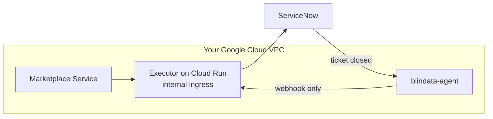

# Quickstart on Google Cloud Run

[README](../../README.md) > 1. Scenario > **2. Platform** > 3. Test

You deploy the executor on Cloud Run (it scales to zero), let ServiceNow call it back through blindata-agent, register it in the Marketplace Service and test the whole flow.

**You need:**

- the **Client ID**, **Client Secret** and **`config/application.yml`** from your [scenario page](../../README.md#1-pick-your-scenario);
- `gcloud`, logged in, on a project with billing;
- the Marketplace Service and blindata-agent running in the project's VPC, with blindata-agent reachable by ServiceNow over HTTPS.



## 1. Deploy the executor

Fill in the first block, then run the whole thing from the directory that contains `config/application.yml`.

```bash
export PROJECT_ID=my-project
export REGION=europe-west1
export VERSION=<released version, for example 1.0.2>
export SERVICENOW_INSTANCE_URL=https://<instance>.service-now.com
export MARKETPLACE_URL=http://marketplace.internal:8085   # as seen from the executor
export SN_CLIENT_ID='<client id>'
export SN_CLIENT_SECRET='<client secret>'

gcloud config set project $PROJECT_ID
gcloud services enable run.googleapis.com secretmanager.googleapis.com

# service account and secrets
gcloud iam service-accounts create servicenow-executor
export SA=servicenow-executor@$PROJECT_ID.iam.gserviceaccount.com
printf '%s' "$SN_CLIENT_ID"     | gcloud secrets create sn-client-id     --data-file=-
printf '%s' "$SN_CLIENT_SECRET" | gcloud secrets create sn-client-secret --data-file=-
gcloud secrets create servicenow-executor-profiles --data-file=config/application.yml
for s in sn-client-id sn-client-secret servicenow-executor-profiles; do
  gcloud secrets add-iam-policy-binding $s --member=serviceAccount:$SA --role=roles/secretmanager.secretAccessor
done

# deploy: CPU always allocated and internal ingress are mandatory
gcloud run deploy servicenow-executor \
  --region=$REGION \
  --image=docker.io/opendatamesh/odm-platform-adapter-marketplace-executor-servicenow:$VERSION \
  --service-account=$SA --port=9019 --cpu=1 --memory=512Mi \
  --no-cpu-throttling --min-instances=0 --max-instances=3 \
  --ingress=internal --no-invoker-iam-check \
  --set-env-vars=SERVICENOW_INSTANCE_URL=$SERVICENOW_INSTANCE_URL,ODM_PRODUCT_PLANE_MARKETPLACE_SERVICE_ADDRESS=$MARKETPLACE_URL,QUARKUS_CONFIG_LOCATIONS=/etc/executor/application.yml \
  --set-secrets=SERVICENOW_CLIENT_ID=sn-client-id:1,SERVICENOW_CLIENT_SECRET=sn-client-secret:1,/etc/executor/application.yml=servicenow-executor-profiles:1

export EXECUTOR_URL=$(gcloud run services describe servicenow-executor --region=$REGION --format='value(status.url)')
echo $EXECUTOR_URL   # for example https://servicenow-executor-abc123xyz-ew.a.run.app
```

If the revision does not become ready, read the logs: the executor prints a numbered list of configuration problems.

```bash
gcloud run services logs read servicenow-executor --region=$REGION --limit=50
```

> `--no-cpu-throttling` is not optional: the executor opens the ticket after answering the Marketplace Service, and Cloud Run's default billing freezes the CPU at that point. `--ingress=internal` keeps the executor off the internet, which is required because its endpoints have no authentication of their own. [Why each setting](../reference/deploy-cloud-run.md#settings-that-matter).

## 2. Connect ServiceNow back through blindata-agent

ServiceNow reaches the executor only through blindata-agent, which authenticates it and lets through only the webhook.

1. **Route the agent to the executor.** In the ODM proxy configuration of blindata-agent, set the `marketplace-executor` key to `$EXECUTOR_URL` (https, no port):

   ```json
   { "servicesURLs": { "marketplace-executor": "https://servicenow-executor-abc123xyz-ew.a.run.app" } }
   ```

2. **Create the ServiceNow identity in Blindata.** An application user (for example `servicenow-marketplace@<your-domain>`) with the `MARKETPLACE_EDITOR` permission only (never `DATAOPS_ADMIN`), and an API key for it.
3. **Smoke test** (harmless: an unknown request id is acknowledged and ignored):

   ```bash
   export HOOK_URL="https://<agent-host>/agent-api/v1/odm/proxy/<configUuid>/marketplace-executor/api/v1/up/marketplace-executor/webhooks/servicenow/ticket-events"
   curl -i -X POST "$HOOK_URL" -H "Content-Type: application/json" \
     -H "X-BD-User: <application user>" -H "X-BD-ApiKey: <api key>" -H "X-BD-Tenant: <tenant uuid>" \
     -d '{"correlationId":"00000000-0000-0000-0000-000000000000","fields":{"state":"7"}}'
   # -> 200 {"outcome":"IGNORED","reason":"UNKNOWN_REQUEST"}
   ```

   `403`: the user lacks `MARKETPLACE_EDITOR`. `404` from Cloud Run: the agent's traffic is not internal to the VPC ([fix](../reference/deploy-cloud-run.md#ingress-and-network-isolation)).

4. **Give the values to ServiceNow.** *All > sys_properties.list > New*, once per row, with **Read roles** `admin`. The Business Rule of your scenario reads them.

   | Name | Type | Value |
   |:--|:--|:--|
   | `x_acme.marketplace.gateway_url` | string | `$HOOK_URL` |
   | `x_acme.marketplace.gateway_user` | string | the application user |
   | `x_acme.marketplace.gateway_api_key` | password2 | its API key |
   | `x_acme.marketplace.gateway_tenant` | string | the Blindata tenant UUID |

Prefer your own gateway (HTTPS load balancer with Cloud Armor) or OAuth with Entra ID? See [Cloud Run gateway options](../reference/deploy-cloud-run.md#expose-the-callback-through-a-gateway).

## 3. Register the executor in the Marketplace Service

Add it to the Marketplace Service configuration and restart the service if it does not reload configuration:

```yaml
odm:
  utility-plane:
    marketplace-executors:
      - name: SERVICENOW
        address: https://servicenow-executor-abc123xyz-ew.a.run.app   # $EXECUTOR_URL
        active: true
```

If the Marketplace Service is itself on Cloud Run, give it Direct VPC egress with `--vpc-egress=all-traffic`, otherwise its calls are refused.

## 4. Test end to end

1. In the marketplace, request access to a data product matched by your filter (for example `urn:dp:finance:sales`).
2. The request shows **`PENDING`** with a ServiceNow ticket number and link.
3. In ServiceNow, close the ticket the way your scenario approves it:

   | Scenario | Grant | Deny |
   |:--|:--|:--|
   | Simple access ticket | Resolve the incident with *Solution provided* | Resolve with *No resolution provided*, or cancel |
   | Catalog order | Approve, then close the RITM as *Closed Complete* | Reject the approval |
   | Import Set | Close the `sc_task` as *Closed Complete* | Close it as *Closed Incomplete* |
   | Scripted REST | Close the `sc_task` as *Closed Complete* | Close it as *Closed Incomplete* |

4. The request becomes **`GRANTED`** (or **`DENIED`**), with the ticket link and the close notes.
5. Ask to remove the access: a revoke ticket opens, and closing it the same way makes the request **`REVOKED`**.

**It works.** You have tested the whole concept.

## If something goes wrong

| Symptom | Check |
|:--|:--|
| No ticket and no `PENDING` | `--no-cpu-throttling` is missing: `gcloud run services describe servicenow-executor --region=$REGION` |
| `ERROR` with a ServiceNow message | Your scenario page, *If something goes wrong* |
| Ticket closed, request still `PENDING` | *All > System Logs > Outbound HTTP Requests* in ServiceNow, the blindata-agent log, then `ignored: <REASON>` in the executor log |
| `ERROR` "Unable to obtain a ServiceNow OAuth token" | Egress to ServiceNow: add Cloud NAT if all egress goes through the VPC |

More in [Cloud Run troubleshooting](../reference/deploy-cloud-run.md#troubleshooting-on-cloud-run) and [Troubleshooting](../reference/troubleshooting.md).

## Before production

- Use an [Artifact Registry remote repository](../reference/deploy-cloud-run.md#1-choose-the-image) instead of pulling from Docker Hub.
- Keep the deployment in version control with the [declarative `service.yaml`](../reference/deploy-cloud-run.md#declarative-alternative-serviceyaml).
- Read [Day 2 operations](../reference/deploy-cloud-run.md#day-2-operations): upgrades, profile changes, secret rotation, rollback.
