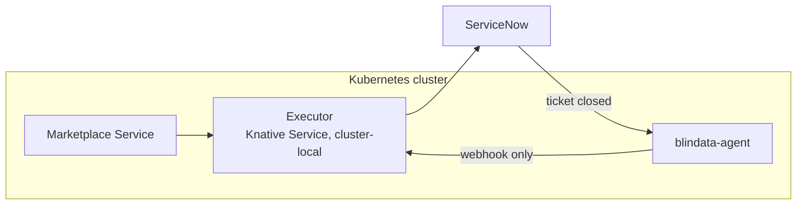

# Quickstart on Knative Serving

[README](../../README.md) > 1. Scenario > **2. Platform** > 3. Test

You deploy the executor as a Knative Service on Kubernetes (GKE, EKS, AKS or on-premises; it scales to zero), let ServiceNow call it back through blindata-agent, register it in the Marketplace Service and test the whole flow.

**You need:**

- the **Client ID**, **Client Secret** and **`config/application.yml`** from your [scenario page](../../README.md#1-pick-your-scenario);
- Knative Serving with a networking layer (Kourier or Istio), and `kubectl` access to a namespace (here `odm`);
- the Marketplace Service and blindata-agent running in the cluster, with blindata-agent exposed to ServiceNow over HTTPS.



## 1. Deploy the executor

From the directory that contains `config/application.yml`, create the secret and the profiles:

```bash
kubectl -n odm create secret generic servicenow-executor-credentials \
  --from-literal=SERVICENOW_CLIENT_ID='<client id>' \
  --from-literal=SERVICENOW_CLIENT_SECRET='<client secret>'

kubectl -n odm create configmap servicenow-executor-profiles \
  --from-file=application.yml=config/application.yml
```

Save this as `servicenow-executor.yaml`, replacing the three marked values:

```yaml
apiVersion: serving.knative.dev/v1
kind: Service
metadata:
  name: servicenow-executor
  namespace: odm
  labels:
    networking.knative.dev/visibility: cluster-local      # no external route: mandatory
spec:
  template:
    metadata:
      annotations:
        autoscaling.knative.dev/min-scale: "0"
        autoscaling.knative.dev/max-scale: "3"
        autoscaling.knative.dev/scale-to-zero-pod-retention-period: "5m"   # mandatory, see below
    spec:
      timeoutSeconds: 120
      containers:
        - image: docker.io/opendatamesh/odm-platform-adapter-marketplace-executor-servicenow:<version>   # <-- 1
          ports:
            - name: http1
              containerPort: 9019
          resources:
            requests:
              cpu: 250m
              memory: 256Mi
            limits:
              memory: 512Mi
          env:
            - name: SERVICENOW_INSTANCE_URL
              value: https://<instance>.service-now.com                             # <-- 2
            - name: ODM_PRODUCT_PLANE_MARKETPLACE_SERVICE_ADDRESS
              value: http://marketplace-service.odm.svc.cluster.local:8085         # <-- 3
            - name: QUARKUS_CONFIG_LOCATIONS
              value: /etc/executor/application.yml
          envFrom:
            - secretRef:
                name: servicenow-executor-credentials
          volumeMounts:
            - name: profiles
              mountPath: /etc/executor
              readOnly: true
      volumes:
        - name: profiles
          configMap:
            name: servicenow-executor-profiles
```

Apply it and check that it is ready:

```bash
kubectl apply -f servicenow-executor.yaml
kubectl -n odm get ksvc servicenow-executor
# NAME                  URL                                                READY
# servicenow-executor   http://servicenow-executor.odm.svc.cluster.local   True
```

If `READY` stays `False`, read the logs: the executor prints a numbered list of configuration problems.

```bash
kubectl -n odm logs -l serving.knative.dev/service=servicenow-executor -c user-container
```

> The retention period keeps the last pod alive for 5 minutes, so the ticket the executor opens after answering the Marketplace Service is not cut off by scale-to-zero. The `cluster-local` label keeps the executor off the internet, which is required because its endpoints have no authentication of their own. [Why each setting](../reference/deploy-knative.md#settings-that-matter).

## 2. Connect ServiceNow back through blindata-agent

ServiceNow reaches the executor only through blindata-agent, which authenticates it and lets through only the webhook.

1. **Route the agent to the executor.** In the ODM proxy configuration of blindata-agent, set the `marketplace-executor` key to the cluster-local address:

   ```json
   { "servicesURLs": { "marketplace-executor": "http://servicenow-executor.odm.svc.cluster.local" } }
   ```

2. **Create the ServiceNow identity in Blindata.** An application user (for example `servicenow-marketplace@<your-domain>`) with the `MARKETPLACE_EDITOR` permission only (never `DATAOPS_ADMIN`), and an API key for it.
3. **Smoke test** (harmless: an unknown request id is acknowledged and ignored):

   ```bash
   export HOOK_URL="https://<agent-host>/agent-api/v1/odm/proxy/<configUuid>/marketplace-executor/api/v1/up/marketplace-executor/webhooks/servicenow/ticket-events"
   curl -i -X POST "$HOOK_URL" -H "Content-Type: application/json" \
     -H "X-BD-User: <application user>" -H "X-BD-ApiKey: <api key>" -H "X-BD-Tenant: <tenant uuid>" \
     -d '{"correlationId":"00000000-0000-0000-0000-000000000000","fields":{"state":"7"}}'
   # -> 200 {"outcome":"IGNORED","reason":"UNKNOWN_REQUEST"}
   ```

   `403`: the user lacks `MARKETPLACE_EDITOR`. `404` from the Knative gateway: the agent is not calling the cluster-local name.

4. **Give the values to ServiceNow.** *All > sys_properties.list > New*, once per row, with **Read roles** `admin`. The Business Rule of your scenario reads them.

   | Name | Type | Value |
   |:--|:--|:--|
   | `x_acme.marketplace.gateway_url` | string | `$HOOK_URL` |
   | `x_acme.marketplace.gateway_user` | string | the application user |
   | `x_acme.marketplace.gateway_api_key` | password2 | its API key |
   | `x_acme.marketplace.gateway_tenant` | string | the Blindata tenant UUID |

Prefer your own ingress or API gateway, or OAuth with Entra ID? See [Knative gateway options](../reference/deploy-knative.md#expose-the-callback-through-a-gateway).

## 3. Register the executor in the Marketplace Service

Add it to the Marketplace Service configuration (no port: Knative listens on 80) and restart the service if it does not reload configuration:

```yaml
odm:
  utility-plane:
    marketplace-executors:
      - name: SERVICENOW
        address: http://servicenow-executor.odm.svc.cluster.local
        active: true
```

## 4. Test end to end

1. In the marketplace, request access to a data product matched by your filter (for example `urn:dp:finance:sales`).
2. The request shows **`PENDING`** with a ServiceNow ticket number and link.
3. In ServiceNow, close the ticket the way your scenario approves it:

   | Scenario | Grant | Deny |
   |:--|:--|:--|
   | Simple access ticket | Resolve the incident with *Solution provided* | Resolve with *No resolution provided*, or cancel |
   | Catalog order | Approve, then close the RITM as *Closed Complete* | Reject the approval |
   | Import Set | Close the `sc_task` as *Closed Complete* | Close it as *Closed Incomplete* |
   | Scripted REST | Close the `sc_task` as *Closed Complete* | Close it as *Closed Incomplete* |

4. The request becomes **`GRANTED`** (or **`DENIED`**), with the ticket link and the close notes.
5. Ask to remove the access: a revoke ticket opens, and closing it the same way makes the request **`REVOKED`**.

**It works.** You have tested the whole concept. Watch the pod disappear about 5 minutes later: `kubectl -n odm get pods -l serving.knative.dev/service=servicenow-executor -w`.

## If something goes wrong

| Symptom | Check |
|:--|:--|
| No ticket and no `PENDING`, and the pod disappeared right after | The retention annotation is missing or not supported by your Knative version ([fix](../reference/deploy-knative.md#settings-that-matter)) |
| `ERROR` with a ServiceNow message | Your scenario page, *If something goes wrong* |
| Ticket closed, request still `PENDING` | *All > System Logs > Outbound HTTP Requests* in ServiceNow, the blindata-agent log, then `ignored: <REASON>` in the executor log |
| `ERROR` "Unable to obtain a ServiceNow OAuth token" | Egress from the cluster to ServiceNow (egress policy, proxy, firewall) |

More in [Knative troubleshooting](../reference/deploy-knative.md#troubleshooting-on-knative) and [Troubleshooting](../reference/troubleshooting.md).

## Before production

- Apply the [network policy](../reference/deploy-knative.md#network-policy), so that only the Marketplace Service, blindata-agent and the Knative system components reach the executor.
- Pin a released image version and keep `servicenow-executor.yaml` in version control.
