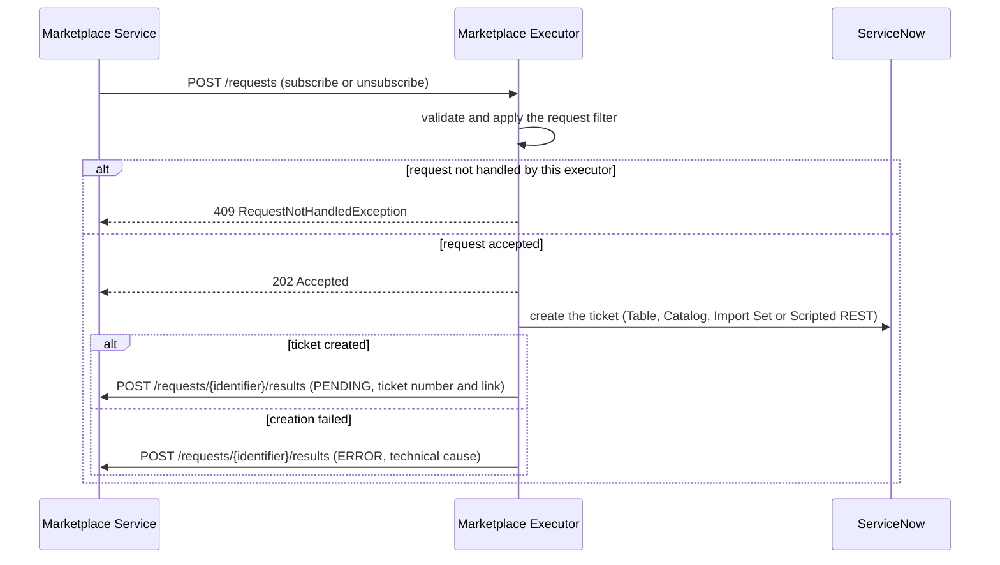
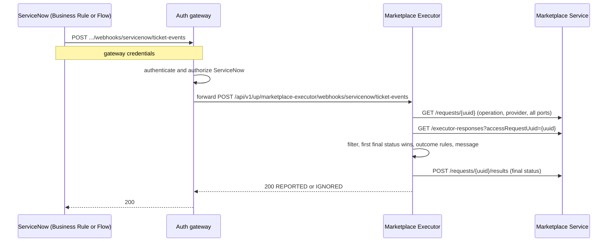

# Concepts: how the executor works

[Back to README](../../README.md)

## Overview

The ODM marketplace lets people ask for access to a data product (or ask for that access to be removed). Somebody still has to *do* the work: approve the request, create the permissions, remove them later. In most companies that work already lives in ServiceNow.

This executor is the bridge. It receives the request from the marketplace, **opens a ServiceNow ticket** that describes it, and tells the marketplace "waiting for ServiceNow". When people close the ticket in ServiceNow, the executor learns about it and tells the marketplace the final result: access granted, denied, revoked, or failed.

The executor does not decide anything about access. It only translates between two worlds. What the ticket looks like, which ServiceNow feature creates it, and which ticket states mean "approved" or "rejected" are all **configuration**.

## Contents

- [Components](#components)
- [Request lifecycle](#request-lifecycle)
- [Mapping marketplace request to ServiceNow record](#mapping-marketplace-request-to-servicenow-record)
- [Status taxonomy and rules](#status-taxonomy-and-rules)
- [Request filter](#request-filter)
- [Design properties](#design-properties)
- [Out of scope](#out-of-scope)

## Components

| Component | Role |
|:--|:--|
| Marketplace Service | Receives access requests from users, forwards them to every active executor, stores the request data and the result history. |
| This executor | Quarkus service (Java 21, port `9019`). Opens tickets, evaluates ticket outcomes, posts results. Stateless, no database. |
| ServiceNow | Holds the tickets and the approval / fulfilment process. Calls the executor back when a ticket is completed. |
| Auth gateway | An authenticating gateway or reverse proxy that authenticates and authorizes ServiceNow's callback before it reaches the executor. A hard prerequisite for the callback leg (see [Securing the webhook](servicenow-setup.md#5-securing-the-webhook)). |

## Request lifecycle

A request goes through two legs.

### Leg 1: the ticket is opened

1. The Marketplace Service posts the request (`MARKETPLACE_SUBSCRIBE` or `MARKETPLACE_UNSUBSCRIBE`) to the executor.
2. The executor validates it and applies the [request filter](#request-filter). A request that is not for this executor is declined with `409` and nothing else happens.
3. The executor answers `202` immediately and continues asynchronously.
4. It creates **one ticket for the whole request** (all ports) using the profile of the operation (`servicenow.profiles.subscribe` or `servicenow.profiles.unsubscribe`). The marketplace request UUID is stored on the ticket (the *correlation value*).
5. It posts a `PENDING` result with the ticket number and link. If the ticket cannot be created, it posts an `ERROR` result with the technical cause instead.

### Leg 2: the ticket is completed

1. A Business Rule (or Flow) on the fulfilled ServiceNow record calls the executor's webhook, through the gateway, when the ticket changes state. It sends the correlation UUID and a map of ticket fields (`state`, `close_code`, `close_notes`, ...). See [API reference](api-reference.md#webhook-post-apiv1upmarketplace-executorwebhooksservicenowticket-events).
2. The executor checks, in this order: correlation present, request known to the Marketplace Service, request still accepted by the filter, no final result yet, an [outcome rule](configuration-reference.md#outcome-rules) matches the fields.
3. If everything holds, it posts the final result (`GRANTED`, `DENIED`, `REVOKED` or `ERROR`) with a descriptive message. Otherwise the event is acknowledged and ignored with a reason.

The operation, provider and the list of ports always come from the Marketplace Service, never from the webhook.

## Mapping marketplace request to ServiceNow record

| Marketplace request | Where it goes on ServiceNow |
|:--|:--|
| `request.identifier` (UUID) | The *correlation field* of the record: `correlation_id` (Table, Scripted REST), variable `marketplace_request_id` (Service Catalog), column `u_marketplace_request_id` (Import Set). Added by the executor after rendering; it cannot be overridden. |
| `provider.dataProductFqn`, `provider.dataProductPortsFqn`, `consumer.*`, `requester.*`, `properties.*`, `startDate`, `endDate`, `operation` | Whatever you decide: each entry of the profile's `fields` is a [template](message-templates.md) with access to these values. |
| Requester (Service Catalog only) | Resolved to a `sys_user` record and used as *Requested for* of the order. |

Four creation interfaces are supported, each one with its own endpoint and defaults:

| `type` | Endpoint called | Guide |
|:--|:--|:--|
| `TABLE` | `POST /api/now/table/{target}` | [Table API](../scenarios/table-api.md) |
| `SERVICE_CATALOG` | `POST /api/sn_sc/servicecatalog/items/{target}/order_now` | [Service Catalog](../scenarios/service-catalog.md) |
| `IMPORT_SET` | `POST /api/now/import/{target}` | [Import Set](../scenarios/import-set.md) |
| `SCRIPTED_REST` | `{method} {path}` | [Scripted REST](../scenarios/scripted-rest.md) |

Going back, the webhook `fields` are matched against the profile's outcome rules to decide the final status, and are exposed to the final result message as `fields.*` and `ticket.*`.

## Status taxonomy and rules

The final status depends on the **operation** and on the **cause** the outcome rules assign to the ticket. Rules only declare a cause, never a status, so a configuration cannot produce a status that is not allowed for the operation.

| Cause (from outcome rules) | `MARKETPLACE_SUBSCRIBE` | `MARKETPLACE_UNSUBSCRIBE` |
|:--|:--|:--|
| `FULFILLED` | `GRANTED` | `REVOKED` |
| `REFUSED` | `DENIED` | `ERROR` (message states that the request was refused on ServiceNow) |
| `FAILED` | `ERROR` | `ERROR` |

| Status | Sent when |
|:--|:--|
| `PENDING` | The ticket has been opened (once per accepted request, never from the webhook) |
| `ERROR` | The ticket could not be opened (technical cause in the message), or one of the `ERROR` cases above |

Rules:

- **No partial grants.** One ticket handles all the ports of the request. Every result carries *all* the requested ports. A request that matches the filter only for some ports is declined as a whole.
- **First final status wins.** Once a final status (`GRANTED`, `DENIED`, `REVOKED`, `ERROR`) exists for a request, later ticket events for it (reopened and re-closed tickets, repeated Business Rules) are acknowledged and ignored (`FINAL_RESULT_ALREADY_REPORTED`). `PENDING` does not count as final.
- **Non-final ticket updates are not results.** An event matching no outcome rule is ignored (`NON_TERMINAL_STATE`) and the request stays `PENDING`.
- **Messages are descriptive.** Every result message says what happened: ticket number and link, close notes and, by default, the ServiceNow user who closed the ticket. For `UNSUBSCRIBE` a refusal is an `ERROR`, and the message makes clear that it is a ServiceNow-side refusal and not a platform failure. See [Message templates](message-templates.md).

## Request filter

`servicenow.filter.*` decides which requests this executor handles, so several executors (for example a ServiceNow one and a Jira one) can sit behind the same Marketplace Service. The full key list is in the [configuration reference](configuration-reference.md#request-filter).

- Every criterion is a list of regular expressions that must **fully match**. A criterion that is not configured matches everything.
- **All configured criteria must match (AND)**; inside a list **any** pattern may match (OR).
- For ports, **every** requested port must match some pattern. A request that only partly belongs to this executor cannot be partially granted, so it is **declined as a whole**.
- A declined request gets `409` and produces no side effect. If **no** executor accepts a request, the Marketplace Service rolls the submission back with "No executor was able to handle the request": the request fails fast instead of staying `PENDING` forever.
- The filter is re-applied when a webhook arrives (`NOT_HANDLED_BY_EXECUTOR`).

> **Exclusive filters are the operating rule.** Each request must be accepted by **exactly one** executor. Results carry no executor identity, so two executors accepting the same request would suppress each other's final result (first final status wins). Example of two disjoint filters: executor A `urn:dp:finance:.*`, executor B `(?!urn:dp:finance:).*`. Every non-matching executor answers `409`, which the Marketplace Service may log: that is expected noise.

## Design properties

- **Stateless.** The ticket carries the request UUID; the Marketplace Service holds the request data and the result history.
- **Configuration only.** Interface, target, ticket content, correlation location, outcome mapping and messages need no code.
- **Fail fast at startup.** The executor refuses to start with an invalid configuration and prints a numbered list of problems. See [Troubleshooting](troubleshooting.md#the-executor-does-not-start).
- **Safe retries.** If the Marketplace Service is unavailable when a final result must be delivered, the webhook answers `500` so ServiceNow can retry; nothing is lost.

## Out of scope

- **Automatic revoke on `endDate`.** Not handled. The recommended direction is for the system that owns the request lifecycle (such as the Marketplace Service) to run a scheduled job that submits a normal `MARKETPLACE_UNSUBSCRIBE` once access expires; this executor then handles it like any other unsubscribe. The default ticket templates already carry `startDate` and `endDate` for the fulfillers.
- **Executor attribution in Marketplace Service results.** Not required: exclusive filters are the operating rule.
- Polling or reconciliation of stuck tickets, writing a work note back to the ticket, changes to the Marketplace Service, and stripping the credential headers in the gateway before forwarding (recommended hardening).
- **Unsubscribe while the subscribe ticket is still open.** Two tickets exist at the same time. The executor does not resolve this: handle it in your ServiceNow process.

---
Next: [Pick your scenario](../../README.md#1-pick-your-scenario) | [Back to README](../../README.md)
