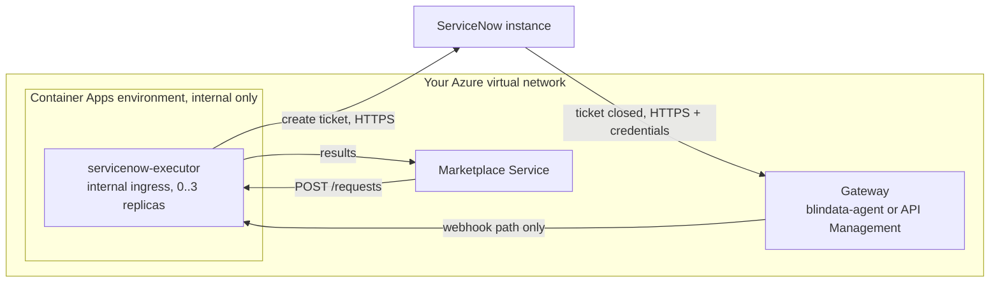

# Azure Container Apps: in depth

[Back to README](../../README.md) | [Quickstart](../platforms/azure-container-apps.md) | [Deployment](deployment.md)

## Overview

Azure Container Apps runs the published image without a cluster to manage, and scales it to zero when there is no traffic. A running replica is never throttled, and the platform removes replicas only after a cool-down period, so the ticket creation that the executor runs after its `202` completes normally. See [Deployment](deployment.md) for the general rule.

The [quickstart](../platforms/azure-container-apps.md) has the ready-to-run version of the commands below. This page explains them, and covers the options the quickstart leaves out.



Prerequisites: the Azure CLI with the `containerapp` extension (`az extension add --name containerapp`), a resource group, a virtual network with a subnet dedicated to the environment, ServiceNow prepared as in your [scenario page](../../README.md#1-pick-your-scenario), and the ticket profiles in `config/application.yml`.

## Contents

- [Settings that matter](#settings-that-matter)
- [Network isolation](#network-isolation)
- [Deploy step by step](#deploy-step-by-step)
- [Expose the callback through a gateway](#expose-the-callback-through-a-gateway)
- [Register with the Marketplace Service](#register-with-the-marketplace-service)
- [Verify](#verify)
- [Troubleshooting on Container Apps](#troubleshooting-on-container-apps)

## Settings that matter

| Setting | Value | Why |
|:--|:--|:--|
| Scale to zero | `minReplicas: 0`, `maxReplicas: 3`, HTTP scale rule | No replica when there is no traffic. Use `minReplicas: 1` to avoid cold starts. The executor is stateless |
| Cool-down | `cooldownPeriod: 300` | **Replicas stay for 5 minutes after the last request** before scaling to zero, so the background ticket creation finishes. 300 seconds is the default; set it explicitly so nobody lowers it by accident. Verify that your API version supports the field (`properties.template.scale.cooldownPeriod`) |
| Ingress | internal, `targetPort: 9019` | **Network isolation is a hard requirement**: the executor endpoints have no authentication of their own |
| Environment | internal only, in your virtual network | No public endpoint at all |
| Ticket profiles | a secret mounted as a file at `/etc/executor/application.yml`, `QUARKUS_CONFIG_LOCATIONS` pointing at it | Container Apps mounts secrets as files through a `Secret` volume |
| Credentials | Key Vault references through a managed identity, exposed with `secretRef` | Never in the image or in plain app configuration |
| Resources | `cpu: 0.5`, `memory: 1Gi` | The image is a native executable: this is enough |

## Network isolation

Two settings decide who can reach the executor; verify them on the Container Apps *ingress* documentation for your setup:

- **The environment** is created with `--internal-only true`: it gets no public IP, only an internal load balancer address in your virtual network.
- **The app ingress**:
  - `external: false` limits it to **apps in the same environment**. Use it when the Marketplace Service and the gateway run as container apps in that environment. The address is `https://servicenow-executor.internal.<environment default domain>`.
  - `external: true` in an internal-only environment limits it to **your virtual network** (not the internet). Use it when the Marketplace Service or the gateway run elsewhere in the network (VMs, AKS). The address is `https://servicenow-executor.<environment default domain>`, and the callers need a private DNS zone for the default domain pointing at the environment's static IP.

In both cases keep the network limited to the Marketplace Service and the gateway, with network security group rules where you can. Read the actual address with `az containerapp show --query properties.configuration.ingress.fqdn`.

Egress: the executor must reach the ServiceNow instance over HTTPS. If you route egress through a firewall or NAT gateway, allow it (and use a static address if ServiceNow allow-lists callers).

## Deploy step by step

The commands use the resource group `odm-rg`, the location `westeurope`, the environment `odm-env`, the Key Vault `odm-kv` and the app `servicenow-executor`.

### 1. Environment

```bash
export RG=odm-rg LOCATION=westeurope
export SUBNET_ID=$(az network vnet subnet show -g $RG --vnet-name odm-vnet -n aca-subnet --query id -o tsv)

az containerapp env create -n odm-env -g $RG -l $LOCATION \
  --infrastructure-subnet-resource-id $SUBNET_ID \
  --internal-only true

az containerapp env show -n odm-env -g $RG \
  --query "{domain:properties.defaultDomain, ip:properties.staticIp, id:id}"
```

### 2. Identity and secrets in Key Vault

```bash
az identity create -n servicenow-executor-id -g $RG
export ID_RES=$(az identity show -n servicenow-executor-id -g $RG --query id -o tsv)
export ID_PRINCIPAL=$(az identity show -n servicenow-executor-id -g $RG --query principalId -o tsv)

az keyvault secret set --vault-name odm-kv --name sn-client-id     --value '<oauth client id>'
az keyvault secret set --vault-name odm-kv --name sn-client-secret --value '<oauth client secret>'
az keyvault secret set --vault-name odm-kv --name servicenow-executor-profiles --file config/application.yml

az role assignment create --assignee $ID_PRINCIPAL --role "Key Vault Secrets User" \
  --scope $(az keyvault show -n odm-kv --query id -o tsv)
```

The role assignment needs a Key Vault that uses Azure RBAC; with access policies, grant `get` on secrets instead. For an API key, store `sn-api-key` and use `SERVICENOW_AUTH_TYPE=API_KEY` and `SERVICENOW_API_KEY` below.

### 3. The app

`servicenow-executor.yaml` (replace the subscription, identity and vault values):

```yaml
location: westeurope
identity:
  type: UserAssigned
  userAssignedIdentities:
    /subscriptions/<sub>/resourceGroups/odm-rg/providers/Microsoft.ManagedIdentity/userAssignedIdentities/servicenow-executor-id: {}
properties:
  managedEnvironmentId: /subscriptions/<sub>/resourceGroups/odm-rg/providers/Microsoft.App/managedEnvironments/odm-env
  configuration:
    ingress:
      external: false              # same environment only; true = whole VNet (see Network isolation)
      targetPort: 9019
      transport: http
    secrets:
      - name: sn-client-id
        keyVaultUrl: https://odm-kv.vault.azure.net/secrets/sn-client-id
        identity: /subscriptions/<sub>/resourceGroups/odm-rg/providers/Microsoft.ManagedIdentity/userAssignedIdentities/servicenow-executor-id
      - name: sn-client-secret
        keyVaultUrl: https://odm-kv.vault.azure.net/secrets/sn-client-secret
        identity: /subscriptions/<sub>/resourceGroups/odm-rg/providers/Microsoft.ManagedIdentity/userAssignedIdentities/servicenow-executor-id
      - name: executor-profiles
        keyVaultUrl: https://odm-kv.vault.azure.net/secrets/servicenow-executor-profiles
        identity: /subscriptions/<sub>/resourceGroups/odm-rg/providers/Microsoft.ManagedIdentity/userAssignedIdentities/servicenow-executor-id
  template:
    containers:
      - name: executor
        image: docker.io/opendatamesh/odm-platform-adapter-marketplace-executor-servicenow:<version>
        resources:
          cpu: 0.5
          memory: 1Gi
        env:
          - name: SERVICENOW_INSTANCE_URL
            value: https://acme.service-now.com
          - name: ODM_PRODUCT_PLANE_MARKETPLACE_SERVICE_ADDRESS
            value: http://marketplace.internal:8085
          - name: QUARKUS_CONFIG_LOCATIONS
            value: /etc/executor/application.yml
          - name: SERVICENOW_CLIENT_ID
            secretRef: sn-client-id
          - name: SERVICENOW_CLIENT_SECRET
            secretRef: sn-client-secret
        volumeMounts:
          - volumeName: profiles
            mountPath: /etc/executor
    volumes:
      - name: profiles
        storageType: Secret
        secrets:
          - secretRef: executor-profiles
            path: application.yml
    scale:
      minReplicas: 0
      maxReplicas: 3
      cooldownPeriod: 300
      rules:
        - name: http
          http:
            metadata:
              concurrentRequests: "10"
```

Add any variable your profiles reference, and `SERVICENOW_MESSAGES_INCLUDE_CLOSING_USER=false` to keep the closing user out of marketplace messages ([Privacy](message-templates.md#privacy)).

```bash
az containerapp create -n servicenow-executor -g $RG --yaml servicenow-executor.yaml
az containerapp show -n servicenow-executor -g $RG --query properties.configuration.ingress.fqdn -o tsv
# -> servicenow-executor.internal.<environment default domain>
```

### 4. Check the start

```bash
az containerapp logs show -n servicenow-executor -g $RG --follow
```

The executor **refuses to start with an invalid configuration**: the numbered list of problems appears in the logs and the replica keeps restarting. Fix the profiles (new Key Vault secret version, then `az containerapp update` to create a new revision) or the variables. See [Troubleshooting](troubleshooting.md#the-executor-does-not-start).

A secret read from Key Vault is not refreshed in a running revision: after changing the profiles or rotating a credential, create a new revision (for example `az containerapp revision restart` or an `az containerapp update`). Verify the refresh behaviour on your setup.

## Expose the callback through a gateway

ServiceNow must call the webhook from the internet, while the executor is internal. The gateway authenticates ServiceNow and forwards only `POST /api/v1/up/marketplace-executor/webhooks/servicenow/ticket-events`. Requirements: [Securing the webhook](servicenow-setup.md#5-securing-the-webhook).

- **blindata-agent (recommended).** Run it where it can reach the executor (as a container app in the same environment, or in the virtual network) and expose it to ServiceNow over HTTPS. Set the `marketplace-executor` key to the executor's internal address:

  ```json
  {
    "servicesURLs": {
      "marketplace-executor": "https://servicenow-executor.internal.<environment default domain>"
    }
  }
  ```

  Then create the ServiceNow identity and run the smoke test of [Option B: blindata-agent](servicenow-setup.md#option-b-blindata-agent).
- **Your own gateway.** Azure API Management (in the virtual network) with a single operation, `POST` on the webhook path, and a policy that checks the credential ServiceNow sends (for example `check-header` for a key, or `validate-jwt` for an OAuth token); or Application Gateway with a WAF custom rule that allows only that method, path and header. Every other path and method, notably `POST .../requests`, must be refused. See [Option A](servicenow-setup.md#option-a-your-own-authenticating-gateway).

## Register with the Marketplace Service

```yaml
odm:
  utility-plane:
    marketplace-executors:
      - name: SERVICENOW
        address: https://servicenow-executor.internal.<environment default domain>
        active: true
```

Use the address returned by `az containerapp show` (https, no `:9019`). Restart the Marketplace Service if it does not reload configuration.

## Verify

1. **No public access.** From the internet, the address does not resolve or is refused.
2. **Scale from zero.** With no replica running (`az containerapp replica list -n servicenow-executor -g $RG` is empty), send the harmless smoke test from a caller inside the environment or network (an unknown UUID is acknowledged and ignored):

   ```bash
   curl -s -X POST "https://servicenow-executor.internal.<environment default domain>/api/v1/up/marketplace-executor/webhooks/servicenow/ticket-events" \
     -H "Content-Type: application/json" \
     -d '{"correlationId":"00000000-0000-0000-0000-000000000000","fields":{"state":"7"}}'
   # -> {"outcome":"IGNORED","reason":"UNKNOWN_REQUEST"}
   ```

   A replica starts, stays for the cool-down period, then disappears.
3. **The gateway works.** Run the smoke test of the gateway you chose.
4. **End to end.** Follow the *Test end to end* step of the [quickstart](../platforms/azure-container-apps.md#4-test-end-to-end).

## Troubleshooting on Container Apps

| Symptom | Likely cause |
|:--|:--|
| The replica keeps restarting | The executor refused its configuration (numbered list in the logs), or a Key Vault reference cannot be resolved (identity, role, secret name) |
| `202` from the executor, but no ticket and no `PENDING` | The replica was removed before the background work finished: check `cooldownPeriod` |
| Callers get a DNS error or a timeout | Wrong ingress mode for where they run (`external: false` admits only apps in the environment), or the private DNS zone is missing for VNet callers |
| `404` from the environment | Wrong host name: use the FQDN from `az containerapp show` |
| `ERROR` "Unable to obtain a ServiceNow OAuth token" or a connection error | Egress to the ServiceNow instance is blocked by the firewall or route table |
| Changes to the profiles have no effect | The running revision still uses the old secret value: create a new revision |

More in [Troubleshooting](troubleshooting.md).

---
[Back to README](../../README.md) | [Deployment](deployment.md) | [ServiceNow setup](servicenow-setup.md)
