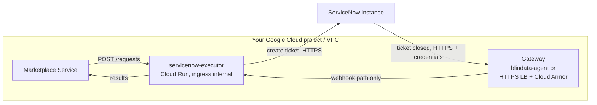

# Google Cloud Run: in depth

[Back to README](../../README.md) | [Quickstart](../platforms/cloud-run.md) | [Deployment](deployment.md)

## Overview

Cloud Run is the reference serverless platform for the executor. It runs the published Docker image as is: no code change and no Kubernetes cluster, and it scales to zero when there is no traffic. This page explains how to deploy it, which settings are mandatory and why, how to let ServiceNow call it back through a gateway, and how to check that everything works. The other supported platforms are listed in [Deployment](deployment.md).

The [quickstart](../platforms/cloud-run.md) has the ready-to-run version of these commands. This page explains them, and covers the options the quickstart leaves out.



- The **Marketplace Service** calls the executor directly, from inside your network. It never goes through the gateway.
- **ServiceNow** calls the executor back only through the **gateway**, which authenticates it and forwards only the webhook path.
- The executor calls **ServiceNow** (internet egress) and the **Marketplace Service**.

## Contents

- [Settings that matter](#settings-that-matter)
- [Deploy step by step](#deploy-step-by-step)
- [Declarative alternative: service.yaml](#declarative-alternative-serviceyaml)
- [Expose the callback through a gateway](#expose-the-callback-through-a-gateway)
- [Register with the Marketplace Service](#register-with-the-marketplace-service)
- [Verify](#verify)
- [Day 2 operations](#day-2-operations)
- [Other serverless platforms](#other-serverless-platforms)
- [Troubleshooting on Cloud Run](#troubleshooting-on-cloud-run)

## Settings that matter

| Setting | Value | Why |
|:--|:--|:--|
| CPU allocation | `--no-cpu-throttling` (CPU always allocated, instance-based billing) | **Mandatory.** The executor answers the Marketplace Service with `202` and opens the ticket afterwards, on a background thread pool. With the default request-based billing, Cloud Run throttles the CPU as soon as the response is sent, so the ticket creation stalls and the request never gets its `PENDING` result |
| Scaling | `--min-instances=0 --max-instances=3` | Scale to zero (default). See [Scale to zero and the idle window](#scale-to-zero-and-the-idle-window). Use `--min-instances=1` to avoid cold starts. The executor is stateless, so more instances are safe |
| Resources | `--memory=512Mi --cpu=1` | The image is a native executable: this is enough |
| Port | `--port=9019` | The container listens on `9019`. It does not read Cloud Run's `PORT` variable |
| Image | Docker Hub or Artifact Registry, pinned version | Cloud Run pulls from Artifact Registry and Docker Hub, not from `ghcr.io` directly. See [step 1](#1-choose-the-image) |
| Ticket profiles | `application.yml` stored in Secret Manager, mounted as a file | Cloud Run has no ConfigMap. A secret volume is the simplest way to mount a file. Point `QUARKUS_CONFIG_LOCATIONS` at it |
| Credentials | Secret Manager, as environment variables, pinned versions | A new secret version is picked up only by a new revision, so pinning makes changes explicit |
| Service account | dedicated, `roles/secretmanager.secretAccessor` on its secrets only | Least privilege. The executor calls no Google API |
| Ingress | `--ingress=internal` (or `internal-and-cloud-load-balancing` with [gateway option B](#option-b-external-https-load-balancer-and-cloud-armor)) | **Network isolation is a hard requirement**: the executor endpoints have no authentication of their own. The ingress setting is what replaces a Kubernetes `NetworkPolicy` |
| Invoker check | `--no-invoker-iam-check` | The Marketplace Service sends no credentials, so Cloud Run IAM authentication cannot be used. Isolation comes from the ingress setting |

### Scale to zero and the idle window

With CPU always allocated, Cloud Run does not stop an instance as soon as a request ends: it usually keeps an idle instance for several minutes (up to about 15) before shutting it down. That is not a documented guarantee, but it is far longer than the few seconds the executor needs to open the ticket and post `PENDING` after the `202`. So:

- `--min-instances=0` is supported: the instance stays alive for the background work, then goes away. The next request pays a cold start, which is short because the image is a native executable, and the Marketplace Service does not time out.
- `--min-instances=1` keeps one instance warm: no cold start, but one instance is billed all the time.
- `--no-cpu-throttling` stays mandatory in both cases. Scale to zero is about *when* an instance is removed; CPU throttling is about whether a living instance can work after the response.

The general rule and its known limit are in [Deployment](deployment.md#known-limit-scale-in-during-background-work).

### Ingress and network isolation

With `--ingress=internal`, Cloud Run accepts only traffic that it considers internal: requests from VPC networks of the same project, from a Shared VPC the service is attached to, or from inside the same VPC Service Controls perimeter. The exact rules are in the Cloud Run *ingress* documentation: verify them for your setup. Everything else gets `404`.

- Anything in those networks can call the executor. Keep them limited to the Marketplace Service and the gateway, and use firewall rules where you can.
- A caller that is **itself a Cloud Run service** (for example a Marketplace Service on Cloud Run) must use Direct VPC egress with `--vpc-egress=all-traffic`. Otherwise its calls to `*.run.app` leave through the internet and are refused.
- VMs and GKE nodes **without an external IP** need *Private Google Access* on their subnet to reach `*.run.app`.
- `--no-invoker-iam-check` is preferable to `--allow-unauthenticated`: the organisation policy *Domain restricted sharing* often forbids granting the invoker role to `allUsers`. On an older gcloud without the flag, use `--allow-unauthenticated`.

### Egress

The default egress reaches the internet, so the executor reaches the ServiceNow instance without anything else. If you route all egress through a VPC, add **Cloud NAT**, and a static IP if your ServiceNow instance allow-lists caller IPs.

## Deploy step by step

The commands use `PROJECT_ID`, `REGION=europe-west1` and the service name `servicenow-executor`.

### 0. Prerequisites

- `gcloud` installed and logged in, and a project with billing.
- ServiceNow prepared as in your [scenario page](../../README.md#1-pick-your-scenario) (integration user, OAuth application, objects).
- Your ticket profiles in `config/application.yml`, copied from your scenario page.

```bash
export PROJECT_ID=my-project
export REGION=europe-west1
gcloud config set project $PROJECT_ID

gcloud services enable run.googleapis.com secretmanager.googleapis.com \
  artifactregistry.googleapis.com compute.googleapis.com
```

### 1. Choose the image

**Option A: Docker Hub, directly.**

```
docker.io/opendatamesh/odm-platform-adapter-marketplace-executor-servicenow:<version>
```

**Option B: Artifact Registry remote repository (recommended for production).** It caches Docker Hub inside your project, so deployments do not depend on Docker Hub availability or pull limits.

```bash
gcloud artifacts repositories create dockerhub-remote \
  --repository-format=docker --mode=remote-repository \
  --remote-docker-repo=DOCKER-HUB --location=$REGION

# image to use
# $REGION-docker.pkg.dev/$PROJECT_ID/dockerhub-remote/opendatamesh/odm-platform-adapter-marketplace-executor-servicenow:<version>
```

Always pin a released version (for example `1.0.2`), never `latest`.

### 2. Create the service account

```bash
gcloud iam service-accounts create servicenow-executor \
  --display-name="ODM marketplace executor for ServiceNow"
export SA=servicenow-executor@$PROJECT_ID.iam.gserviceaccount.com
```

### 3. Store the credentials

For OAuth client credentials (the default):

```bash
printf '%s' "<oauth client id>"     | gcloud secrets create sn-client-id     --data-file=-
printf '%s' "<oauth client secret>" | gcloud secrets create sn-client-secret --data-file=-
```

For an API key instead, create `sn-api-key` the same way and, in step 5, pass `SERVICENOW_AUTH_TYPE=API_KEY` and `SERVICENOW_API_KEY=sn-api-key:1`.

### 4. Store the ticket profiles

```bash
gcloud secrets create servicenow-executor-profiles --data-file=config/application.yml

for s in sn-client-id sn-client-secret servicenow-executor-profiles; do
  gcloud secrets add-iam-policy-binding $s \
    --member=serviceAccount:$SA --role=roles/secretmanager.secretAccessor
done
```

### 5. Deploy

```bash
gcloud run deploy servicenow-executor \
  --region=$REGION \
  --image=docker.io/opendatamesh/odm-platform-adapter-marketplace-executor-servicenow:<version> \
  --service-account=$SA \
  --port=9019 \
  --cpu=1 --memory=512Mi \
  --no-cpu-throttling \
  --min-instances=0 --max-instances=3 \
  --ingress=internal \
  --no-invoker-iam-check \
  --set-env-vars=SERVICENOW_INSTANCE_URL=https://acme.service-now.com,ODM_PRODUCT_PLANE_MARKETPLACE_SERVICE_ADDRESS=http://marketplace.internal:8085,QUARKUS_CONFIG_LOCATIONS=/etc/executor/application.yml \
  --set-secrets=SERVICENOW_CLIENT_ID=sn-client-id:1,SERVICENOW_CLIENT_SECRET=sn-client-secret:1,/etc/executor/application.yml=servicenow-executor-profiles:1
```

- `ODM_PRODUCT_PLANE_MARKETPLACE_SERVICE_ADDRESS` is the Marketplace Service address **as seen from the executor**. If it is only reachable inside the VPC, give the executor Direct VPC egress (`--network=... --subnet=... --vpc-egress=private-ranges-only`).
- Add `SERVICENOW_MESSAGES_INCLUDE_CLOSING_USER=false` to `--set-env-vars` to keep the closing user out of marketplace messages ([Privacy](message-templates.md#privacy)).
- Add any variable your profiles reference.
- Use `--ingress=internal-and-cloud-load-balancing` if you choose [gateway option B](#option-b-external-https-load-balancer-and-cloud-armor).

### 6. Get the URL and check the start

```bash
gcloud run services describe servicenow-executor --region=$REGION --format='value(status.url)'
# -> https://servicenow-executor-abc123xyz-ew.a.run.app

gcloud run services logs read servicenow-executor --region=$REGION --limit=50
```

The executor **refuses to start with an invalid configuration**: the numbered list of problems appears in the logs (also in Cloud Logging) and the new revision never becomes ready. Fix the profiles or variables and deploy again. See [Troubleshooting](troubleshooting.md#the-executor-does-not-start).

## Declarative alternative: service.yaml

The same service as a file you can keep in version control and apply with `gcloud run services replace service.yaml --region=$REGION`:

```yaml
apiVersion: serving.knative.dev/v1
kind: Service
metadata:
  name: servicenow-executor
  annotations:
    run.googleapis.com/ingress: internal                 # or internal-and-cloud-load-balancing
    run.googleapis.com/invoker-iam-disabled: "true"      # same as --no-invoker-iam-check
spec:
  template:
    metadata:
      annotations:
        run.googleapis.com/cpu-throttling: "false"       # CPU always allocated: mandatory
        autoscaling.knative.dev/minScale: "0"            # "1" keeps one instance warm
        autoscaling.knative.dev/maxScale: "3"
    spec:
      serviceAccountName: servicenow-executor@PROJECT_ID.iam.gserviceaccount.com
      containers:
        - image: docker.io/opendatamesh/odm-platform-adapter-marketplace-executor-servicenow:<version>
          ports:
            - containerPort: 9019
          resources:
            limits:
              cpu: "1"
              memory: 512Mi
          env:
            - name: SERVICENOW_INSTANCE_URL
              value: https://acme.service-now.com
            - name: ODM_PRODUCT_PLANE_MARKETPLACE_SERVICE_ADDRESS
              value: http://marketplace.internal:8085
            - name: QUARKUS_CONFIG_LOCATIONS
              value: /etc/executor/application.yml
            - name: SERVICENOW_CLIENT_ID
              valueFrom:
                secretKeyRef:
                  name: sn-client-id
                  key: "1"                               # secret version
            - name: SERVICENOW_CLIENT_SECRET
              valueFrom:
                secretKeyRef:
                  name: sn-client-secret
                  key: "1"
          volumeMounts:
            - name: profiles
              mountPath: /etc/executor
      volumes:
        - name: profiles
          secret:
            secretName: servicenow-executor-profiles
            items:
              - key: "1"                                 # secret version
                path: application.yml
```

Verify the annotation names on your gcloud release (`gcloud run services describe servicenow-executor --format=export` prints the current service in this format).

## Expose the callback through a gateway

ServiceNow is SaaS and must call the webhook from the internet, but the executor accepts only internal traffic and has no authentication of its own. A gateway closes the gap: it authenticates ServiceNow and forwards **only** `POST /api/v1/up/marketplace-executor/webhooks/servicenow/ticket-events`. The general requirements are in [Securing the webhook](servicenow-setup.md#5-securing-the-webhook). On Google Cloud, choose one of the options below.

### Option A: blindata-agent (recommended)

The ready-made option, which also supports OAuth 2.0 (Microsoft Entra ID) for ServiceNow.

1. Run blindata-agent in the same VPC (a Compute Engine VM or GKE), reachable from ServiceNow over HTTPS (for example behind your existing HTTPS load balancer or ingress).
2. In the ODM proxy configuration, point the `marketplace-executor` key at the executor's Cloud Run URL: https, no port.

   ```json
   {
     "servicesURLs": {
       "marketplace-executor": "https://servicenow-executor-abc123xyz-ew.a.run.app"
     }
   }
   ```

   The agent sets the `Host` header to the target host, which is what Cloud Run needs to route the call. The agent's own traffic must count as internal (see [Ingress and network isolation](#ingress-and-network-isolation)).
3. Create the ServiceNow identity with `MARKETPLACE_EDITOR` only, and run the smoke test, as described in [Option B: blindata-agent](servicenow-setup.md#option-b-blindata-agent).

The URL ServiceNow calls is then:

```
https://<agent-host>/agent-api/v1/odm/proxy/<configUuid>/marketplace-executor/api/v1/up/marketplace-executor/webhooks/servicenow/ticket-events
```

### Option B: external HTTPS load balancer and Cloud Armor

Your own gateway built from Google Cloud parts: a global external Application Load Balancer sends traffic to the executor through a serverless NEG, and a Cloud Armor policy lets through only `POST` calls to the webhook path that carry a shared secret header. The executor must be deployed with `--ingress=internal-and-cloud-load-balancing`, so that it accepts the load balancer and still refuses direct internet calls.

```bash
# the shared secret ServiceNow will send in the x-gateway-key header
export GATEWAY_KEY=$(openssl rand -hex 32)
export HOOK_DOMAIN=snow-hook.acme.com

# 1. serverless NEG and backend service
gcloud compute network-endpoint-groups create servicenow-executor-neg \
  --region=$REGION --network-endpoint-type=serverless \
  --cloud-run-service=servicenow-executor
gcloud compute backend-services create servicenow-executor-backend \
  --global --load-balancing-scheme=EXTERNAL_MANAGED
gcloud compute backend-services add-backend servicenow-executor-backend \
  --global --network-endpoint-group=servicenow-executor-neg \
  --network-endpoint-group-region=$REGION

# 2. Cloud Armor: deny everything, allow only the webhook with the secret
gcloud compute security-policies create servicenow-webhook-policy
gcloud compute security-policies rules update 2147483647 \
  --security-policy=servicenow-webhook-policy --action=deny-403
gcloud compute security-policies rules create 1000 \
  --security-policy=servicenow-webhook-policy --action=allow \
  --expression="request.method == 'POST' && request.path == '/api/v1/up/marketplace-executor/webhooks/servicenow/ticket-events' && request.headers['x-gateway-key'] == '$GATEWAY_KEY'"
gcloud compute backend-services update servicenow-executor-backend \
  --global --security-policy=servicenow-webhook-policy

# 3. URL map, certificate, HTTPS proxy, IP and forwarding rule
gcloud compute url-maps create servicenow-executor-lb \
  --default-service=servicenow-executor-backend
gcloud compute ssl-certificates create servicenow-executor-cert \
  --global --domains=$HOOK_DOMAIN
gcloud compute target-https-proxies create servicenow-executor-proxy \
  --url-map=servicenow-executor-lb --ssl-certificates=servicenow-executor-cert
gcloud compute addresses create servicenow-executor-ip --global
gcloud compute forwarding-rules create servicenow-executor-https \
  --global --load-balancing-scheme=EXTERNAL_MANAGED \
  --address=servicenow-executor-ip --target-https-proxy=servicenow-executor-proxy --ports=443

gcloud compute addresses describe servicenow-executor-ip --global --format='value(address)'
# create a DNS A record HOOK_DOMAIN -> this address; the managed certificate becomes active after that
```

- To also allow-list ServiceNow's egress addresses, append `&& inIpRange(origin.ip, '<servicenow egress range>')` to the expression (one `inIpRange` per range, joined with `||` inside parentheses).
- The URL ServiceNow calls is `https://snow-hook.acme.com/api/v1/up/marketplace-executor/webhooks/servicenow/ticket-events`, with the header `x-gateway-key: <GATEWAY_KEY>`.
- Every other path or method, notably `POST .../requests`, is answered `403` by Cloud Armor.

Limits of this option:

- The shared secret lives in the Cloud Armor rule, readable by whoever can read security policies in the project. To rotate it, update rule `1000` and the ServiceNow property `gateway_api_key` together.
- The `x-gateway-key` header is forwarded to the executor, which ignores it and never logs it. Keep it out of any load balancer log field you add.
- Cloud Armor compares a fixed value: it cannot validate OAuth tokens. If you need OAuth, use [blindata-agent](#option-a-blindata-agent-recommended) or an API gateway that validates tokens.

Smoke test (harmless: an unknown UUID is acknowledged and ignored):

```bash
curl -i -X POST "https://$HOOK_DOMAIN/api/v1/up/marketplace-executor/webhooks/servicenow/ticket-events" \
  -H "Content-Type: application/json" -H "x-gateway-key: $GATEWAY_KEY" \
  -d '{"correlationId":"00000000-0000-0000-0000-000000000000","fields":{"state":"7"}}'
# -> 200 {"outcome":"IGNORED","reason":"UNKNOWN_REQUEST"}
# without the header, or on any other path: 403
```

## Register with the Marketplace Service

Add the executor to the Marketplace Service configuration with its Cloud Run URL: https, no `:9019`.

```yaml
odm:
  utility-plane:
    marketplace-executors:
      - name: SERVICENOW
        address: https://servicenow-executor-abc123xyz-ew.a.run.app
        active: true
```

The Marketplace Service must reach that URL as internal traffic (see [Ingress and network isolation](#ingress-and-network-isolation)). Restart it if it does not reload configuration.

## Verify

1. **Ingress works.** From outside your VPC (your laptop), a direct call must be refused:

   ```bash
   curl -i https://servicenow-executor-abc123xyz-ew.a.run.app/api-docs
   # -> 404 (or 403): the service is not reachable from the internet
   ```

2. **The executor answers inside the VPC.** From a VM in the VPC (for example with `gcloud compute ssh`):

   ```bash
   curl -i -X POST "https://servicenow-executor-abc123xyz-ew.a.run.app/api/v1/up/marketplace-executor/webhooks/servicenow/ticket-events" \
     -H "Content-Type: application/json" \
     -d '{"correlationId":"00000000-0000-0000-0000-000000000000","fields":{"state":"7"}}'
   # -> 200 {"outcome":"IGNORED","reason":"UNKNOWN_REQUEST"}
   ```

   Swagger UI is at `<url>/swagger-ui`, reachable only from inside the VPC.
3. **The gateway works.** Run the smoke test of the gateway option you chose.
4. **End to end.** Follow the *Test end to end* step of the [quickstart](../platforms/cloud-run.md#4-test-end-to-end).

## Day 2 operations

| Task | How |
|:--|:--|
| Upgrade the executor | `gcloud run deploy servicenow-executor --region=$REGION --image=<image>:<new version>`: the other settings are kept |
| Change the ticket profiles | `gcloud secrets versions add servicenow-executor-profiles --data-file=config/application.yml`, then `gcloud run services update servicenow-executor --region=$REGION --update-secrets=/etc/executor/application.yml=servicenow-executor-profiles:<new version>`. An invalid file keeps the previous revision serving |
| Rotate the ServiceNow secret | Generate it in ServiceNow ([Rotating secrets](servicenow-setup.md#rotating-secrets)), `gcloud secrets versions add sn-client-secret --data-file=-`, then `--update-secrets=SERVICENOW_CLIENT_SECRET=sn-client-secret:<new version>` |
| Read the logs of a request | In Cloud Logging, filter `resource.type="cloud_run_revision" AND resource.labels.service_name="servicenow-executor"` and search for the request UUID or the ticket number ([log lines](troubleshooting.md#logs)) |
| Roll back | `gcloud run services update-traffic servicenow-executor --region=$REGION --to-revisions=<previous revision>=100` |

**Cost.** With instance-based billing you pay for the whole life of an instance, including the idle window after the last request. With `--min-instances=0` (the default here) an executor that receives a few requests a day costs a few instance-minutes per burst of activity. With `--min-instances=1`, one instance is billed all the time.

## Other serverless platforms

The executor also runs on Knative, the KEDA HTTP add-on and Azure Container Apps. **AWS Lambda, AWS App Runner and Cloud Run with request-based billing are not supported**: they freeze or throttle the runtime once the HTTP response is sent, so the ticket creation that starts after the `202` would stall or be lost. The full comparison is in [Deployment](deployment.md).

## Troubleshooting on Cloud Run

| Symptom | Likely cause |
|:--|:--|
| The new revision never becomes ready | The executor refused its configuration (numbered list in the logs), or the service account cannot read a secret (`Permission denied on secret` in the deployment error) |
| `202` from the executor, but no ticket and no `PENDING` | CPU throttling is on. Check `run.googleapis.com/cpu-throttling: "false"` with `gcloud run services describe` |
| `404` when the Marketplace Service or the agent calls the run.app URL | Its traffic is not internal: Cloud Run caller without `--vpc-egress=all-traffic`, VM without Private Google Access, or a network outside the project |
| `403` from the load balancer | The Cloud Armor rule refused the call: wrong `x-gateway-key`, wrong path or method, or the IP is not in the allow-list |
| `ERROR` "Unable to obtain a ServiceNow OAuth token" or a connection error | Egress: with all traffic routed through the VPC, add Cloud NAT. With IP allow-listing on ServiceNow, use a static NAT address |
| `403` with the Cloud Run "Forbidden" page | The invoker check is on: redeploy with `--no-invoker-iam-check` |

More in [Troubleshooting](troubleshooting.md).

---
[Back to README](../../README.md) | [Build, run locally and release](build-and-run.md) | [ServiceNow setup](servicenow-setup.md)
