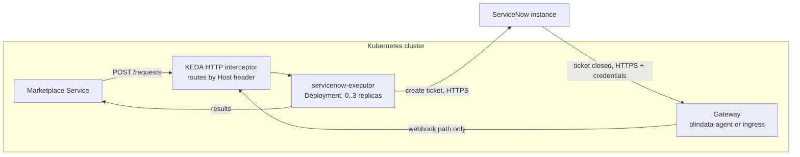

# KEDA HTTP add-on: in depth

[Back to README](../../README.md) | [Quickstart](../platforms/keda-http.md) | [Deployment](deployment.md)

## Overview

The [KEDA](https://keda.sh/) HTTP add-on scales an ordinary Kubernetes `Deployment` to zero when it receives no HTTP traffic and back up on the first request. Kubernetes never throttles a running pod, and the add-on scales a deployment in only after a configurable idle period, so the ticket creation that the executor runs after its `202` completes normally. See [Deployment](deployment.md) for the general rule.

Choose this over [Knative](deploy-knative.md) when you already run KEDA, or want to keep plain `Deployment` and `Service` objects.

The [quickstart](../platforms/keda-http.md) has the ready-to-run version of the commands below. This page explains them, and covers the options the quickstart leaves out.



Prerequisites: KEDA and the KEDA HTTP add-on installed (for example with their Helm charts, in the namespace `keda`), `kubectl` access to the namespace, ServiceNow prepared as in your [scenario page](../../README.md#1-pick-your-scenario), and the ticket profiles in `config/application.yml`.

## Contents

- [How traffic reaches the executor](#how-traffic-reaches-the-executor)
- [Settings that matter](#settings-that-matter)
- [Deploy step by step](#deploy-step-by-step)
- [Network policy](#network-policy)
- [Expose the callback through a gateway](#expose-the-callback-through-a-gateway)
- [Register with the Marketplace Service](#register-with-the-marketplace-service)
- [Verify](#verify)
- [Troubleshooting with KEDA](#troubleshooting-with-keda)

## How traffic reaches the executor

A deployment scaled to zero has no pod to answer, so callers must not call the executor's `Service` directly. Every call goes through the add-on **interceptor** (the service `keda-add-ons-http-interceptor-proxy` in the `keda` namespace, port `8080`). The interceptor holds the request, asks KEDA to start a pod, and forwards the request when the pod is ready. It also counts requests, which is how KEDA knows the executor is busy.

The interceptor serves many applications and picks the target from the **`Host` header**, which must be one of the `hosts` of the executor's `HTTPScaledObject`. The Marketplace Service and the gateway send the host of the URL they call, so the simplest arrangement is a name that points at the interceptor:

- an `ExternalName` Service `servicenow-executor-scaled` in the executor's namespace, resolving to the interceptor;
- callers use `http://servicenow-executor-scaled.odm.svc.cluster.local:8080`;
- the `HTTPScaledObject` lists `servicenow-executor-scaled.odm.svc.cluster.local` in `hosts`.

Callers that follow the URL send `Host: servicenow-executor-scaled.odm.svc.cluster.local:8080` (with the port); blindata-agent sends the host without the port. Verify how your add-on version matches a `Host` that carries a port, and list both forms in `hosts` if needed. An alternative is an internal `Ingress` that routes a host name to the interceptor.

## Settings that matter

| Setting | Value | Why |
|:--|:--|:--|
| Replicas | `replicas.min: 0`, `replicas.max: 3` | Scale to zero, a few replicas at most. The executor is stateless |
| Idle period | `scaledownPeriod: 300` | **Keeps the deployment up for 5 minutes after the last request**, so the background ticket creation finishes before scale-in |
| Routing | `hosts`, `scaleTargetRef.service`, `scaleTargetRef.port: 9019` | The interceptor forwards matching hosts to the executor's `Service` on `9019` |
| Termination | `terminationGracePeriodSeconds: 30` | Time a pod gets after `SIGTERM` |
| Ticket profiles | ConfigMap mounted at `/etc/executor`, `QUARKUS_CONFIG_LOCATIONS=/etc/executor/application.yml` | The profiles are not secret |
| Credentials | Kubernetes Secret, as environment variables | Never in the ConfigMap or the image |

The field names of `HTTPScaledObject` have changed between add-on releases: verify them for your add-on version (`kubectl explain httpscaledobject.spec`).

## Deploy step by step

The commands use the namespace `odm`.

### 1. Credentials and profiles

```bash
kubectl -n odm create secret generic servicenow-executor-credentials \
  --from-literal=SERVICENOW_CLIENT_ID='<oauth client id>' \
  --from-literal=SERVICENOW_CLIENT_SECRET='<oauth client secret>'

kubectl -n odm create configmap servicenow-executor-profiles \
  --from-file=application.yml=config/application.yml
```

For an API key, put `SERVICENOW_API_KEY` in the secret and add `SERVICENOW_AUTH_TYPE=API_KEY` to the environment below.

### 2. Deployment, Service, ExternalName and HTTPScaledObject

`servicenow-executor.yaml`:

```yaml
apiVersion: apps/v1
kind: Deployment
metadata:
  name: servicenow-executor
  namespace: odm
spec:
  selector:
    matchLabels:
      app: servicenow-executor
  template:
    metadata:
      labels:
        app: servicenow-executor
    spec:
      terminationGracePeriodSeconds: 30
      containers:
        - name: executor
          image: docker.io/opendatamesh/odm-platform-adapter-marketplace-executor-servicenow:<version>
          ports:
            - containerPort: 9019
          resources:
            requests:
              cpu: 250m
              memory: 256Mi
            limits:
              memory: 512Mi
          env:
            - name: SERVICENOW_INSTANCE_URL
              value: https://acme.service-now.com
            - name: ODM_PRODUCT_PLANE_MARKETPLACE_SERVICE_ADDRESS
              value: http://marketplace-service.odm.svc.cluster.local:8085
            - name: QUARKUS_CONFIG_LOCATIONS
              value: /etc/executor/application.yml
          envFrom:
            - secretRef:
                name: servicenow-executor-credentials
          volumeMounts:
            - name: profiles
              mountPath: /etc/executor
              readOnly: true
      volumes:
        - name: profiles
          configMap:
            name: servicenow-executor-profiles
---
apiVersion: v1
kind: Service
metadata:
  name: servicenow-executor              # the real backend, called only by the interceptor
  namespace: odm
spec:
  selector:
    app: servicenow-executor
  ports:
    - port: 9019
      targetPort: 9019
---
apiVersion: v1
kind: Service
metadata:
  name: servicenow-executor-scaled       # the name callers use
  namespace: odm
spec:
  type: ExternalName
  externalName: keda-add-ons-http-interceptor-proxy.keda.svc.cluster.local
---
apiVersion: http.keda.sh/v1alpha1
kind: HTTPScaledObject
metadata:
  name: servicenow-executor
  namespace: odm
spec:
  hosts:
    - servicenow-executor-scaled.odm.svc.cluster.local
  scaleTargetRef:
    name: servicenow-executor
    kind: Deployment
    apiVersion: apps/v1
    service: servicenow-executor
    port: 9019
  replicas:
    min: 0
    max: 3
  scaledownPeriod: 300
```

Add any variable your profiles reference, and `SERVICENOW_MESSAGES_INCLUDE_CLOSING_USER=false` to keep the closing user out of marketplace messages ([Privacy](message-templates.md#privacy)).

### 3. Apply and check

```bash
kubectl apply -f servicenow-executor.yaml
kubectl -n odm get httpscaledobject servicenow-executor
kubectl -n odm get deployment servicenow-executor     # READY 0/0 when idle
```

The first request starts a pod. If it does not become ready, read its logs: the executor **refuses to start with an invalid configuration** and prints a numbered list of problems ([Troubleshooting](troubleshooting.md#the-executor-does-not-start)).

```bash
kubectl -n odm logs deployment/servicenow-executor
```

## Network policy

All traffic reaches the executor pods from the interceptor, so a `NetworkPolicy` on the executor pods admits only the `keda` namespace:

```yaml
apiVersion: networking.k8s.io/v1
kind: NetworkPolicy
metadata:
  name: servicenow-executor-ingress
  namespace: odm
spec:
  podSelector:
    matchLabels:
      app: servicenow-executor
  policyTypes: [Ingress]
  ingress:
    - from:
        - namespaceSelector:
            matchLabels:
              kubernetes.io/metadata.name: keda
```

The interceptor is shared: anything that can reach it and sends the executor's host name reaches the executor. **Restrict access to the interceptor** (a `NetworkPolicy` in the `keda` namespace that admits only the Marketplace Service, the gateway and your other scaled applications' callers), and never expose the interceptor outside the cluster. Verify the namespace and labels of your installation.

## Expose the callback through a gateway

ServiceNow must call the webhook from outside the cluster. The gateway authenticates ServiceNow and forwards only `POST /api/v1/up/marketplace-executor/webhooks/servicenow/ticket-events`, through the interceptor. Requirements: [Securing the webhook](servicenow-setup.md#5-securing-the-webhook).

- **blindata-agent (recommended).** Run it in the cluster and expose it to ServiceNow over HTTPS through your ingress. Set the `marketplace-executor` key to the interceptor-routed address:

  ```json
  {
    "servicesURLs": {
      "marketplace-executor": "http://servicenow-executor-scaled.odm.svc.cluster.local:8080"
    }
  }
  ```

  The agent sets the `Host` header to the target host (without the port), which must be listed in `hosts`. Then create the ServiceNow identity and run the smoke test of [Option B: blindata-agent](servicenow-setup.md#option-b-blindata-agent).
- **Your own gateway.** An ingress controller or API gateway with authentication, exposed over HTTPS, with a single route: `POST` on the webhook path, forwarded to the interceptor with a `Host` listed in `hosts`. See [Option A](servicenow-setup.md#option-a-your-own-authenticating-gateway).

## Register with the Marketplace Service

Use the interceptor-routed address, never the backend `Service`:

```yaml
odm:
  utility-plane:
    marketplace-executors:
      - name: SERVICENOW
        address: http://servicenow-executor-scaled.odm.svc.cluster.local:8080
        active: true
```

Restart the Marketplace Service if it does not reload configuration.

## Verify

1. **Scale from zero.** With the deployment at `0/0`, send the harmless smoke test (an unknown UUID is acknowledged and ignored) and watch a pod start:

   ```bash
   kubectl -n odm get pods -l app=servicenow-executor -w &
   kubectl -n odm run curl --rm -it --image=curlimages/curl --restart=Never -- \
     curl -s -X POST http://servicenow-executor-scaled.odm.svc.cluster.local:8080/api/v1/up/marketplace-executor/webhooks/servicenow/ticket-events \
     -H "Content-Type: application/json" \
     -d '{"correlationId":"00000000-0000-0000-0000-000000000000","fields":{"state":"7"}}'
   # -> {"outcome":"IGNORED","reason":"UNKNOWN_REQUEST"}
   ```

   The pod stays for the `scaledownPeriod`, then the deployment returns to `0/0`. If a network policy blocks the test pod, run it with the labels of an allowed caller.
2. **The gateway works.** Run the smoke test of the gateway you chose.
3. **End to end.** Follow the *Test end to end* step of the [quickstart](../platforms/keda-http.md#4-test-end-to-end).

## Troubleshooting with KEDA

| Symptom | Likely cause |
|:--|:--|
| `404` from the interceptor | The `Host` header is not in `hosts` (for example sent with the port while `hosts` lists it without) |
| The request hangs, then times out | The pod cannot start or become ready: check `kubectl describe pod` and the executor logs (startup validation) |
| `202` from the executor, but no ticket and no `PENDING` | The deployment was scaled in before the background work finished: check `scaledownPeriod` |
| The deployment never scales to zero | Some caller polls the executor through the interceptor, or `replicas.min` is not `0` |
| Callers reach the executor without going through the interceptor | They use the backend `Service` name: register the `-scaled` address instead |
| `ERROR` "Unable to obtain a ServiceNow OAuth token" or a connection error | Egress from the cluster to the ServiceNow instance is blocked |

More in [Troubleshooting](troubleshooting.md).

---
[Back to README](../../README.md) | [Deployment](deployment.md) | [ServiceNow setup](servicenow-setup.md)
