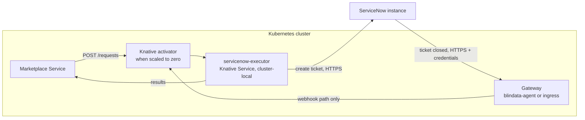

# Knative Serving: in depth

[Back to README](../../README.md) | [Quickstart](../platforms/knative.md) | [Deployment](deployment.md)

## Overview

Knative Serving runs the published image on any Kubernetes cluster (GKE, EKS, AKS or on-premises) and scales it to zero when there is no traffic. Kubernetes never throttles a running pod, so the ticket creation that the executor runs after its `202` completes normally. The only setting that matters for that is how long a pod stays alive after its last request. See [Deployment](deployment.md) for the general rule.

The [quickstart](../platforms/knative.md) has the ready-to-run version of the commands below. This page explains them, and covers the options the quickstart leaves out.



Prerequisites: Knative Serving installed with a networking layer (Kourier or Istio), `kubectl` access to the namespace, ServiceNow prepared as in your [scenario page](../../README.md#1-pick-your-scenario), and the ticket profiles in `config/application.yml`.

## Contents

- [Settings that matter](#settings-that-matter)
- [Deploy step by step](#deploy-step-by-step)
- [Network policy](#network-policy)
- [Expose the callback through a gateway](#expose-the-callback-through-a-gateway)
- [Register with the Marketplace Service](#register-with-the-marketplace-service)
- [Verify](#verify)
- [Troubleshooting on Knative](#troubleshooting-on-knative)

## Settings that matter

| Setting | Value | Why |
|:--|:--|:--|
| Scale to zero | `autoscaling.knative.dev/min-scale: "0"` | No pod when there is no traffic. Use `"1"` to avoid cold starts |
| Pod retention | `autoscaling.knative.dev/scale-to-zero-pod-retention-period: "5m"` | **Keeps the last pod for 5 minutes after its last request**, so the background ticket creation finishes before scale-in. Verify that your Knative version supports this annotation; otherwise raise `scale-to-zero-grace-period` in the `config-autoscaler` ConfigMap of `knative-serving` |
| Maximum scale | `autoscaling.knative.dev/max-scale: "3"` | The executor is stateless, so several pods are safe |
| Visibility | label `networking.knative.dev/visibility: cluster-local` | **Network isolation is a hard requirement**: the service gets no external route, only the cluster-internal address |
| Port | `containerPort: 9019`, `name: http1` | The container listens on `9019`; Knative routes to it |
| Ticket profiles | ConfigMap mounted at `/etc/executor`, `QUARKUS_CONFIG_LOCATIONS=/etc/executor/application.yml` | The profiles are not secret, a ConfigMap is enough |
| Credentials | Kubernetes Secret, as environment variables | Never in the ConfigMap or the image |
| Request timeout | `timeoutSeconds: 120` | Covers the slowest webhook call (Marketplace lookups and result delivery with retries). Knative also derives the pod's termination grace period from it: verify on your version |

## Deploy step by step

The commands use the namespace `odm`.

### 1. Credentials and profiles

```bash
kubectl -n odm create secret generic servicenow-executor-credentials \
  --from-literal=SERVICENOW_CLIENT_ID='<oauth client id>' \
  --from-literal=SERVICENOW_CLIENT_SECRET='<oauth client secret>'

kubectl -n odm create configmap servicenow-executor-profiles \
  --from-file=application.yml=config/application.yml
```

For an API key, put `SERVICENOW_API_KEY` in the secret and add `SERVICENOW_AUTH_TYPE=API_KEY` to the environment below.

### 2. The Knative Service

`servicenow-executor.yaml`:

```yaml
apiVersion: serving.knative.dev/v1
kind: Service
metadata:
  name: servicenow-executor
  namespace: odm
  labels:
    networking.knative.dev/visibility: cluster-local      # no external route
spec:
  template:
    metadata:
      annotations:
        autoscaling.knative.dev/min-scale: "0"
        autoscaling.knative.dev/max-scale: "3"
        autoscaling.knative.dev/scale-to-zero-pod-retention-period: "5m"
    spec:
      timeoutSeconds: 120
      containers:
        - image: docker.io/opendatamesh/odm-platform-adapter-marketplace-executor-servicenow:<version>
          ports:
            - name: http1
              containerPort: 9019
          resources:
            requests:
              cpu: 250m
              memory: 256Mi
            limits:
              memory: 512Mi
          env:
            - name: SERVICENOW_INSTANCE_URL
              value: https://acme.service-now.com
            - name: ODM_PRODUCT_PLANE_MARKETPLACE_SERVICE_ADDRESS
              value: http://marketplace-service.odm.svc.cluster.local:8085
            - name: QUARKUS_CONFIG_LOCATIONS
              value: /etc/executor/application.yml
          envFrom:
            - secretRef:
                name: servicenow-executor-credentials
          volumeMounts:
            - name: profiles
              mountPath: /etc/executor
              readOnly: true
      volumes:
        - name: profiles
          configMap:
            name: servicenow-executor-profiles
```

Add any variable your profiles reference, and `SERVICENOW_MESSAGES_INCLUDE_CLOSING_USER=false` to keep the closing user out of marketplace messages ([Privacy](message-templates.md#privacy)).

### 3. Apply and check

```bash
kubectl apply -f servicenow-executor.yaml
kubectl -n odm get ksvc servicenow-executor
# NAME                  URL                                                      READY
# servicenow-executor   http://servicenow-executor.odm.svc.cluster.local         True
```

The internal address is `http://servicenow-executor.odm.svc.cluster.local` (port 80, Knative routes to `9019`).

If `READY` stays `False`, read the logs: the executor **refuses to start with an invalid configuration** and prints a numbered list of problems ([Troubleshooting](troubleshooting.md#the-executor-does-not-start)).

```bash
kubectl -n odm logs -l serving.knative.dev/service=servicenow-executor -c user-container
```

## Network policy

The executor must be reachable only by the Marketplace Service and the gateway. With Knative, a request does not always come straight from the caller:

- when the service is scaled to zero, the request goes through the **activator** (namespace `knative-serving`), which starts a pod and forwards the request;
- requests come in through the networking layer (Kourier in `kourier-system`, or the Istio gateway in `istio-system`);
- every pod has a **queue-proxy** sidecar in front of the container.

A `NetworkPolicy` on the executor pods must therefore admit the Knative system namespaces as well as the Marketplace Service and the gateway. Restrict who reaches the cluster-local address itself at the source (the callers' namespaces) or with your service mesh. Verify the namespace names and labels for your networking layer.

```yaml
apiVersion: networking.k8s.io/v1
kind: NetworkPolicy
metadata:
  name: servicenow-executor-ingress
  namespace: odm
spec:
  podSelector:
    matchLabels:
      serving.knative.dev/service: servicenow-executor
  policyTypes: [Ingress]
  ingress:
    - from:
        - namespaceSelector:
            matchLabels:
              kubernetes.io/metadata.name: knative-serving
        - namespaceSelector:
            matchLabels:
              kubernetes.io/metadata.name: kourier-system   # or istio-system
        - podSelector:
            matchLabels:
              app: marketplace-service                      # your Marketplace Service pods
        - podSelector:
            matchLabels:
              app: blindata-agent                           # your gateway pods
```

## Expose the callback through a gateway

ServiceNow must call the webhook from outside the cluster, while the executor has only a cluster-local address. The gateway authenticates ServiceNow and forwards only `POST /api/v1/up/marketplace-executor/webhooks/servicenow/ticket-events`. Requirements: [Securing the webhook](servicenow-setup.md#5-securing-the-webhook).

- **blindata-agent (recommended).** Run it in the cluster and expose it to ServiceNow over HTTPS through your ingress. Set the `marketplace-executor` key to the cluster-local address:

  ```json
  {
    "servicesURLs": {
      "marketplace-executor": "http://servicenow-executor.odm.svc.cluster.local"
    }
  }
  ```

  The agent sets the `Host` header to the target host, which is what Knative uses for routing. Then create the ServiceNow identity and run the smoke test of [Option B: blindata-agent](servicenow-setup.md#option-b-blindata-agent).
- **Your own gateway.** An ingress controller or API gateway with authentication (API key, mTLS, OAuth), exposed over HTTPS, with a single route: `POST` on the webhook path, forwarded to the cluster-local address (with that `Host` header). Every other path and method must be refused. See [Option A](servicenow-setup.md#option-a-your-own-authenticating-gateway).

## Register with the Marketplace Service

```yaml
odm:
  utility-plane:
    marketplace-executors:
      - name: SERVICENOW
        address: http://servicenow-executor.odm.svc.cluster.local
        active: true
```

No port: Knative listens on 80 and routes to `9019`. Restart the Marketplace Service if it does not reload configuration.

## Verify

1. **The executor answers inside the cluster** (harmless: an unknown UUID is acknowledged and ignored):

   ```bash
   kubectl -n odm run curl --rm -it --image=curlimages/curl --restart=Never -- \
     curl -s -X POST http://servicenow-executor.odm.svc.cluster.local/api/v1/up/marketplace-executor/webhooks/servicenow/ticket-events \
     -H "Content-Type: application/json" \
     -d '{"correlationId":"00000000-0000-0000-0000-000000000000","fields":{"state":"7"}}'
   # -> {"outcome":"IGNORED","reason":"UNKNOWN_REQUEST"}
   ```

   If a network policy blocks the test pod, run it with the labels of an allowed caller.
2. **Scale to zero works.** Watch the pods: one starts for the request above, stays for the retention period, then disappears.

   ```bash
   kubectl -n odm get pods -l serving.knative.dev/service=servicenow-executor -w
   ```

3. **The gateway works.** Run the smoke test of the gateway you chose.
4. **End to end.** Follow the *Test end to end* step of the [quickstart](../platforms/knative.md#4-test-end-to-end). The executor log must show `Opened ServiceNow ticket ...` even when the pod was started by that request.

## Troubleshooting on Knative

| Symptom | Likely cause |
|:--|:--|
| `READY False`, revision failed | The executor refused its configuration (numbered list in the logs), or the secret or ConfigMap is missing |
| `202` from the executor, but no ticket and no `PENDING`, and the pod disappeared right after | The pod was removed before the background work finished: check the retention annotation (or the global `scale-to-zero-grace-period`) |
| Calls time out or hang during a cold start | The activator cannot reach the pod: a `NetworkPolicy` does not admit `knative-serving` |
| `404` from the Knative gateway | Wrong `Host` header or URL: the caller must use the cluster-local name |
| Reachable from outside the cluster | The `cluster-local` visibility label is missing |
| `ERROR` "Unable to obtain a ServiceNow OAuth token" or a connection error | Egress from the cluster to the ServiceNow instance is blocked (egress policy, proxy, firewall) |

More in [Troubleshooting](troubleshooting.md).

---
[Back to README](../../README.md) | [Deployment](deployment.md) | [ServiceNow setup](servicenow-setup.md)
