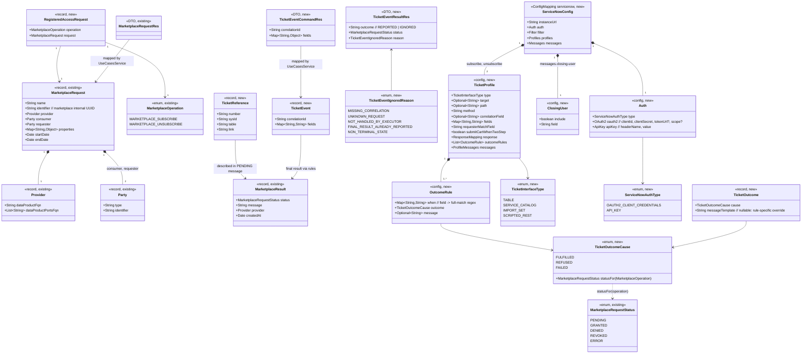

# ServiceNow Marketplace Executor — ticket-driven fulfilment of ODM marketplace access requests

> Base package below is abbreviated as `{base}` = `org.opendatamesh.platform.adapter.marketplace.executor.starter` (kept as-is, see Safeguards).
> Source analysis: `spdd/analysis/BDMD-5340-202610161110-[Analysis]-servicenow-marketplace-executor.md`.

## Requirements

1. Turn the stateless marketplace executor starter into a **ServiceNow executor** that fulfils every ODM marketplace access request (`MARKETPLACE_SUBSCRIBE`, `MARKETPLACE_UNSUBSCRIBE`) by **opening a ServiceNow ticket** and reports the operation result **when the ticket is completed on ServiceNow**, so that data product access follows the organisation's ServiceNow processes.
2. Let operators adapt the executor to their ServiceNow practices **through configuration only**:
   - choose, per operation, the **creation interface**: Table API, Service Catalog API, Import Set API or Scripted REST API
   - choose the **target**: table, catalog item, staging table or endpoint
   - choose the **ticket content**: a field map of Qute templates
   - choose where the **marketplace request UUID** is stored
   - define how ticket states translate into outcomes
   - define the **descriptive result messages**
3. Report a two-phase result:
   - `PENDING` with the ticket reference once the ticket is opened, or `ERROR` if it cannot be opened
   - then exactly one **final** status driven by the ServiceNow webhook, respecting the operation taxonomy. **No partial grants**, and the **first final status wins**.
4. Handle only the requests matching a configurable **regex-based request filter**. Decline the others with a non-2xx answer, so several executors can coexist behind the Marketplace Service. Exclusive filters are the operating rule.
5. Authenticate every outbound ServiceNow call with the **best-practice mechanism**: **OAuth 2.0 client credentials** by default, with a **static API key** as the alternative mode.
   - Place Service Catalog orders **on behalf of the marketplace requester**.
   - Rely on the **blindata-agent proxy** for webhook authentication: the executor does no inbound auth. The agent-side `marketplace-executor` auth filter is delivered by the companion canvas `blindata-agent/spdd/prompt/BDMD-5340-202610161527-[Feat]-filter-odm-marketplace-executor-auth.md`.
   - blindata-agent is a hard prerequisite. Standalone deployments must bring their own gateway.
6. Make the **inclusion of the ServiceNow closing user** in result messages configurable (included by default).
7. Ship a **README** that explains how to configure the executor, ServiceNow and the agent route, with **one basic scenario (base config) per creation interface**.
8. Out of scope:
   - automatic revoke on `endDate`
   - the Blindata-direct mode (blindata-api webhooks ↔ executor)
   - polling and reconciliation
   - changes to the marketplace server
   - stripping credential headers in the agent forwarder

## Entities



Status taxonomy (`TicketOutcomeCause.statusFor`), the single source of truth:

| Cause | `MARKETPLACE_SUBSCRIBE` | `MARKETPLACE_UNSUBSCRIBE` |
|---|---|---|
| FULFILLED | GRANTED | REVOKED |
| REFUSED | DENIED | ERROR (refusal message) |
| FAILED | ERROR | ERROR |

Outcome rules declare a **cause**, never a status. That makes it impossible to configure a status outside an operation's allowed set.

## Approach

1. **Workflow redesign (two legs, stateless)**:
   - **Outbound leg**:
     - `POST /api/v1/up/marketplace-executor/requests`
     - The use case validates the invariants, then evaluates the **request filter** synchronously. A non-matching request raises `RequestNotHandledException` (409), which the Marketplace Service counts as "not handled".
     - A matching request gets `202`. Asynchronously, the executor opens the ticket through the operation profile's creation interface, then reports `PENDING` (best effort) or `ERROR`.
   - **Inbound leg**:
     - ServiceNow sends `POST /api/v1/up/marketplace-executor/webhooks/servicenow/ticket-events` through the blindata-agent proxy, with a fixed executor-defined contract: `{correlationId, fields{…}}`.
     - The use case:
       1. looks up the access request in the Marketplace Service (`GET /requests/{uuid}`), the authoritative source of operation, provider and all ports
       2. re-applies the filter
       3. checks first-final-wins (`GET /executor-responses?accessRequestUuid=`)
       4. evaluates the ordered outcome rules → cause → status
       5. composes the message
       6. posts the final result **synchronously**, propagating failures as 500 so ServiceNow can retry
     - Every "ignore" case returns `200` with `IGNORED` and a reason.
   - **No executor state**: the ticket carries the correlation UUID, and the Marketplace Service holds request data and result history.
2. **ServiceNow integration**:
   - **Authentication** follows ServiceNow's machine-to-machine guidance and is resolved once in a dedicated `RestUtils` bean (qualifier `@ServiceNowApi`) produced by `ServiceNowRestUtilsProducer` from the existing `RestUtilsFactory.getAuthenticatedRestUtils(httpClient, objectMapper, headers, oauth2)`:
     - `OAUTH2_CLIENT_CREDENTIALS` (default; ServiceNow inbound client credentials, Washington DC+). An `Oauth2` with `grantType=client_credentials`, `clientId`, `clientSecret`, optional `scope`, and `url = auth.oauth2.token-url` or `{instanceUrl}/oauth_token.do`. The existing `AuthenticatedRestUtilsTemplate` requests, caches (until `expires_in`) and attaches `Authorization: Bearer`.
     - `API_KEY` (alternative). A connection header `{auth.api-key.header-name}: {auth.api-key.value}`, default header `x-sn-apikey`, with no OAuth2.
     - `ServiceNowClient` therefore never handles credentials. It adds only `Content-Type` and `Accept: application/json`.
   - **Requester resolution** (Service Catalog): before ordering, the executor resolves the marketplace requester to a `sys_user` sys_id:
     - `GET /api/now/table/sys_user?sysparm_query={match-field}={requester identifier}&sysparm_fields=sys_id&sysparm_limit=1`, where `requester-match-field` defaults to `email`.
     - The result is sent as `sysparm_requested_for`.
     - A requester whose type is not `user`, or who is not found, fails ticket creation, which reports `ERROR`.
   - **Typed interface kinds** (strategy pattern): one `TicketCreator` per `TicketInterfaceType`, each with built-in defaults that the profile can override:

   | Type | Endpoint | Body envelope | Default correlation target | Default reference extraction (JSON Pointer) |
   |---|---|---|---|---|
   | TABLE | `POST /api/now/table/{target}` | rendered fields + correlation field | field `correlation_id` | number `/result/number`, sysId `/result/sys_id`, table = `target` |
   | SERVICE_CATALOG | `POST /api/sn_sc/servicecatalog/items/{target}/order_now`. If the response holds `/result/cart_id` and no request number, and `submitCartWhenTwoStep`, then `POST /api/sn_sc/servicecatalog/cart/submit_order` | `{sysparm_quantity:"1", sysparm_requested_for:<resolved requester sys_id>, variables:{rendered fields + correlation}}` | variable `marketplace_request_id` | number `/result/request_number` (fallback `/result/number`), sysId `/result/request_id` (fallback `/result/sys_id`), table `sc_request` |
   | IMPORT_SET | `POST /api/now/import/{target}` | rendered fields + correlation column | column `u_marketplace_request_id` | `/result/0/status` must not be `error` or `ignored` (otherwise fail with `/result/0/error_message` or `/result/0/status_message`); number `/result/0/display_value`, sysId `/result/0/sys_id`, table `/result/0/table` |
   | SCRIPTED_REST | `{method} {path}` (path is required) | rendered fields + correlation field | field `correlation_id` | `response.number-pointer` and `response.sys-id-pointer` are **required**; table from `response.table-pointer` or `response.table` (optional) |

   - The correlation entry is **always injected by the executor** after rendering, so templates cannot omit or override it.
   - Ticket link: `{instanceUrl}/{table}.do?sys_id={sysId}`, or empty when the table or sysId is unknown.
   - These ServiceNow product facts were checked against ServiceNow documentation and community sources:
     - inbound client credentials since Washington DC, off by default and enabled by a system property, plus the OAuth Application User
     - API key header and access policy
     - Import Set response `result[]` with `status`, `sys_id`, `table`, `display_value`
     - Catalog two-step checkout returning a `cart_id`

     Response shapes are **overridable** through pointers, because they vary by release and configuration.
   - **Request filter** criteria are **regular expressions**, compiled once and matched with `Pattern.matcher(value).matches()` (full match). Case sensitivity is under user control, for example with `(?i)`.
   - **Closing user**: `servicenow.messages.closing-user.include` (default `true`) and `.field` (default `closed_by`).
     - When included, templates get `ticket.closedBy`.
     - When excluded, `ticket.closedBy` is absent **and** the closing-user field is removed from the `fields` map exposed to templates, so no template can leak it.
3. **Configuration and templating**:
   - Typed `@ConfigMapping(prefix = "servicenow")`, YAML plus env overrides.
   - Templates use **Quarkus Qute**, parsed at runtime through the injected `io.quarkus.qute.Engine`.
   - The data model is **maps and lists only** (native-safe): `request.*`, `operation`, `ticket.*`, `fields.*`, `error.message`.
   - Template values may be inline, or `file:/path` to load an external file at startup.
   - Qute is configured with `strict-rendering=false` and `property-not-found-strategy=noop`, so missing data renders empty. There is no HTML escaping: parsed templates have no content-type variant.
   - **Startup validation** (`ServiceNowConfigValidator`, observing `StartupEvent`) fails fast on any of these:
     - unparsable templates
     - missing required interface settings
     - a field named like the correlation target
     - a profile with no FULFILLED rule
     - invalid rule or filter regexes
     - a blank instance URL
     - missing credentials for the selected auth type
4. **Business logic placement** (hexagonal, per `spdd/norms/USE_CASE_IMPLEMENTATION.md`):
   - **Policy lives in the use cases**:
     - filter → decline
     - PENDING is best effort, ERROR on open failure
     - the ignore reasons
     - first-final-wins
     - cause → status taxonomy
     - final post must succeed
   - **Mechanics live in `@ApplicationScoped` core services** reached through plain port impls:
     - regex matching
     - Qute rendering
     - JSON Pointer extraction
     - per-interface payloads
     - retry and back-off
     - marketplace JSON mapping
   - The starter's `MarketplaceAccessOutboundPort` (grant and revoke, then immediate GRANTED or REVOKED) is **replaced** by a ticket port, because its semantics are wrong for ServiceNow.
5. **Reliability and error handling**:
   - `MarketplaceServiceClient.sendResult` replaces the hard-coded `Thread.sleep(2000)` with a **bounded retry**: `result-delivery.max-attempts` (default 5) with `result-delivery.backoff` (default 1s) on 404, 5xx and I/O errors. 404 is retried because of the commit race inside the marketplace transaction. After that it throws `InternalException`.
   - ServiceNow 401 and 403 errors, and OAuth token-request failures (an `IllegalStateException` from `AuthenticatedRestUtilsTemplate`), are turned into a technical-error message. It names the auth type, OAuth application, integration user roles or access policy, and never any secret.
   - All HTTP errors are mapped by the existing `ResponseExceptionMapper` (`ErrorResponse` body).
6. **Security model**:
   - The webhook endpoint has no executor-side auth. It must be reachable only through blindata-agent (network isolation), and the README states this as a hard requirement. Standalone ODM deployments must place their own authenticating gateway in front of it.
   - The agent route is authorized by the new blindata-agent `marketplace-executor` filter (companion canvas): MARKETPLACE_EDITOR is needed for `POST` on the shared webhooks namespace `…/api/v1/up/marketplace-executor/webhooks/**` (which holds `…/webhooks/servicenow/ticket-events`), and everything else is denied. `DATAOPS_ADMIN` must not be used for the ServiceNow identity.
   - The agent forwards **all** caller headers, including `X-BD-User` and `X-BD-ApiKey`, to the executor. The executor must **never log request headers** and never echo them.
   - ServiceNow secrets (`SERVICENOW_CLIENT_ID`, `SERVICENOW_CLIENT_SECRET`, or `SERVICENOW_API_KEY`) come from env or mounted secrets and are never logged.

## Structure

### Inheritance Relationships
1. `UseCase` (existing) is implemented by `ProcessMarketplaceRequest` (reworked) and `CompleteTicket` (new). Both are package-private.
2. `UseCasePresenter` (existing) is extended by `CompleteTicketPresenter` (new).
3. `OdmApiException` (existing) is extended by `RequestNotHandledException` (new, `CONFLICT`, `getErrorName()` = `"RequestNotHandledException"`).
4. `TicketCreator` (new interface: `TicketInterfaceType type()`, `TicketReference create(TicketProfile, Map<String,Object> templateData, String correlationId)`) is implemented by `TableApiTicketCreator`, `ServiceCatalogTicketCreator`, `ImportSetTicketCreator` and `ScriptedRestTicketCreator` (all `@ApplicationScoped`).
5. Port interfaces and their plain `*OutboundPortImpl` classes:
   - processrequest:
     - `RequestFilterOutboundPort`
     - `ServiceNowTicketOutboundPort`
     - `ResultMessageOutboundPort`
     - `MarketplaceResultOutboundPort` (existing, kept)
     - `AsyncExecutionOutboundPort` (existing, kept)
   - completeticket:
     - `CompleteTicketMarketplaceOutboundPort`
     - `CompleteTicketFilterOutboundPort`
     - `TicketOutcomeOutboundPort`
     - `CompleteTicketMessageOutboundPort`

### Dependencies
1. `MarketplaceExecutorUseCaseResource` (existing) depends on `MarketplaceExecutorUseCasesService.processRequest`.
2. `ServiceNowTicketEventUseCaseResource` (new) depends on `MarketplaceExecutorUseCasesService.processTicketEvent`.
3. `MarketplaceExecutorUseCasesService` depends on `ProcessMarketplaceRequestFactory`, `CompleteTicketFactory` and `ObjectMapper` (to serialize non-scalar webhook field values).
4. `ProcessMarketplaceRequestFactory` injects these and wires the port impls with `new`:
   - `RequestFilterService`
   - `ServiceNowTicketService`
   - `ResultMessageService`
   - `MarketplaceServiceClient`
   - `AsyncExecutorService`
5. `CompleteTicketFactory` injects these and wires the port impls with `new`:
   - `MarketplaceServiceClient`
   - `RequestFilterService`
   - `OutcomeRulesService`
   - `ResultMessageService`
6. Core service dependencies:
   - `ServiceNowTicketService` depends on `ServiceNowConfig`, `TicketTemplateRenderer` and `Instance<TicketCreator>`.
   - Each `TicketCreator` depends on `ServiceNowClient`, `TicketTemplateRenderer` and `ServiceNowConfig`.
   - `ServiceNowClient` depends on `@ServiceNowApi RestUtils` (produced by `ServiceNowRestUtilsProducer` from `ServiceNowConfig`, `ObjectMapper` and `RestUtilsFactory.getAuthenticatedRestUtils`) and on `ServiceNowConfig`.
   - `ServiceCatalogTicketCreator` additionally uses `ServiceNowClient.get` for requester resolution.
   - `MarketplaceServiceClient` depends on `RestUtils`, `MarketplaceServiceConfig` and `ObjectMapper`.
   - `RequestFilterService` depends on `ServiceNowConfig`.
   - `OutcomeRulesService` depends on `ServiceNowConfig`.
   - `ResultMessageService` depends on `ServiceNowConfig`, `TicketTemplateRenderer` and `ServiceNowClient` (only for `ticketLink`).
   - `TicketTemplateRenderer` depends on Qute `Engine`.
   - `ServiceNowConfigValidator` depends on `ServiceNowConfig`, `RequestFilterService`, `OutcomeRulesService` and `TicketTemplateRenderer`.
   - `MarketplaceServiceClient` owns the `MarketplaceResult` → `MarketplaceResponseRes` mapping (private methods). The former `MarketplaceResourceMapper` in the use-case package was removed.

### Layered Architecture
1. **HTTP layer** (`{base}.rest`, `{base}.resources`): thin JAX-RS resources plus `*Res` DTOs with OpenAPI. The existing `ResponseExceptionMapper` produces the uniform `ErrorResponse`.
2. **Application layer** (`{base}.marketplace.services`): `MarketplaceExecutorUseCasesService` maps `*Res` ↔ domain commands and presenter results ↔ `*ResultRes`.
3. **Use case layer**:
   - `{base}.marketplace.services.usecases.processrequest` (reworked)
   - `{base}.marketplace.services.usecases.completeticket` (new)

   It holds commands, presenters, ports, plain port impls, and the single `@ApplicationScoped` factory per slice.
4. **Domain layer** (`{base}.marketplace.domain`): existing records and enums plus `RegisteredAccessRequest`, `TicketReference`, `TicketEvent`, `TicketOutcomeCause`, `TicketOutcome` and `TicketEventIgnoredReason`.
5. **Core / infrastructure layer** (`{base}.servicenow.services.core`, new):
   - `ServiceNowClient`
   - `ServiceNowTicketService`
   - the `TicketCreator` strategies
   - `TicketTemplateRenderer`
   - `RequestFilterService`
   - `OutcomeRulesService`
   - `ResultMessageService`

   `{base}.marketplace.services.core.MarketplaceServiceClient` is also new.
6. **Configuration layer** (`{base}.config`):
   - `ServiceNowConfig` (new)
   - `TicketInterfaceType` and `ServiceNowAuthType` (new, kept with the config because they are config values)
   - `ServiceNowApi` qualifier and `ServiceNowRestUtilsProducer` (new)
   - `MarketplaceServiceConfig` (extended)
   - `ServiceNowConfigValidator` (new)
   - `RestUtilsProducer` (existing)
7. **Exception layer** (`{base}.exceptions`): the existing `OdmApiException` hierarchy plus `RequestNotHandledException`.

## Operations

> Execute in order. Each task lists its completion criterion.

### 1. Update build — `pom.xml`
1. Change `artifactId` to `odm-platform-adapter-marketplace-executor-servicenow`, `name` to `ODM Platform Adapter Marketplace Executor ServiceNow`, and `description` to `ODM Marketplace Executor that fulfils access requests through ServiceNow tickets`.
2. Add the dependency `io.quarkus:quarkus-qute`, with the version managed by the BOM.
3. Leave `template.yaml` and the Java base package untouched.
4. Done when `./mvnw -q compile` succeeds.

### 2. Create Exception — `RequestNotHandledException` (`{base}.exceptions`)
1. `public class RequestNotHandledException extends OdmApiException`: constructors `(String message)` and `(String message, Throwable cause)`. `getErrorName()` returns `getClass().getSimpleName()`. `getStatus()` returns `Response.Status.CONFLICT`.
2. Usage: thrown synchronously by `ProcessMarketplaceRequest` when the request filter does not accept a request.

### 3. Create Domain Types (`{base}.marketplace.domain`)
1. `public record RegisteredAccessRequest(MarketplaceOperation operation, MarketplaceRequest request)`.
2. `public record TicketReference(String number, String sysId, String table, String link)`.
3. `public record TicketEvent(String correlationId, Map<String, String> fields)`: the compact constructor replaces a null `fields` with `Map.of()` and wraps it in `Map.copyOf`.
4. `public enum TicketOutcomeCause { FULFILLED, REFUSED, FAILED; public MarketplaceRequestStatus statusFor(MarketplaceOperation operation) }`
   - Logic: implement the taxonomy table in **Entities** with a `switch` on `operation`, then on `this`.
   - It never returns `PENDING`.
5. `public record TicketOutcome(TicketOutcomeCause cause, String messageTemplate)`: `messageTemplate` is nullable.
6. `public enum TicketEventIgnoredReason { MISSING_CORRELATION, UNKNOWN_REQUEST, NOT_HANDLED_BY_EXECUTOR, FINAL_RESULT_ALREADY_REPORTED, NON_TERMINAL_STATE }`.
7. Keep all existing domain types unchanged.

### 4. Create/Update Configuration (`{base}.config`)
1. `public enum TicketInterfaceType { TABLE, SERVICE_CATALOG, IMPORT_SET, SCRIPTED_REST }` and `public enum ServiceNowAuthType { OAUTH2_CLIENT_CREDENTIALS, API_KEY }`.
2. `@ConfigMapping(prefix = "servicenow") public interface ServiceNowConfig`. Nested interfaces:
   - `String instanceUrl()`
   - `Auth auth()`:
     - `@WithDefault("OAUTH2_CLIENT_CREDENTIALS") ServiceNowAuthType type()`
     - `OAuth2 oauth2()`: `Optional<String> clientId()`, `Optional<String> clientSecret()`, `Optional<String> tokenUrl()` (default computed as `instanceUrl + "/oauth_token.do"`), `Optional<String> scope()`
     - `ApiKey apiKey()`: `@WithDefault("x-sn-apikey") String headerName()`, `Optional<String> value()`
   - `Filter filter()`. Each criterion is an `Optional<List<String>>` of **regular expressions** (full match), and an absent criterion means "match all":
     - `operations()`
     - `providerDataProductFqns()`
     - `portFqns()`
     - `consumerTypes()`
     - `consumerIdentifiers()`
     - `requesterIdentifiers()`
     - plus `Map<String, String> properties()` (property key → regex)
   - `Profiles profiles()`: `TicketProfile subscribe()` and `TicketProfile unsubscribe()`, plus `default TicketProfile forOperation(MarketplaceOperation op)`.
   - `TicketProfile`:
     - `TicketInterfaceType type()`
     - `Optional<String> target()`
     - `Optional<String> path()`
     - `@WithDefault("POST") String method()`
     - `Optional<String> correlationField()`
     - `Map<String, String> fields()`
     - `@WithDefault("email") String requesterMatchField()` (SERVICE_CATALOG only: the `sys_user` field compared with the requester identifier)
     - `@WithDefault("true") boolean submitCartWhenTwoStep()`
     - `ResponseMapping response()`
     - `List<OutcomeRule> outcomeRules()`
     - `ProfileMessages messages()`
   - `ResponseMapping`: `Optional<String> numberPointer()`, `sysIdPointer()`, `tablePointer()` and `table()`.
   - `OutcomeRule`: `Map<String, String> when()`, `TicketOutcomeCause outcome()`, `Optional<String> message()`.
   - `ProfileMessages`: `Optional<String>` for `pending()`, `fulfilled()`, `refused()`, `failed()` and `technicalError()`.
   - `Messages` (global defaults, all `@WithDefault` using the default templates in task 11): `pending()`, `fulfilled()`, `refused()`, `failed()`, `technicalError()`, plus `ClosingUser closingUser()` with `@WithDefault("true") boolean include()` and `@WithDefault("closed_by") String field()`.
3. Extend `MarketplaceServiceConfig` with `ResultDelivery resultDelivery()`, which has `@WithDefault("5") int maxAttempts()` and `@WithDefault("1s") Duration backoff()`.
4. Done when the application starts with the `application.yml` from task 11.

### 5. Implement Core Service — `TicketTemplateRenderer` (`{base}.servicenow.services.core`, `@ApplicationScoped`)
1. Dependency: `io.quarkus.qute.Engine engine` (constructor injection).
2. Attributes: `ConcurrentMap<String, Template> cache`.
3. Methods:
   - `String render(String templateSource, Map<String, Object> data)`
     - Logic: `resolveSource(templateSource)`, where a value starting with `file:` is read from the filesystem path. Then `cache.computeIfAbsent(source, engine::parse)` and `template.data(data).render()`.
     - Exception handling: wrap `TemplateException` or `IOException` in `InternalException("Unable to render template: " + cause)`.
   - `void verify(String templateSource)`: resolve and parse only. It throws `InternalException` with the template excerpt (max 80 chars) on failure. Used by the startup validator.
   - `Map<String, Object> requestData(MarketplaceOperation operation, MarketplaceRequest request)`
     - Logic: build nested `LinkedHashMap`s:
       - `request` → `identifier`, `name`, `operation` (enum name), `startDate`, `endDate` (ISO-8601 instant strings, or `""` when null), `properties` (map or empty map)
       - `request.provider` → `dataProductFqn`, `dataProductPortsFqn` (list)
       - `request.consumer` and `request.requester` → `type`, `identifier`
     - Returns `Map.of("request", requestMap, "operation", operation.name())`, as a mutable copy so callers can add `ticket`, `fields`, `error` and `outcome`.

### 6a. Create Authenticated Client Producer — `ServiceNowApi` + `ServiceNowRestUtilsProducer` (`{base}.config`)
1. `@Qualifier @Retention(RUNTIME) @Target({METHOD, FIELD, PARAMETER, TYPE}) public @interface ServiceNowApi {}`.
2. `public class ServiceNowRestUtilsProducer`: `@Produces @ApplicationScoped @ServiceNowApi RestUtils serviceNowRestUtils(ServiceNowConfig config, ObjectMapper objectMapper)`.
   - Logic: `RestUtilsFactory.getAuthenticatedRestUtils(HttpClient.newBuilder().connectTimeout(Duration.ofSeconds(60)).build(), objectMapper, connectionHeaders(config), oauth2(config))`.
     - `OAUTH2_CLIENT_CREDENTIALS`: `connectionHeaders = List.of()`, and `oauth2 = new Oauth2(tokenUrl, "client_credentials", scope or null, clientId, clientSecret, null, null)`, where `tokenUrl = config.auth().oauth2().tokenUrl().orElse(stripTrailingSlash(instanceUrl) + "/oauth_token.do")`.
     - `API_KEY`: `connectionHeaders = List.of(new HttpHeader(apiKey.headerName(), apiKey.value().orElseThrow()))`, and `oauth2 = null`.
3. The existing unqualified `RestUtils` from `RestUtilsProducer` stays dedicated to the Marketplace Service.
4. Verify in a unit test that the token request omits `scope` when it is not configured. If `AuthenticatedRestUtilsTemplate` sends `scope=null`, fix the shared-secret request builder there to skip null values. It is the only change allowed in the template's client package.
   - *Implemented:* `Oauth2` has no all-arguments constructor, so the producer builds it with `setUrl`, `setGrantType`, `setScope`, `setClientId` and `setClientSecret`.
   - The shared-secret builder in `AuthenticatedRestUtilsTemplate` now skips `scope` when it is null or blank; before the fix it sent `scope=`.
   - `ServiceNowRestUtilsProducerTest` checks the token URL, `grant_type=client_credentials`, that `scope` is absent, and the Bearer header, against a local `com.sun.net.httpserver.HttpServer`.

### 6. Implement Core Service — `ServiceNowClient` (`{base}.servicenow.services.core`, `@ApplicationScoped`)
1. Dependencies: `@ServiceNowApi RestUtils restUtils`, `ServiceNowConfig config`.
2. Methods:
   - `JsonNode send(String method, String path, ObjectNode body)`
     - Logic:
       1. Build the URL as `stripTrailingSlash(config.instanceUrl()) + path`.
       2. Use the headers `[Content-Type: application/json, Accept: application/json]`. Authentication is added by the qualified `RestUtils`.
       3. `POST` maps to `restUtils.genericPost(url, headers, body, JsonNode.class)`.
       4. `PATCH` maps to `restUtils.genericPatch(url, headers, body, JsonNode.class)`.
       5. Only POST and PATCH are supported, because `RestUtils` has no identifier-less PUT. The startup validator enforces this. At runtime, any other method raises `InternalException("Unsupported ServiceNow HTTP method <method>: only POST and PATCH are supported")`.
   - `JsonNode get(String path, Map<String, String> queryParams)`
     - Logic: append URL-encoded query parameters to the URL, then call `restUtils.genericGet(url, headers, null, JsonNode.class)`.
   - Exception handling, shared by `send` and `get`:
     - `ClientException` with code 401 or 403 → `InternalException("ServiceNow rejected the integration credentials (HTTP <code>, auth type <type>): check the OAuth application / API key, the integration user roles and the API access policy for " + path)`
     - `IllegalStateException` raised while obtaining the OAuth token → `InternalException("Unable to obtain a ServiceNow OAuth token: " + e.getMessage() + ". Check client credentials and that inbound client credentials are enabled on the instance")`
     - other `ClientException` → `InternalException("ServiceNow call " + method + " " + path + " failed with HTTP " + code + ": " + truncate(responseBody, 500))`
     - `ClientResourceMappingException` → `InternalException("Unexpected ServiceNow response for " + path)`
   - Never include header values, client secrets or API keys in messages or logs.
   - `String ticketLink(String table, String sysId)`: returns `""` if either is blank, otherwise `instanceUrl + "/" + table + ".do?sys_id=" + sysId`.

### 7. Implement Ticket Creators (`{base}.servicenow.services.core`, each `@ApplicationScoped`, implements `TicketCreator`)
Shared shape. The `create(profile, data, correlationId)` body is a composed method:
1. `ObjectNode fields = renderFields(profile, data)`: each `profile.fields()` entry becomes a `TextNode` of `renderer.render(value, data)`.
2. `ObjectNode body = buildBody(profile, data, fields, correlationId)`: per interface. The correlation entry is always added last.
3. `JsonNode response = client.send(...)`.
4. `return toReference(profile, response)`: uses `JsonNode.at(pointer)`. A **blank number or sysId** raises `InternalException("ServiceNow response did not contain the ticket <number|sys_id> at <pointer>")`. With a fallback pointer chain (Catalog defaults), the message names the first pointer. The link comes from `client.ticketLink`.

As implemented:
- **Requester data:** `TicketCreator.create` receives no request object. Creators that need request data, here the Catalog requester, read it from `data["request"]` as built by `TicketTemplateRenderer.requestData`.
- **Missing target or path:** `InternalException("<Table API|Service Catalog|Import Set> profile requires a <target table|catalog item target|staging table target>")`, and for Scripted REST `"Scripted REST profile requires a path"` and `"… requires response.number-pointer"` / `"… requires response.sys-id-pointer"`.
- **Table resolution order:**
  - TABLE, SERVICE_CATALOG and SCRIPTED_REST use `response.table-pointer`, then `response.table`, then the interface default (`target`, `sc_request`, or `""`).
  - IMPORT_SET uses `response.table`, then the table pointer (default `/result/0/table`).
- Each creator keeps the `ServiceNowConfig` constructor dependency listed in **Structure**, even where it is currently unused.

Per-interface specifics (defaults from the Approach table; a profile override always wins):
- `TableApiTicketCreator`: path `/api/now/table/` + `target`; correlation field defaults to `correlation_id`; table = `response.table` or `target`.
- `ServiceCatalogTicketCreator`:
  - `resolveRequester(request, profile)` runs first:
    - The requester type must equal `user` (case-insensitive). Otherwise throw `InternalException("Catalog orders require a user requester; got <type>")`.
    - Call `client.get("/api/now/table/sys_user", Map.of("sysparm_query", profile.requesterMatchField() + "=" + requester.identifier(), "sysparm_fields", "sys_id", "sysparm_limit", "1"))`.
    - If `/result/0/sys_id` is blank, throw `InternalException("Requester <identifier> not found in ServiceNow sys_user (" + matchField + ")")`.
    - Reject identifiers containing `^`, because they would alter the encoded query: throw `InternalException`.
  - Body: `sysparm_quantity:"1"`; `sysparm_requested_for` = resolved sys_id; `variables` = fields + correlation (default `marketplace_request_id`).
  - Path: `/api/sn_sc/servicecatalog/items/{target}/order_now`.
  - If `response.at("/result/cart_id")` is present, the request number is missing, and `submitCartWhenTwoStep` is set: call `POST /api/sn_sc/servicecatalog/cart/submit_order` with `{}`, and extract from that response.
  - If the request number is missing and `submitCartWhenTwoStep` is false: throw `InternalException("Catalog order returned a cart (two-step checkout); enable submit-cart-when-two-step or disable two-step checkout")`.
  - Default pointers: number `/result/request_number` → `/result/number`; sysId `/result/request_id` → `/result/sys_id`; table `sc_request`.
- `ImportSetTicketCreator`:
  - Path: `/api/now/import/{target}`; correlation column defaults to `u_marketplace_request_id`.
  - `ensureRowTransformed(response)`: when `/result/0/status` is `error` or `ignored`, throw `InternalException("Import Set transform did not create the ticket (status <s>): " + first non-blank of /result/0/error_message, /result/0/status_message)`.
  - Default pointers: number `/result/0/display_value`; sysId `/result/0/sys_id`; table pointer `/result/0/table`.
- `ScriptedRestTicketCreator`:
  - `path` is required, and the method is `profile.method()`. The correlation field defaults to `correlation_id`.
  - `numberPointer` and `sysIdPointer` are required (validated at startup). Table comes from `tablePointer`, else `table`, else `""`.

### 8. Implement Core Service — `ServiceNowTicketService` (`{base}.servicenow.services.core`, `@ApplicationScoped`)
1. Dependencies: `ServiceNowConfig`, `TicketTemplateRenderer`, `Instance<TicketCreator> creators`. The constructor builds an `EnumMap<TicketInterfaceType, TicketCreator>`.
2. `TicketReference openTicket(MarketplaceOperation operation, MarketplaceRequest request)`
   - Logic: `profile = config.profiles().forOperation(operation)`; `data = renderer.requestData(operation, request)`; `return creators.get(profile.type()).create(profile, data, request.identifier())`.
   - Log at info: `"Opened ServiceNow ticket {number} ({table}) for request {uuid} operation {op}"`.

### 9. Implement Core Services — `RequestFilterService`, `OutcomeRulesService`, `ResultMessageService` (`{base}.servicenow.services.core`, `@ApplicationScoped`)
1. `RequestFilterService.accepts(MarketplaceOperation operation, MarketplaceRequest request): boolean`
   - Logic: every configured criterion must match (AND); within a criterion any regex may match (OR). Regexes are compiled once in the constructor with `Pattern.compile(regex)`, and a value matches when `pattern.matcher(value).matches()` (full match, case-sensitive unless the regex uses `(?i)`). A null value never matches.
   - `void verifyPatterns()`: compiles every filter regex and throws `InternalException` naming the criterion and index. Used by the startup validator.
   - The `portFqns` criterion requires **every** `request.provider().dataProductPortsFqn()` entry to match some regex. An empty port list never matches a configured port criterion.
   - A `properties` criterion matches `String.valueOf(request.properties().get(key))` against the regex; a missing key does not match.
   - No configured criteria means `true`.
   - `String describeMismatch(...)`: returns the first failing criterion name, used in the decline message. The names are `operations`, `provider-data-product-fqns`, `port-fqns`, `consumer-types`, `consumer-identifiers`, `requester-identifiers` and `properties.<key>`. It returns `""` when every criterion matches.
   - A configured but **empty** criterion list is treated as absent (match all).
2. `OutcomeRulesService`:
   - `Optional<TicketOutcome> evaluate(MarketplaceOperation operation, Map<String, String> fields)`
     - Logic: iterate `profile.outcomeRules()` in order. A rule matches when every `when` entry's field is present and its value full-matches the compiled regex (`Pattern.compile(value)`, cached). The first match returns `new TicketOutcome(rule.outcome(), rule.message().orElse(null))`.
   - `void verifyRules()`: compiles all regexes and throws `InternalException` naming the profile and rule index.
3. `ResultMessageService`:
   - `String pending(MarketplaceOperation op, MarketplaceRequest req, TicketReference ticket)`
   - `String finalOutcome(MarketplaceOperation op, MarketplaceRequest req, TicketOutcome outcome, MarketplaceRequestStatus status, Map<String, String> fields)`
   - `String technicalError(MarketplaceOperation op, MarketplaceRequest req, String errorMessage)`
   - Logic for each: build data as `renderer.requestData(...)` plus:
     - `ticket` → `number`, `sysId`, `table`, `link`, and `closedBy` **only when** `messages.closing-user.include` is true (value of `fields[closing-user.field]`). For final outcomes these come from fields `number`, `sys_id`, `table` and a link built from them.
     - `fields`: a copy of the webhook fields. When `closing-user.include` is false, the `closing-user.field` entry is **removed**.
     - `outcome` → `cause`, `status`
     - `error.message`
   - Template choice: rule message, else profile message for the cause or kind, else the global message. Causes map to `fulfilled`, `refused` and `failed`; the other kinds are `pending` and `technicalError`. Render the chosen template.
   - Trim the result and truncate it to 4000 chars.

### 10. Implement Core Service — `MarketplaceServiceClient` (`{base}.marketplace.services.core`, `@ApplicationScoped`)
1. Dependencies: `RestUtils`, `MarketplaceServiceConfig`, `ObjectMapper`.
2. Methods:
   - `Optional<RegisteredAccessRequest> findAccessRequest(String uuid)`
     - `GET {address}/api/v1/pp/marketplace/requests/{uuid}` as `JsonNode`. 404 returns `Optional.empty()`.
     - Map `operation` (`MARKETPLACE_SUBSCRIBE` or `MARKETPLACE_UNSUBSCRIBE`), `uuid` → identifier, `name`, `providerDataProductFqn`, `providerDataProductPortsFqn`, `consumerType`, `consumerIdentifier`, `requesterType`, `requesterIdentifier`, `properties` (object → `Map`), `startDate` and `endDate` into domain records.
     - Other errors become `InternalException("Marketplace Service lookup failed for request " + uuid)`.
   - `boolean hasFinalResult(String uuid)`
     - `GET {address}/api/v1/pp/marketplace/executor-responses?accessRequestUuid={urlEncoded uuid}&page=0&size=100` as `JsonNode`.
     - Returns true if any `/content/*/status` is not `PENDING`.
     - Errors become `InternalException`.
   - `void sendResult(String uuid, MarketplaceResult result)`
     - Logic: up to `resultDelivery().maxAttempts()` attempts of `POST {address}/api/v1/pp/marketplace/requests/{uuid}/results`. The body is `MarketplaceResponseRes`, mapped by private methods `toResponseRes` and `toProviderRes` at the bottom of this class. They are moved from the former `MarketplaceResourceMapper`, which is **deleted**, because it was the only `*Res` type inside the use-case package and this client is now its only user. Retry with `Thread.sleep(backoff)` on a `ClientException` with code 404 or ≥500, or on a `RuntimeException` caused by I/O. Other 4xx errors fail immediately.
     - On exhaustion, throw `InternalException("Unable to deliver result " + status + " for request " + uuid + ": " + lastError)`.
     - As implemented, there is no sleep after the last failed attempt. "I/O error" means a `RuntimeException` whose cause chain contains an `IOException`. The starter's `RestUtils` already turns `IOException` into `ClientException(500)`, which is retried as 5xx.
     - Restore the interrupt flag if interrupted.
3. Removes the `Thread.sleep(2000)` from the old `MarketplaceResultOutboundPortImpl`.

### 11. Update Configuration Files — `src/main/resources/application.yml` (+ `src/test/resources/application.yml`)
1. `quarkus.application.name: odm-platform-adapter-marketplace-executor-servicenow`. Update the OpenAPI `info-title` to `ODM Platform Adapter Marketplace Executor ServiceNow API` and `info-description` to mention ServiceNow ticket fulfilment.
2. `quarkus.qute.strict-rendering: false` and `quarkus.qute.property-not-found-strategy: noop`.
3. `odm.product-plane.marketplace-service.result-delivery.max-attempts: 5` and `backoff: 1s`.
4. `servicenow` block. Values use env placeholders:
   - `instance-url: ${SERVICENOW_INSTANCE_URL}`
   - `auth.type: OAUTH2_CLIENT_CREDENTIALS`, `auth.oauth2.client-id: ${SERVICENOW_CLIENT_ID:}`, `auth.oauth2.client-secret: ${SERVICENOW_CLIENT_SECRET:}`, `auth.api-key.value: ${SERVICENOW_API_KEY:}`
   - `messages.closing-user.include: ${SERVICENOW_MESSAGES_INCLUDE_CLOSING_USER:true}` and `messages.closing-user.field: closed_by`
   - **No ticket profiles in the packaged `src/main/resources/application.yml`.** SmallRye Config merges list entries by index and map entries by key across config sources. A real-instance test showed that packaged default `outcome-rules`/`fields` leak into an operator's external override, for example a catalog rule `state: "3"` inheriting the packaged `close_code` condition. So `servicenow.profiles.*` must be supplied **entirely** by external configuration (mounted `config/application.yml`, `QUARKUS_CONFIG_LOCATIONS`, or env). A missing profile fails startup with Quarkus's required-property error.
   - The README Table API scenario provides the following **reference TABLE/incident** subscribe and unsubscribe profiles as a ready-to-mount file, and `src/test/resources/application.yml` keeps full profiles for tests:
     - `short_description`, `description` (including the request UUID, provider, ports, consumer, requester, start and end dates) and `category` fields
     - outcome rules, aligned with the incident close codes of current releases (verified on a Zurich instance: `Solution provided`, `Workaround provided`, `Resolved by caller|change|problem|request`, `No resolution provided`, `Duplicate`, `Known error`, `User error`):
       1. `state: "6|7"` + `close_code: "(?i)(Solution provided|Workaround provided|Resolved by .*)"` → FULFILLED
       2. `state: "6|7"` + `close_code: "(?i)No resolution provided"` → REFUSED
       3. `state: "8"` (Canceled) → REFUSED
       4. `state: "6|7"` (any other close code) → FAILED. This fallback makes sure every resolved or closed incident produces a final result instead of staying `PENDING`.
   - default `messages`, all Qute templates:
     - `pending`: `ServiceNow ticket {ticket.number} opened for {operation} of {request.provider.dataProductFqn} (ports: {#each request.provider.dataProductPortsFqn}{it}{#if it_hasNext}, {/if}{/each}). Awaiting fulfilment: {ticket.link}`
     - `fulfilled`: `{outcome.status} through ServiceNow ticket {ticket.number} ({ticket.link}){#if ticket.closedBy} closed by {ticket.closedBy}{/if}.{#if fields.close_notes} Close notes: {fields.close_notes}{/if}`
     - `refused`: `Request refused on ServiceNow: ticket {ticket.number} ({ticket.link}){#if ticket.closedBy} closed by {ticket.closedBy}{/if}.{#if fields.close_notes} Reason: {fields.close_notes}{/if}` (for UNSUBSCRIBE this text is what makes the `ERROR` descriptive)
     - `failed`: `ServiceNow reported a failure on ticket {fields.number} ({ticket.link}).{#if fields.close_notes} Details: {fields.close_notes}{/if}`
     - `technical-error`: `Technical error while processing {operation} on ServiceNow: {error.message}`
5. Test resources: the same structure with `instance-url: https://test.service-now.com`, `auth.type: API_KEY` with `api-key.value: test-key` (the `@ServiceNowApi RestUtils` is mocked in tests), subscribe = TABLE `incident`, unsubscribe = IMPORT_SET `u_marketplace_revoke`, and a filter `provider-data-product-fqns: ["urn:dp:finance:.*"]`. `result-delivery.backoff` is `10ms`, to keep retry tests fast.
6. YAML keys are the kebab-case form of the `@ConfigMapping` methods, for example `messages.technical-error` maps to `technicalError()`.
7. The main `application.yml` has **no default** for `${SERVICENOW_INSTANCE_URL}`, so the service does not start without it.

### 12. Implement Startup Validation — `ServiceNowConfigValidator` (`{base}.config`, `@ApplicationScoped`)
1. Constructor dependencies: `ServiceNowConfig`, `RequestFilterService`, `OutcomeRulesService`, `TicketTemplateRenderer`.
   - `void onStart(@Observes StartupEvent event)` delegates to `public void validate()`, which is also called directly by unit tests.
   - Default correlation targets used by the field check when `correlation-field` is empty: `correlation_id` for TABLE and SCRIPTED_REST, `marketplace_request_id` for SERVICE_CATALOG, `u_marketplace_request_id` for IMPORT_SET. They match the creators.
   - An invalid filter regex fails `RequestFilterService` construction, and the validator collects that error in its problem list.

   `validate()` is a composed method with these steps:
   1. `verifyConnection()`: instance URL is a valid `https` URL (`http` allowed only when it starts with `http://localhost`). For `OAUTH2_CLIENT_CREDENTIALS`, `client-id` and `client-secret` are present and not blank; for `API_KEY`, `api-key.value` is present and not blank.
   2. For each profile: `verifyInterfaceSettings(op, profile)`:
      - target is required for TABLE, SERVICE_CATALOG and IMPORT_SET
      - path, number pointer and sysId pointer are required for SCRIPTED_REST
      - method is in {POST, PATCH}
   3. `verifyFields(op, profile)`: no field key equals the effective correlation target.
   4. `verifyRules(op, profile)`: at least one rule, at least one FULFILLED rule, and every rule has a non-empty `when`. Delegate regex compilation to `OutcomeRulesService.verifyRules()`.
   5. `verifyFilter()`: `RequestFilterService.verifyPatterns()`.
   6. `verifyTemplates()`: `renderer.verify` on every field template, rule message and profile or global message.
2. Any failure throws `IllegalStateException` with an aggregated, numbered list of problems. The application must not start.
3. Never print client secrets or API keys.

### 13. Rework Use Case — `processrequest` (`{base}.marketplace.services.usecases.processrequest`)
1. Delete `MarketplaceAccessOutboundPort` and `MarketplaceAccessOutboundPortImpl`.
2. Create these ports and plain impls (constructor-injected collaborators, package-private):
   - `RequestFilterOutboundPort { boolean isHandledByThisExecutor(MarketplaceOperation, MarketplaceRequest); String mismatchReason(MarketplaceOperation, MarketplaceRequest); }` → `RequestFilterService`
   - `ServiceNowTicketOutboundPort { TicketReference openTicket(MarketplaceOperation, MarketplaceRequest); }` → `ServiceNowTicketService`
   - `ResultMessageOutboundPort { String pendingMessage(...); String technicalErrorMessage(..., String error); }` → `ResultMessageService`
   - `MarketplaceResultOutboundPortImpl` now delegates to `MarketplaceServiceClient.sendResult`. The interface stays unchanged, and the sleep is removed.
3. `ProcessMarketplaceRequest.execute()`:
   ```
   enforceInvariants();            // unchanged rules
   declineWhenNotHandled();        // throws RequestNotHandledException("Request <uuid> is not handled by this ServiceNow executor: <reason>")
   asyncPort.runAsync(this::openTicketAndReport);
   ```
   - `openTicketAndReport()`:
     - `try { TicketReference ticket = ticketPort.openTicket(op, req); reportPending(ticket); } catch (RuntimeException e) { reportTechnicalError(e); }`
   - `reportPending(ticket)`: sends `PENDING` with `messagePort.pendingMessage`. On a `RuntimeException`, log a warning (`"PENDING result for request {} not delivered; ticket {} is open"`) and do not rethrow: it is best effort by policy.
   - `reportTechnicalError(e)`: first logs `"Unable to open ServiceNow ticket for request <uuid>: <cause>"` at error level, then sends `ERROR` with `messagePort.technicalErrorMessage(op, req, e.getMessage())`. On delivery failure it logs an error (`"ERROR result for request <uuid> not delivered"`).
   - `MarketplaceResultOutboundPortImpl` delegates to `MarketplaceServiceClient.sendResult`. It has no mapping and no sleep.
   - `result(status, message)` builds `MarketplaceResult` with `command.request().provider()` (all ports) and `new Date()`.
4. `ProcessMarketplaceRequestFactory`: inject `RequestFilterService`, `ServiceNowTicketService`, `ResultMessageService`, `MarketplaceServiceClient` and `AsyncExecutorService`, and drop the `RestUtils` and `MarketplaceServiceConfig` injections. Wire everything with `new`.

### 14. Create Use Case — `completeticket` (`{base}.marketplace.services.usecases.completeticket`)
1. `public record CompleteTicketCommand(TicketEvent event)`.
2. `public interface CompleteTicketPresenter extends UseCasePresenter { void presentReported(MarketplaceRequestStatus status); void presentIgnored(TicketEventIgnoredReason reason); }`.
3. Ports and plain impls:
   - `CompleteTicketMarketplaceOutboundPort { Optional<RegisteredAccessRequest> findAccessRequest(String uuid); boolean hasFinalResult(String uuid); void sendFinalResult(String uuid, MarketplaceResult result); }` → `MarketplaceServiceClient`
   - `CompleteTicketFilterOutboundPort { boolean isHandledByThisExecutor(MarketplaceOperation, MarketplaceRequest); }` → `RequestFilterService`
   - `TicketOutcomeOutboundPort { Optional<TicketOutcome> evaluate(MarketplaceOperation, Map<String,String> fields); }` → `OutcomeRulesService`
   - `CompleteTicketMessageOutboundPort { String finalMessage(MarketplaceOperation, MarketplaceRequest, TicketOutcome, MarketplaceRequestStatus, Map<String,String> fields); }` → `ResultMessageService`
4. `class CompleteTicket implements UseCase`, `execute()`:
   ```
   if (correlationMissing())                    → ignore(MISSING_CORRELATION)
   Optional<RegisteredAccessRequest> registered = marketplacePort.findAccessRequest(uuid)
   if (registered.isEmpty())                    → ignore(UNKNOWN_REQUEST)
   if (!filterPort.isHandledByThisExecutor(..)) → ignore(NOT_HANDLED_BY_EXECUTOR)
   if (marketplacePort.hasFinalResult(uuid))    → ignore(FINAL_RESULT_ALREADY_REPORTED)
   Optional<TicketOutcome> outcome = outcomePort.evaluate(op, fields)
   if (outcome.isEmpty())                       → ignore(NON_TERMINAL_STATE)
   reportFinalResult(registered, outcome)       // status = cause.statusFor(op); message; sendFinalResult (exceptions propagate)
   presenter.presentReported(status)
   ```
   - `ignore(reason)`: log at info (`"Ticket event for request {} ignored: {}"`) and call `presenter.presentIgnored(reason)`.
   - The final result's provider is `registered.request().provider()`, which contains **all** requested ports.
   - Exceptions from `sendFinalResult` or `findAccessRequest` propagate as `InternalException` (HTTP 500), so ServiceNow can retry.
5. `CompleteTicketFactory` (`@ApplicationScoped`): `public UseCase buildCompleteTicket(CompleteTicketCommand command, CompleteTicketPresenter presenter)`.

### 15. Update Use Cases Service — `MarketplaceExecutorUseCasesService`
1. Inject `CompleteTicketFactory` in addition to the existing factory, plus `ObjectMapper`, used by `stringify` to serialize `Map`/`Iterable` values.
2. `public TicketEventResultRes processTicketEvent(TicketEventCommandRes res)`
   - Logic: map to `new CompleteTicketCommand(new TicketEvent(trimToNull(res.getCorrelationId()), stringify(res.getFields())))`.
     - A `null` body (empty request) maps to `new TicketEvent(null, Map.of())`, so it is acknowledged as `IGNORED` / `MISSING_CORRELATION` and not answered with 500. A 500 would make ServiceNow retry forever.
     - `stringify` maps every value to `String.valueOf`, skips nulls, and serializes non-scalar values as JSON text.
   - Build a private static `TicketEventResultHolder implements CompleteTicketPresenter`, then call `factory.buildCompleteTicket(command, holder).execute()` and return `holder.toRes()`.
3. Keep `processRequest` unchanged.

### 16. Create DTOs (`{base}.resources`)
1. `TicketEventCommandRes`:
   - `@Schema(description = "Marketplace request UUID stored in the ServiceNow ticket")` `String correlationId`
   - `@Schema(description = "Ticket fields used by outcome rules and messages, e.g. state, close_code, close_notes, number, sys_id, table, closed_by")` `Map<String, Object> fields`
   - A bean with an empty constructor plus getters and setters. There is no `@NotBlank` on `correlationId`: a missing correlation is acknowledged with `IGNORED`, not rejected.
2. `TicketEventResultRes`: `String outcome` (`REPORTED` | `IGNORED`), `MarketplaceRequestStatus status` (nullable), `TicketEventIgnoredReason reason` (nullable), each with `@Schema`. The class is annotated `@JsonInclude(JsonInclude.Include.NON_NULL)`, so null `status` or `reason` are omitted from the JSON, as the README documents.

### 17. Create REST Resource — `ServiceNowTicketEventUseCaseResource` (`{base}.rest`)
1. `@Path("/api/v1/up/marketplace-executor/webhooks/servicenow")`, `@Produces(MediaType.APPLICATION_JSON)`, `@Consumes(MediaType.APPLICATION_JSON)`, `@Tag(name = "ServiceNow Ticket Events", description = "Webhook called by ServiceNow (through the blindata-agent proxy) when a ticket changes state")`.
2. `@POST @Path("/ticket-events") public TicketEventResultRes receiveTicketEvent(@RequestBody TicketEventCommandRes body)` calls `useCasesService.processTicketEvent(body)`.
3. OpenAPI responses:
   - `200`: reported or ignored, with body `TicketEventResultRes`
   - `500`: marketplace or ServiceNow processing failure, meaning ServiceNow should retry
4. Update `MarketplaceExecutorUseCaseResource` OpenAPI: add `@APIResponse(responseCode = "409", description = "Request not handled by this executor (request filter)")`.

### 18. Update Tests
1. Replace `MarketplaceExecutorUseCaseResourceTest.validSubscribeRequestIsAccepted`:
   - stub `restUtils.genericPost(contains("/api/now/table/incident"), any(), any(), eq(JsonNode.class))` to return `{"result":{"number":"INC0010001","sys_id":"abc"}}`
   - verify that the PENDING result is posted to `/requests/id-1/results`
   - the request body uses `dataProductFqn: "urn:dp:finance:sales"`
2. Add the Gherkin-mapped tests below. Each test method's Javadoc copies its Scenario verbatim, and each test class gets a comment referencing `BDMD-5340`.
3. Use `@QuarkusTest` with `@InjectMock RestUtils` for HTTP-level tests, and plain JUnit with `new` and fake ports for use case and creator unit tests. Keep the existing `*Test` suffix, because surefire only runs `*Test` and the project has no failsafe.

### High-level tests (Gherkin)

```gherkin
Feature: Open a ServiceNow ticket for a marketplace access request
  Scenario: Subscribe request opens a Table API ticket and reports PENDING
    Given the subscribe profile uses the Table API on table "incident"
    And ServiceNow answers with ticket number "INC0010001"
    When the Marketplace Service submits a MARKETPLACE_SUBSCRIBE request "id-1" for data product "urn:dp:finance:sales"
    Then the executor answers 202
    And an incident is created whose "correlation_id" is "id-1"
    And a PENDING result mentioning "INC0010001" is posted for request "id-1"

  Scenario: Unsubscribe request opens an Import Set ticket
    Given the unsubscribe profile uses the Import Set API on staging table "u_marketplace_revoke"
    When the Marketplace Service submits a MARKETPLACE_UNSUBSCRIBE request "id-2"
    Then a row is posted to "/api/now/import/u_marketplace_revoke" whose "u_marketplace_request_id" is "id-2"
    And a PENDING result is posted for request "id-2"

  Scenario: Import Set transform error is reported as ERROR
    Given the Import Set API answers with row status "error" and error message "Transform failed"
    When the Marketplace Service submits a MARKETPLACE_UNSUBSCRIBE request "id-3"
    Then an ERROR result whose message contains "Transform failed" is posted for request "id-3"

  Scenario: Service Catalog two-step checkout submits the cart
    Given the subscribe profile uses the Service Catalog API
    And order_now answers with a cart_id and no request number
    When a subscribe request "id-4" is processed
    Then the cart is submitted
    And the PENDING result references the request number returned by submit_order

  Scenario: Scripted REST response without the configured number pointer is reported as ERROR
    Given the subscribe profile uses a Scripted REST endpoint with number pointer "/result/ticket"
    And the endpoint answers without "/result/ticket"
    When a subscribe request "id-5" is processed
    Then an ERROR result explaining that the ticket number was not found is posted for request "id-5"

  Scenario: ServiceNow rejects the integration credentials
    Given ServiceNow answers 401 to ticket creation
    When a subscribe request "id-6" is processed
    Then an ERROR result mentioning the integration credentials and access policy is posted for request "id-6"
    And no secret value appears in the message

  Scenario: OAuth token cannot be obtained
    Given the OAuth token endpoint rejects the client credentials
    When a subscribe request "id-7" is processed
    Then an ERROR result explaining that a ServiceNow OAuth token could not be obtained is posted for request "id-7"

  Scenario: OAuth client credentials authenticate ServiceNow calls
    Given the executor is configured with auth type OAUTH2_CLIENT_CREDENTIALS
    When the ServiceNow client is produced
    Then it requests a token from "<instance>/oauth_token.do" with grant type "client_credentials"
    And it sends ServiceNow calls with a Bearer token

  Scenario: Catalog order is placed on behalf of the marketplace requester
    Given the subscribe profile uses the Service Catalog API
    And the requester "jane@acme.com" exists in ServiceNow sys_user with sys_id "u-42"
    When a subscribe request "id-8" requested by "jane@acme.com" is processed
    Then the catalog order is sent with requested_for "u-42"

  Scenario: Unknown requester fails the catalog order
    Given the subscribe profile uses the Service Catalog API
    And the requester "ghost@acme.com" does not exist in ServiceNow sys_user
    When a subscribe request "id-9" requested by "ghost@acme.com" is processed
    Then no catalog order is sent
    And an ERROR result stating that the requester was not found is posted for request "id-9"

Feature: Request filtering for multi-executor deployments
  Scenario: Request outside the filter is declined without side effects
    Given the filter accepts only data products matching the regex "urn:dp:finance:.*"
    When the Marketplace Service submits a request for data product "urn:dp:hr:payroll"
    Then the executor answers 409 with error "RequestNotHandledException"
    And no ServiceNow call and no result post happen

  Scenario: Request with only some ports inside the port filter is declined as a whole
    Given the port filter accepts only ports matching the regex "urn:dp:finance:sales:port:.*"
    When a request has one matching and one non-matching port
    Then the request is declined

  Scenario: Filter patterns are full-match regular expressions
    Given the filter accepts consumer types matching the regex "(?i)user|team"
    When requests arrive with consumer types "USER", "team" and "dataproduct-user"
    Then "USER" and "team" are accepted
    And "dataproduct-user" is declined

Feature: Complete the access request from the ServiceNow webhook
  Scenario: Fulfilled subscribe ticket grants access for all ports
    Given request "id-1" is a MARKETPLACE_SUBSCRIBE registered in the Marketplace Service with ports "p1" and "p2"
    And no final result exists for "id-1"
    When ServiceNow sends a ticket event for "id-1" with state "7" and close_code "Solved (Permanently)"
    Then a GRANTED result with ports "p1" and "p2" is posted for "id-1"
    And the webhook answers 200 with outcome "REPORTED" and status "GRANTED"

  Scenario: Refused subscribe ticket denies access
    Given request "id-1" is a registered MARKETPLACE_SUBSCRIBE without final result
    When ServiceNow sends a ticket event for "id-1" matching a REFUSED rule with close_notes "Not authorised"
    Then a DENIED result whose message contains "Not authorised" is posted

  Scenario: Refused unsubscribe ticket is reported as a descriptive ERROR
    Given request "id-2" is a registered MARKETPLACE_UNSUBSCRIBE without final result
    When ServiceNow sends a ticket event for "id-2" matching a REFUSED rule with closed_by "jdoe"
    Then an ERROR result whose message states the request was refused on ServiceNow by "jdoe" is posted

  Scenario: Closing user is omitted when its inclusion is disabled
    Given closing-user inclusion is disabled
    And request "id-1" is a registered MARKETPLACE_SUBSCRIBE without final result
    When ServiceNow sends a fulfilled ticket event for "id-1" with closed_by "jdoe"
    Then the GRANTED result message does not contain "jdoe"
    And a template referencing fields.closed_by renders it empty

  Scenario: Fulfilled unsubscribe ticket revokes access
    Given request "id-2" is a registered MARKETPLACE_UNSUBSCRIBE without final result
    When ServiceNow sends a ticket event for "id-2" matching a FULFILLED rule
    Then a REVOKED result is posted

  Scenario: First final status wins
    Given request "id-1" already has a GRANTED result in the Marketplace Service
    When ServiceNow sends another ticket event for "id-1" matching a REFUSED rule
    Then no result is posted
    And the webhook answers 200 with outcome "IGNORED" and reason "FINAL_RESULT_ALREADY_REPORTED"

  Scenario: Non-terminal ticket update is ignored
    Given request "id-1" is a registered MARKETPLACE_SUBSCRIBE without final result
    When ServiceNow sends a ticket event for "id-1" with state "2"
    Then no result is posted and the reason is "NON_TERMINAL_STATE"

  Scenario: Unknown correlation is ignored
    When ServiceNow sends a ticket event for an identifier unknown to the Marketplace Service
    Then no result is posted and the reason is "UNKNOWN_REQUEST"

  Scenario: Missing correlation is ignored
    When ServiceNow sends a ticket event without correlationId
    Then no result is posted and the reason is "MISSING_CORRELATION"

  Scenario: Marketplace unavailable makes the webhook fail for retry
    Given request "id-1" is a registered MARKETPLACE_SUBSCRIBE without final result
    And the Marketplace Service results endpoint keeps answering 503
    When ServiceNow sends a fulfilled ticket event for "id-1"
    Then the webhook answers 500

Feature: Configuration safety
  Scenario: Invalid configuration prevents startup
    Given a profile whose field map contains the correlation field
    When the configuration is validated
    Then validation fails naming the offending profile and field

  Scenario: Missing template values render empty instead of failing
    Given a field template referencing "request.properties.costCenter"
    And the request has no "costCenter" property
    When the ticket fields are rendered
    Then the field is rendered without error and without the missing value
```

| Feature / Scenario | Test class | Method |
| --- | --- | --- |
| Open ticket / Subscribe request opens a Table API ticket and reports PENDING | `MarketplaceExecutorUseCaseResourceTest` | `whenSubscribeRequestThenTableTicketOpenedAndPendingReported` |
| Open ticket / Unsubscribe request opens an Import Set ticket | `MarketplaceExecutorUseCaseResourceTest` | `whenUnsubscribeRequestThenImportSetRowPostedAndPendingReported` |
| Open ticket / Import Set transform error is reported as ERROR | `ImportSetTicketCreatorTest` | `whenRowStatusErrorThenTicketCreationFails` + `ProcessMarketplaceRequestTest.whenTicketCreationFailsThenErrorReported` |
| Open ticket / Service Catalog two-step checkout submits the cart | `ServiceCatalogTicketCreatorTest` | `whenOrderNowReturnsCartThenCartSubmitted` |
| Open ticket / Scripted REST response without the configured number pointer is reported as ERROR | `ScriptedRestTicketCreatorTest` | `whenNumberPointerMissingThenTicketCreationFails` |
| Open ticket / ServiceNow rejects the integration credentials | `ServiceNowClientTest` | `whenUnauthorizedThenDescriptiveErrorWithoutSecrets` |
| Open ticket / OAuth token cannot be obtained | `ServiceNowClientTest` | `whenOauthTokenUnavailableThenDescriptiveError` |
| Open ticket / OAuth client credentials authenticate ServiceNow calls | `ServiceNowRestUtilsProducerTest` | `whenOauthClientCredentialsThenBearerTokenRequested` |
| Open ticket / Catalog order is placed on behalf of the marketplace requester | `ServiceCatalogTicketCreatorTest` | `whenRequesterFoundThenOrderRequestedForRequester` |
| Open ticket / Unknown requester fails the catalog order | `ServiceCatalogTicketCreatorTest` | `whenRequesterNotFoundThenTicketCreationFails` |
| Filtering / Filter patterns are full-match regular expressions | `RequestFilterServiceTest` | `whenRegexPatternsThenFullMatchApplied` |
| Webhook / Closing user is omitted when its inclusion is disabled | `ResultMessageServiceTest` | `whenClosingUserExcludedThenNotExposedToTemplates` |
| Filtering / Request outside the filter is declined without side effects | `MarketplaceExecutorUseCaseResourceTest` | `whenRequestOutsideFilterThenConflictAndNoSideEffects` |
| Filtering / Request with only some ports inside the port filter is declined as a whole | `RequestFilterServiceTest` | `whenSomePortsDoNotMatchThenRequestNotAccepted` |
| Webhook / Fulfilled subscribe ticket grants access for all ports | `ServiceNowTicketEventUseCaseResourceTest` | `whenSubscribeTicketFulfilledThenGrantedWithAllPorts` |
| Webhook / Refused subscribe ticket denies access | `CompleteTicketTest` | `whenSubscribeTicketRefusedThenDenied` |
| Webhook / Refused unsubscribe ticket is reported as a descriptive ERROR | `CompleteTicketTest` | `whenUnsubscribeTicketRefusedThenDescriptiveError` |
| Webhook / Fulfilled unsubscribe ticket revokes access | `CompleteTicketTest` | `whenUnsubscribeTicketFulfilledThenRevoked` |
| Webhook / First final status wins | `ServiceNowTicketEventUseCaseResourceTest` | `whenFinalResultExistsThenEventIgnored` |
| Webhook / Non-terminal ticket update is ignored | `CompleteTicketTest` | `whenNoRuleMatchesThenIgnoredAsNonTerminal` |
| Webhook / Unknown correlation is ignored | `CompleteTicketTest` | `whenRequestUnknownThenIgnored` |
| Webhook / Missing correlation is ignored | `ServiceNowTicketEventUseCaseResourceTest` | `whenCorrelationMissingThenIgnored` + `whenBodyEmptyThenIgnoredAsMissingCorrelation` |
| Webhook / Marketplace unavailable makes the webhook fail for retry | `ServiceNowTicketEventUseCaseResourceTest` | `whenMarketplaceUnavailableThenServerError` |
| Config / Invalid configuration prevents startup | `ServiceNowConfigValidatorTest` | `whenFieldOverridesCorrelationThenValidationFails` |
| Config / Missing template values render empty instead of failing | `TicketTemplateRendererTest` | `whenPropertyMissingThenRendersEmpty` |

### 19. Rewrite Documentation — `README.md`
Rewrite the README for the ServiceNow executor, keeping the existing visual style (badges, nav links, mermaid, collapsible details). Required sections:
1. **What it does**: two sequence diagrams.
   - Opened leg: Marketplace → Executor → ServiceNow, then PENDING.
   - Completed leg: ServiceNow BR/Flow → blindata-agent proxy → Executor → Marketplace lookup → result.
2. **Status taxonomy table**, plus the rules "no partial grants", "first final status wins" and "messages".
3. **Quick start**: build, run, env vars (`SERVICENOW_INSTANCE_URL`, `SERVICENOW_CLIENT_ID`, `SERVICENOW_CLIENT_SECRET` or `SERVICENOW_API_KEY`, marketplace address). Prerequisites: ServiceNow Washington DC or later, and blindata-agent. Standalone ODM deployments must provide their own authenticating gateway in front of the executor.
4. **Configuration reference**: every `servicenow.*` key with its default, the per-interface defaults table, the request filter semantics (AND/OR, all ports must match, 409 decline, "no executor handled" behaviour), outcome rules, message templates, and result-delivery retries.
5. **Qute template primer**: available data (`request.*`, `operation`, `ticket.*`, `fields.*`, `outcome.*`, `error.message`), single-brace syntax vs. Mustache `{{…}}`, `{#if}` and `{#each}`, quoting templates in YAML, `file:` templates, and how missing values render.
6. **ServiceNow setup (common)**:
   - create a dedicated integration user with minimal roles and ACLs: create rights on each target, catalog ordering, and `sys_user` read for requester resolution
   - **recommended: OAuth 2.0 client credentials**:
     - enable inbound client credentials (system property, off by default)
     - register an OAuth application (*Create an OAuth API endpoint for external clients*)
     - set its **OAuth Application User** to the integration user
     - store the client id and secret as secrets
   - **alternative: API key**:
     - activate the API Key and HMAC Authentication plugin
     - create an inbound authentication profile (`x-sn-apikey` header)
     - create a REST API key bound to the integration user
   - create API access policies for each API used (Table, Import Set, Service Catalog, Scripted REST) referencing the chosen inbound authentication profile
   - Business Rule template (`RESTMessageV2`, async) posting `{correlationId, fields{state, close_code, close_notes, number, sys_id, table, closed_by}}` to the agent proxy URL with Blindata credentials headers. `closed_by` must be a **display value**, falling back to `resolved_by`, because incidents in state 6 (Resolved) have an empty `closed_by` (verified on Zurich).
   - Note that recent releases (Zurich patch 13+) **restrict Basic auth on the REST API** to users with `snc_basic_auth_api_access` or web-service-only users. This is one more reason the executor uses OAuth client credentials.
   - condition: fire only when the state changes into a closed state
   - Flow Designer REST step alternative
7. **blindata-agent route**:
   - add the executor to the ODM proxy `servicesURLs`
   - the proxy URL pattern `/agent-api/v1/odm/proxy/{configUuid}/{service}/api/v1/up/marketplace-executor/webhooks/servicenow/ticket-events`
   - Blindata application user and credential headers
   - authorization: the agent's `marketplace-executor` auth filter, which requires a Blindata application user with **MARKETPLACE_EDITOR** and allows only `POST` on the shared webhooks namespace `…/api/v1/up/marketplace-executor/webhooks/**`. Never grant `DATAOPS_ADMIN` to the ServiceNow identity.
   - note that the agent forwards caller headers to the executor
   - **network isolation requirement** for the executor
8. **Basic scenarios, one per creation interface**. Each is self-contained, with:
   - (a) a complete base executor YAML (connection, subscribe and unsubscribe profiles, outcome rules, messages)
   - (b) the minimal ServiceNow objects to create
   - (c) the Business Rule table, the correlation read-back expression and an example payload
   - (d) an example run: request JSON → ServiceNow record → webhook payload → result JSON

   The four scenarios:
   - **Table API**: `incident` (or `sc_task`), `correlation_id`, BR on `incident`, states 6/7/8.
   - **Service Catalog**: catalog item with variable `marketplace_request_id`, the two-step checkout note, the item's **mandatory variables** supplied through `fields` (otherwise `order_now` answers 400 "Mandatory Variables are required"), and the **request-for-others permission**. Verified on Zurich: ServiceNow silently ignores `sysparm_requested_for` and orders for the caller unless the integration user holds a role listed in `glide.sc.req_for.roles` (empty by default, with `glide.sc.req_for.roles.default = deny`). The README must instruct granting a dedicated role, for example `odm_marketplace_requester`, and adding it to that property. BR on `sc_req_item` reading `current.variables.marketplace_request_id`, approval `rejected` → REFUSED, state 3 → FULFILLED, state 4 → REFUSED.
   - **Import Set**: staging table `u_marketplace_access` with column `u_marketplace_request_id`, a transform map to `sc_task` mapping that column to `correlation_id`, BR on `sc_task`, status `error` handling.
   - **Scripted REST**: example scripted resource contract, required response pointers, BR on the record the script creates.
9. **Operations notes**:
   - logs to look for (request UUID, ticket number)
   - client-secret / API-key rotation
   - "request stays PENDING" troubleshooting
   - coexisting executors and exclusive filters
   - the privacy note on `closed_by` and notes, and how to disable closing-user inclusion
   - the **exclusive filters operating rule** for coexisting executors
10. **Out of scope / roadmap**: automatic revoke on `endDate` (lifecycle-owner approach), the Blindata-direct mode, executor attribution in the marketplace server.
11. Keep the Contributing and License sections.

## Norms

1. **Annotation standards** (`spdd/norms/README.md`, `spdd/norms/USE_CASE_IMPLEMENTATION.md`):
   - `@Path` + `@Produces(MediaType.APPLICATION_JSON)` on `*UseCaseResource` in the unversioned `{base}.rest` package.
   - OpenAPI annotations on resources: `@Tag`, `@Operation`, `@APIResponses`, `@RequestBody`, following the annotation flavour already used in `MarketplaceExecutorUseCaseResource`. `@Schema` goes on DTO fields.
   - `@ApplicationScoped` only on factories, the use cases service, core services, creators, clients and the validator. **Never** on use case classes or `*OutboundPortImpl`.
   - `@ConfigMapping` interfaces for configuration, with `@WithDefault` for defaults.
2. **Dependency injection**:
   - Constructor injection everywhere.
   - Factories are the composition root and build ports and use cases with `new` (`USE_CASE_IMPLEMENTATION.md` §7).
   - Port impls receive collaborators through their constructors.
   - `TicketCreator` strategies are discovered via `Instance<TicketCreator>`.
3. **Exception handling**:
   - Throw `BadRequestException`, `NotFoundException`, `ResourceConflictException`, `InternalException` and the new `RequestNotHandledException` (all extend `OdmApiException` with `getErrorName()` and `getStatus()`).
   - The existing `ResponseExceptionMapper` produces `ErrorResponse {timestamp, status, error, message, path}`. Do not add another mapper.
   - Messages must be descriptive but must never contain secrets (`README.md` › Exceptions and API errors).
   - `ClientException` and `ClientResourceMappingException` are translated inside adapters and core clients, never leaked to use cases.
4. **Data validation**:
   - Keep the bean validation on `MarketplaceRequestRes` and the existing `enforceInvariants()`.
   - Use cases validate early in `execute()` and fail fast (`README.md` › Data validation).
   - Configuration is validated at startup by `ServiceNowConfigValidator`.
5. **Layering and boundaries** (`USE_CASE_IMPLEMENTATION.md` hard boundaries):
   - No `*Res` types inside `{base}.marketplace.services.usecases.*`.
   - Commands and presenters use domain records and enums only.
   - `MarketplaceExecutorUseCasesService` is the only bridge from `*Res` to commands.
   - Business policy lives in the use case and mechanics live in adapters or core services (`USE_CASE_IMPLEMENTATION.md` §5, "Business logic vs implementation detail").
6. **Code structure** (`spdd/norms/CODE_STRUCTURE.md`):
   - Composed method (step-down). Each public method is a short outline of named private steps at one abstraction level.
   - Method bodies stay well under ~200 lines.
   - **No new `*Utils` or `*Helper` types.** Helpers such as regex compilation, JSON Pointer reads and URL building are private methods at the bottom of the owning class. Small duplicates across the four creators are acceptable.
7. **Outbound HTTP**: always through the injected `RestUtils` bean from `RestUtilsProducer` (`README.md` › Outbound HTTP), so tests can `@InjectMock` it. Do not create new HTTP clients.
8. **Logging**:
   - Use a class-level logger consistent with the surrounding module (existing classes use `org.jboss.logging.Logger`).
   - Use info for business steps (ticket opened, event reported or ignored) and warn or error for delivery failures.
   - Always include the request UUID and ticket number. **Never** log client secrets, API keys, OAuth tokens, any request or response headers (the agent forwards Blindata credentials), or full request bodies.
   - `CorrelationIdFilter` MDC propagation is preserved by `AsyncExecutorServiceImpl`.
9. **Documentation**: OpenAPI on public endpoints, and no redundant Javadoc on getters and setters. Package-private use case and port types (`README.md` › Documentation in code).
10. **Testing**:
    - Every Gherkin scenario maps to one test method whose Javadoc copies the scenario.
    - HTTP-level tests use `@QuarkusTest` + `@InjectMock RestUtils` (existing pattern) for the Marketplace Service, and `@InjectMock @ServiceNowApi RestUtils` for ServiceNow.
    - Use case and adapter unit tests use plain `new` with fake ports (`USE_CASE_IMPLEMENTATION.md` §10).
11. **Not applicable**: `GENERIC-CRUD-GUIDELINES.md` and `TransactionalOutboundPort`. The service has no persistence and no transactions.

## Safeguards

1. **Functional constraints**:
   - Exactly two operations are supported. Every final result's provider is the Marketplace Service's registered provider with **all** requested ports, so no partial grants are possible.
   - Outcome rules map to causes only. The status is computed solely by `TicketOutcomeCause.statusFor` (SUBSCRIBE: GRANTED/DENIED/ERROR; UNSUBSCRIBE: REVOKED/ERROR). `DENIED` must never be produced for UNSUBSCRIBE.
   - A ticket event can produce at most one result post, and none when any final (non-`PENDING`) result already exists for the UUID.
   - `PENDING` is sent at most once per accepted request and never from the webhook leg.
   - The correlation UUID is always written by the executor into the interface's correlation target. Templates cannot remove or override it.
2. **Performance constraints**:
   - `POST /requests` answers within the HTTP call without waiting for ServiceNow (filter evaluation only, then `202`).
   - Result delivery uses at most `max-attempts` (default 5) attempts with `backoff` (default 1s).
   - Parsed templates are cached, and filter and rule regexes are compiled once. OAuth access tokens are cached until `expires_in`, so there is no token request per call.
   - The executor-responses lookup reads at most one page of 100 items.
3. **Security constraints**:
   - The OAuth client secret and API key are read only from configuration (env or secret) and never appear in logs, exception messages, result messages or OpenAPI.
   - Outbound ServiceNow auth is OAuth 2.0 client credentials by default; API key only when explicitly configured.
   - Catalog orders are placed on behalf of the resolved requester only. Never fall back silently to the integration user.
   - When `messages.closing-user.include=false`, the closing user must not reach any result message.
   - The webhook has no executor-side auth by product decision. The README must state that the executor must be network-reachable only by the Marketplace Service and blindata-agent.
   - Rendered values are sent as JSON strings built by Jackson, never by string concatenation.
4. **Integration constraints**:
   - Marketplace Service endpoints used, unchanged: `POST /api/v1/pp/marketplace/requests/{uuid}/results`, `GET /api/v1/pp/marketplace/requests/{uuid}` and `GET /api/v1/pp/marketplace/executor-responses?accessRequestUuid=`.
   - The executor's inbound API `POST /api/v1/up/marketplace-executor/requests` keeps its existing contract. Only the new `409` response is added.
   - ServiceNow endpoints are those in the Approach table. Response pointers must stay configurable, because shapes vary by release (Catalog two-step, Import Set display value).
   - No code changes in the marketplace server or blindata-api. The blindata-agent `marketplace-executor` auth filter is delivered by its companion canvas in the blindata-agent repository and must be released together with this executor.
   - The webhook path `/api/v1/up/marketplace-executor/webhooks/servicenow/ticket-events` lives in the shared **webhooks namespace** `/api/v1/up/marketplace-executor/webhooks/**`, which that filter exposes for every executor. Only webhook endpoints may be placed in the namespace.
5. **Business rule constraints**:
   - Declined requests produce `409 RequestNotHandledException`, no ServiceNow call and no result post.
   - Webhook ignore cases return `200` with `outcome=IGNORED` and a `TicketEventIgnoredReason`, and post nothing.
   - Final-result delivery failures return `500`, so ServiceNow can retry.
   - A failure to open the ticket (including an Import Set `error`/`ignored` status, a missing reference pointer, or 401/403) produces exactly one `ERROR` result with a technical-error message.
   - UNSUBSCRIBE refusals produce `ERROR` with the `refused` message, so the message must state that the refusal happened on ServiceNow.
6. **Exception handling constraints**:
   - All business exceptions extend `OdmApiException` and are rendered by the existing `ResponseExceptionMapper`. The error name is the exception's simple class name.
   - Exceptions are classified by domain: request scope (`RequestNotHandledException`), input (`BadRequestException`), integration and technical failures (`InternalException`).
   - Messages never expose tokens, headers or stack traces. ServiceNow response bodies are truncated to 500 characters.
7. **Technical constraints**:
   - Keep the Java base package `{base}` and leave `template.yaml` untouched, for template-sync compatibility. Only the Maven coordinates and display names change.
   - Use Quarkus Qute (`quarkus-qute`, BOM-managed). The template data model is `Map`/`List`/`String` only, so it stays native-image safe.
   - Configure Qute with `strict-rendering=false` and `property-not-found-strategy=noop`.
   - Statelessness is mandatory: no database, no local persistence of tickets or requests.
   - No `Thread.sleep` outside the bounded result-delivery retry.
8. **Data constraints**:
   - `correlationId` is the Marketplace Service internal UUID (`request.identifier` received by the executor), never the business identifier.
   - Webhook `fields` are coerced to `Map<String,String>`, with null values dropped.
   - Result messages are trimmed and truncated to 4000 characters.
   - Dates in templates are ISO-8601 strings.
9. **API constraints**:
   - New endpoint `POST /api/v1/up/marketplace-executor/webhooks/servicenow/ticket-events`: request `TicketEventCommandRes {correlationId, fields}`, response `TicketEventResultRes {outcome, status, reason}`, with status codes `200` and `500` (and `400` only for malformed JSON).
   - It is documented in OpenAPI under the tag "ServiceNow Ticket Events".
   - `MarketplaceExecutorUseCaseResource` documents `202`, `400`, `409` and `500`.
